# 三摄视频 → 风机叶片三维重建：算法说明（v0.2）

> 适用代码：`blade_recon0.2/`。当前CLI使用13维全局状态，默认轮廓求解；显式RGB辅助候选和健康模板见[职责合同](纹理辅助几何_职责与合同.md)。当前候选独立Patch2/8、Crack7/8，跨相机RGB0/264，`FAILED_GATE / NOT_ACCEPTED`；真实同材料点米误差及主增益为null，见[独立测量](材料点对应实验报告_2026-10-11.md)。
> 研究定位：运动约束下的整体表面，可解释显式表面基线。
> 插图：`docs/fig/`，图 1–11 由 `docs/make_figures.py`、图 12–16 由 `eval_texture.py` 和 `docs/make_texture_figures.py` 生成，全部来自真实运行结果，没有示意画

---

## 0. 一页摘要

**要解决的问题**：三台共光心、扇形排布的 800 万像素相机（单路 50°×40°，合成水平 150°）装在轮毂下方。给定它们拍到的叶片视频，逐帧输出三片叶片的三维形状，并在 Blender 中播放。要求看不见的部分也能给出估计，并且整体结果符合物理规律、能被专家认可。

**核心思路**：不逐像素恢复深度，而是"**先合成，再比较**"。

1. 用一个**物理参数化叶片模型**描述三片叶片：设计外形（弦长、扭角、翼型）+ 结构振型（挥舞、摆振）+ 刚体姿态（方位角、桨距、轴倾、预锥）。每帧包含 **13个全局状态方向**。
2. 把模型投影到三路原图上，让**模型轮廓与图像中的叶片轮廓重合**，用鲁棒的有界最小二乘估计可观的状态方向。
3. 看不见的叶片由**周期物理先验**推算：只用看得清的叶片在线拟合"推力 + 风切变 + 重力"的周期规律，再按每片叶片自己的方位角推算。
4. 输出每帧的13维状态和逐截面的"**观测/推断**"标记。Blender 用**同一个模型**还原网格，绿色表示有图像依据，橙色表示推断。

**为什么符合物理规律**：网格只能由"设计外形 + 结构振型 + 刚体姿态"生成，没有逐顶点的自由度，所以在表示层面就排除了扭曲、折断这类非物理形状。

**冻结合成基线测量**（§12所列10维拟合对象，20 s，跳过第一圈；不代表当前13维CLI的独立精度）：

| 指标 | 结果 |
|---|---|
| 有图像依据的截面，网格误差 | 平均 6.8 cm，P95 14 cm |
| 看到的叶尖，位置误差 | 平均 0.15 m |
| 推断的叶尖，位置误差 | 平均 0.48 m，最大 1.2 m |
| 方位角误差 | 0.17° |
| 桨距误差 | 约 0.2° |
| 注入的气动不平衡（叶片 1 挥舞 +0.6 m） | 准确指向叶片 1，幅值误差 1% |

**表面纹理（§15的冻结合成测量）**：把原图像素按重建位姿反投影到每片叶片的表面图集上。所列合成对象中，60×1.5 cm的裂纹和40×30 cm的修补块可见，定位误差5~24 cm；该测量不代表当前材料点候选接受。表面起伏只体现为明暗，不能测高度。前缘和迎风面看不到。叶尖处展向分辨率约 7 cm/px，是弦向的 5 倍（展向压缩）。

**最关键的工程发现**：如果三摄"水平朝前"安装，叶片外侧一半**在一整圈里都看不到**（最外只能看到 r = 29 m）。要让叶尖有图像依据，阵列需要下俯 40°~60°。

---

## 1. 问题定义

### 1.1 输入

| 类别 | 内容 | 本版用法 |
|---|---|---|
| 视频 | 三路同步原图 C1/C2/C3，近红外灰度，全局快门 | 每路独立处理，**不先拼接成全景** |
| 相机参数 | 各路K与明确坐标系的外参 | 静态输入用cameras.json；动态bundle逐帧声明MODEL系T_cv_from_model、frame/t、RGB和mask |
| 机组几何 | 轮毂高度、悬伸、轴倾、预锥、叶尖半径、轮毂半径、预弯 | 默认 NREL 5MW |
| 叶片外形 | 弦长、扭角、相对厚度沿展向分布；翼型 | NREL 5MW 公开表 + 翼型族近似 |
| 结构振型 | 挥舞 1/2 阶、摆振 1 阶 | ElastoDyn 公开振型多项式 |
| **不使用** | SCADA（转速、桨距）、逐帧真值 | 转速和桨距都从图像估计；真值只用于评分 |

**为什么不用拼接全景**：拼接要做重采样、选接缝和融合。叶根离相机只有几米，在接缝处会出现视差错位，这会直接变成几何误差，而且之后无法追溯到具体相机和具体射线。拼接全景只用于给人看。

### 1.2 输出

- 每帧的状态向量 x（见 §3.4）及其标准差。
- 每片叶片每个截面的标记：**观测**（这一帧有图像轮廓支撑）或**推断**（由模型和先验给出）。
- 三维网格不单独存储。Blender 端用同一个前向模型逐帧还原，每帧约 100 字节。

### 1.3 要求与对应设计

| 要求 | 对应设计 |
|---|---|
| 符合物理规律 | 网格只能由设计外形 + 结构振型 + 刚体姿态生成（§3） |
| 不可见部分可以估计 | 周期物理先验 + 可观性门控（§8、§9） |
| 专家认可 | 观测和推断分开标记、分开评分；不把推断画得和观测一样"真"（§11、§12） |
| 能在 Blender 上验证 | 状态流 + 同一前向模型；有真值时叠加真值线框（§11） |
| 能快速跑通 | 纯 numpy/scipy/OpenCV，CPU 单线程每帧约 0.6 s（816×636） |

---

## 2. 坐标系与相机模型

### 2.1 机组坐标系

原点在塔底中心，**z 竖直向上，x 水平指向上风**（从塔筒指向叶轮），y 由右手定则确定。单位：米、度。

| 符号 | 含义 | 公式 |
|---|---|---|
| H | 轮毂中心 | (overhang, 0, hub_height) |
| n | 叶轮轴（指向上风，随轴倾 τ 上仰） | (cos τ, 0, sin τ) |
| ê_up | 旋转平面内的"上" | (−sin τ, 0, cos τ) |
| ê_lat | 旋转平面内的"横向" | −n × ê_up |
| r̂(ψ) | 方位角 ψ 处的径向 | cos ψ·ê_up + sin ψ·ê_lat，ψ=0 竖直向上 |
| ê_rot(ψ) | 旋转方向（前缘朝向） | −sin ψ·ê_up + cos ψ·ê_lat |

### 2.2 相机模型（OpenCV 约定）

相机坐标系：x 向右，y 向下，z 向前。像素原点在左上角像素的中心。

$$
\mathbf p = K\,(R\,\mathbf X + \mathbf t),\qquad u = p_x/p_z,\; v = p_y/p_z
$$

深度 z ≤ 0.05 m 的点视为不可见。

### 2.3 三摄阵列

- 三个光心重合（光轴延长线交于一点），位于轮毂后方 b、下方 d 处。默认 b = 6 m、d = 3 m。
- 中路朝正前（上风），可整体下俯 α。两侧相机绕阵列的"上"轴各偏 ±50°。
- 单路 50°×40°，像素为方形，所以 W/H = tan25°/tan20° = 1.281。800 万像素取 **3264×2548**，fx ≈ fy ≈ 3500 px。
- 光心重合意味着**没有立体基线**，这套相机本质上是一台 150° 的单目相机。即使光心相距 0.1 m，60 m 处的深度误差也约为 Z²σ_d/(fB) ≈ 3600×0.5/(3500×0.1) ≈ 5 m，所以**三角测量这条路走不通**，只能用"单目 + 物理先验"。

代码：`camera.py` 中的 `build_rig()`。

---

## 3. 叶片物理参数化模型（前向模型）

代码：`model.py`，`Rotor.forward(state) → verts (3, S, N, 3)`。默认 S = 40 个截面，N = 32 个周线点。

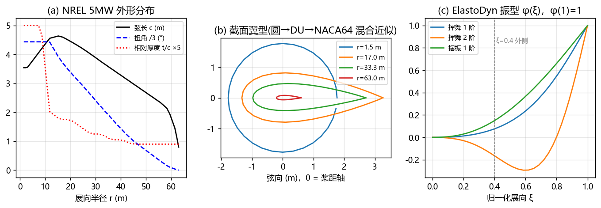

*图 2　(a) NREL 5MW 弦长、扭角、相对厚度沿展向的分布；(b) 几个代表截面的翼型（圆 → DU → NACA64 的混合近似）；(c) ElastoDyn 振型，φ(1)=1。*

### 3.1 设计外形

- **截面位置**：r 从轮毂半径 1.5 m 到叶尖 63 m，在根部和叶尖附近加密。
- **弦长 c(r)、扭角 θ_tw(r)、相对厚度 t/c(r)**：按 NREL 5MW 公开表（Jonkman 2009, Table 2-1）插值，图 2(a)。
- **翼型**：t/c ≥ 1 时为圆；0.4 ~ 1 之间在圆与 NACA00xx 之间混合；小于 0.4 时用 NACA00xx 厚度分布加少量弯度。图 2(b)。
- **桨距轴弦向位置 x_pa**：圆柱段取 0.5，薄翼型取 0.25，中间按 t/c 插值。

这是"**有来源的近似模板**"，不是制造外形。换用 Blender 模板的真实几何文件（`nrel5mw_geometry.json`、`reference-surfaces.npz`）只需要替换 `BladeTemplate`，见 §13。

### 3.2 结构振型

ElastoDyn 振型是 6 次多项式（不含 0、1 次项）：

$$
\varphi(\xi)=\sum_{k=2}^{6} c_k\,\xi^k,\qquad \xi=\frac{r-R_{hub}}{R_{tip}-R_{hub}},\qquad \varphi(1)=1
$$

| 振型 | 系数 c₂…c₆（NRELOffshrBsline5MW_Blade.dat） |
|---|---|
| 挥舞 1 阶 φ_f1 | 0.0622, 1.7254, −3.2452, 4.7131, −2.2555 |
| 挥舞 2 阶 φ_f2 | −0.5809, 1.2067, −15.5349, 29.7347, −13.8255 |
| 摆振 1 阶 φ_e1 | 0.3627, 2.5337, −3.5772, 2.3760, −0.6952 |

振型在根部很小，在外侧很大（图 2(c)），这决定了后面的**可观性**：只看到叶根时，挥舞量几乎测不出来（§9）。

### 3.3 刚体姿态与变形的组合

以叶片 b 为例，方位角 ψ_b = ψ + 120°·b，桨距 θ_b，预锥 γ：

**展向轴与"朝上风"法向**

$$
\mathbf a = \cos\gamma\,\hat r(\psi_b) + \sin\gamma\,\mathbf n,\qquad
\mathbf n_b = -\sin\gamma\,\hat r(\psi_b) + \cos\gamma\,\mathbf n
$$

**随桨距转动的弦线方向与厚度方向**

$$
\hat c(\theta)=\cos\theta\,\hat e_{rot}+\sin\theta\,\mathbf n_b,\qquad
\hat t(\theta)=-\sin\theta\,\hat e_{rot}+\cos\theta\,\mathbf n_b
$$

**变形位移**

挥舞方向取 f̂ = −t̂(θ)（正值朝下风，即朝塔筒），摆振方向取 ê = ĉ(θ)（正值朝前缘）：

$$
\delta_f(r)=q_f\,\varphi_{f1}(\xi)+q_{f2}\,\varphi_{f2}(\xi),\qquad \delta_e(r)=q_e\,\varphi_{e1}(\xi)
$$

**弦长缩短**（弯曲后弧长守恒，展向投影变短）：

$$
\Delta(r)=\tfrac12\int_{R_{hub}}^{r}\left(\delta_f'^2+\delta_e'^2\right)dr
$$

**截面中心（弹性轴）**，其中 p(r) 为预弯：

$$
\mathbf c(r)=\mathbf H+\big(r-\Delta(r)\big)\mathbf a+p(r)\,\mathbf n_b+\delta_f(r)\,\hat f+\delta_e(r)\,\hat e
$$

**表面点**（截面总转角 β = θ_tw(r) + θ，翼型周线点为 (x_j, y_j)）：

$$
\mathbf X(r,j)=\mathbf c(r)+\big(x_{pa}-x_j\big)\,c(r)\,\hat c(\beta)+y_j\,c(r)\,\hat t(\beta)
$$

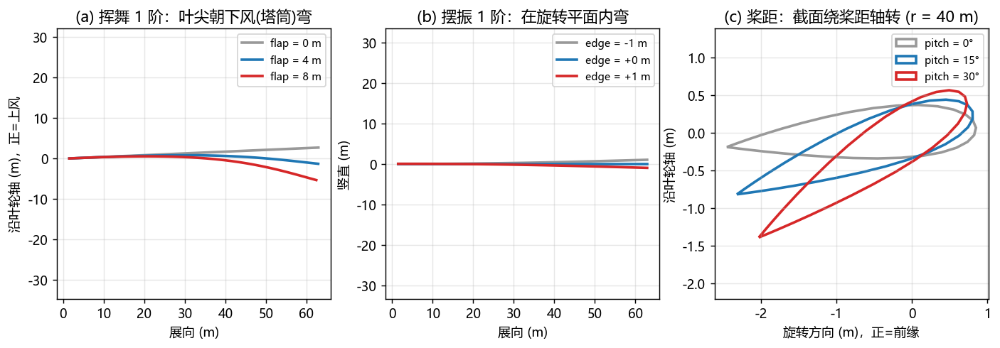

*图 3　叶片在 3 点钟水平位置（真实比例）。(a) 挥舞：叶尖朝下风弯；flap = 0 时叶尖偏向上风约 2.7 m，这是 2.5° 预锥造成的。(b) 摆振：在旋转平面内弯。(c) 桨距：r = 40 m 截面绕桨距轴转动。*

### 3.4 状态向量

| 下标 | 名称 | 含义 | 单位 | 本版 |
|---|---|---|---|---|
| 0 | ψ | 叶片 1 的方位角（0 = 竖直向上） | ° | 估计 |
| 1–3 | θ_b | 逐叶片桨距（正 = 朝顺桨） | ° | 估计 |
| 4–6 | q_f,b | 挥舞 1 阶叶尖幅值（正 = 朝下风） | m | 估计 |
| 7–9 | q_e,b | 摆振 1 阶叶尖幅值（正 = 朝前缘） | m | 估计 |
| 10–12 | q_f2,b | 挥舞2阶叶尖幅值 | m | 估计；外侧支持不足时保持最近观测值 |

当前CLI估计13维状态。轮廓点数量多不能证明各状态方向独立可辨；不可观方向由门控冻结，不确定度按输出质量读取（§4、§9）。

---

## 4. 安装可观性：先算清楚能看到什么

代码：`coverage.py`，纯几何计算，不渲染，秒级出结果。对每个方位角（0°~360°）和每个展向截面，判断它是否落在任一路相机的画幅内（不考虑遮挡）。

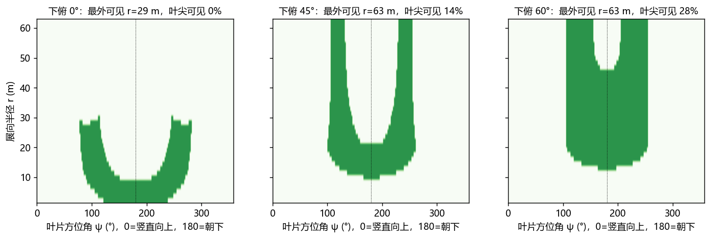

*图 4　轮毂后 6 m、下 3 m，三种下俯角。绿色表示该截面在该方位角能被看到。*

| 三路下俯角 | 一圈中能看到的最外截面 | 叶尖可见的方位角比例 |
|---|---|---|
| 0°（水平朝前） | **r = 29 m** | **0%** |
| 20° | 63 m | 2% |
| 45°（本文自测） | 63 m | 14% |
| 60° | 63 m | 27% |

**原因**：从叶轮后方 b = 6 m 处朝前看，叶尖相对光轴的夹角约为 atan(63/6) ≈ 84°，超出了 150° 视场的半角 75°；垂直方向又只有 ±20°。水平朝前时，能看到的叶片半径上限约为 b·tan75° ≈ 3.7b。

**结论**：
1. 相机朝向决定了"能重建什么"，必须在重建之前先跑这个分析。
2. 即使下俯 45°，一圈里被观测到的截面也只占约 13%，**大部分时间三维叶片都是推断出来的**，所以输出必须带"观测/推断"标记。
3. 观测集中在下半圈（方位角约 106°~254°），这会影响 1P 分量的辨识（§12.4）。

---

## 5. 观测提取

代码：`recon.py` 中的 `segment()` 和 `Obs`。

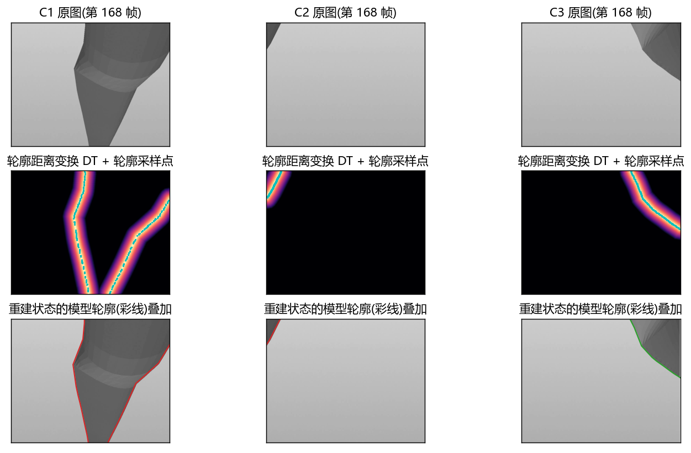

*图 5　第一行：三路原图；第二行：轮廓距离变换 DT 和轮廓采样点（青色）；第三行：重建状态下的模型轮廓（彩线）叠加在原图上。C2 本帧没有叶片。*

### 5.1 叶片分割

- **优先使用外部掩码**：你们的 YOLO 分割结果放在 `<masks>/<相机名>/%06d.png`。所有叶片画在同一张二值图里即可，**不需要区分是哪一片**。
- **没有外部掩码时**，用天空背景自动阈值：
  1. 高斯模糊（5×5）；
  2. 逐行估计背景：天空上下有渐变，所以按行估计。用 **95% 分位**（叶片比天空暗时）或 5% 分位（叶片比天空亮时，比如近红外补光，参数 `--polarity bright`）。**不能用中位数**：叶根离相机很近时，叶片会占满半行以上，中位数就变成了叶片的灰度；
  3. 对背景差图做 Otsu 阈值。如果 Otsu 阈值小于 12 个灰度级，说明画面里只有天空，直接判为"无叶片"。否则 Otsu 只是在把噪声一分为二，会产生满屏的假轮廓，这是开发中实际遇到的 bug；
  4. 开运算，并去掉面积小于画面 0.2% 的连通域（噪声、鸟、云边）。

### 5.2 轮廓表示

- 轮廓 = 掩码的形态学梯度（3×3）。
- **距离变换 DT**：每个像素到最近轮廓像素的距离。查一次 DT 就能得到"模型轮廓点离观测轮廓有多远"，而且可以双线性插值，对参数是连续的。
- **轮廓采样点**：沿轮廓均匀取 200 个点，**去掉贴着画幅边框的点**，因为那是被画面截断形成的边，不是叶片的真实边缘。

---

## 6. 模型轮廓：截面投影曲线的包络

代码：`recon.py` 中的 `silhouettes()`。

叶片是一个扫掠曲面，它在图像上的轮廓是**各截面投影曲线的包络线**。在像面上，包络点满足：

$$
\frac{\partial \mathbf u}{\partial s}\times\frac{\partial \mathbf u}{\partial c}=0
$$

其中 s 是展向，c 是沿翼型周线的方向，× 是二维叉积。也就是说，展向切向量与周向切向量在像面上平行。

**离散实现**：
1. 对每个截面的 N 个周线点，用有限差分求 ∂u/∂s（相邻截面）和 ∂u/∂c（相邻周线点）；
2. 沿周线找叉积变号的位置，线性插值得到候选包络点；
3. 在候选点中取离投影展向轴最远的左右两个，作为该截面的左右轮廓点；
4. 如果没有变号（比如端面正对相机），就退回取"最外点"；
5. **根部端面和叶尖端面**的投影环也是可见轮廓的一部分，单独加入。

**为什么不能用更简单的"最外点"近似**（取垂直于投影展向轴方向上最远的周线点）？这个近似只在叶片远离相机、外形变化缓慢时成立。叶根离相机只有几米，弦长又在快速变化（从圆柱过渡到翼型），这时真实轮廓会偏离近似 3~10 px：

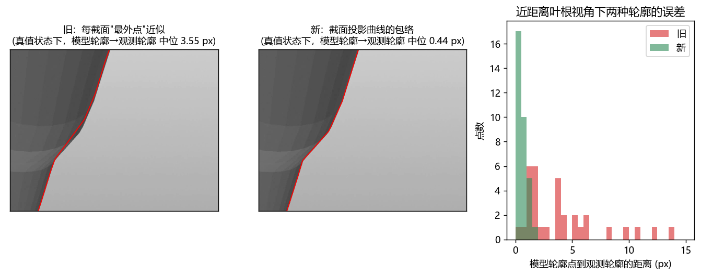

*图 6　同一帧、**真值状态**下的模型轮廓。旧方法（最外点）与观测轮廓的偏离中位数为 3.55 px，新方法（包络）为 0.44 px。旧方法的这部分偏差在开发中被挥舞量拿去"补偿"，导致挥舞估计偏离 5~9 m。*

**截面间加密**：近处的叶片，相邻截面在像面上可能相隔一百多像素，所以在截面之间对轮廓点线性插值 4 倍（`DENSE = 4`）。

---

## 7. 目标函数

代码：`Fitter.residuals()`。每帧最小化：

$$
E(\mathbf x)=\underbrace{\sum_{\text{相机}}\Big[\sum_k \rho\big(D_{obs}(\mathbf u_k)\big)^2+0.7^2\sum_m\rho\big(d(\mathbf o_m,\mathcal C)\big)^2\Big]}_{\text{图像项(鲁棒)}}
+\underbrace{w\sum_i\Big(\tfrac{x_i-\hat x_i}{\sigma^{step}_i}\Big)^2 f^2}_{\text{时序先验}}
+\underbrace{\sum_i\Big(\tfrac{x_i-\mu_i}{\sigma^{phys}_i}\Big)^2 f^2}_{\text{物理先验}}
$$

| 项 | 含义 |
|---|---|
| D_obs(u_k) | 模型轮廓点 u_k 处的观测 DT 值：**模型轮廓要落在观测轮廓上** |
| d(o_m, 𝒞) | 观测轮廓点 o_m 到模型轮廓折线（含端面环）的最近距离：**观测轮廓要被模型解释**，上限 30 px |
| ρ | 鲁棒变换，见下 |
| x̂ | 时序预测：ψ̂ = ψ_{k−1} + ω·Δt，其余量取上一帧 |
| σ^step | 帧间变化尺度：ψ 3°、θ 1.5°、q_f 0.8 m、q_e 0.25 m；权重 w = 0.5 |
| μ, σ^phys | 周期物理先验的预测值与散布（§8） |
| f | 鲁棒尺度，2 px |

**双向倒角**：只用第一项时，模型轮廓"落在某条边上"就满足了，但可能有观测边没有被解释；只用第二项时，模型可能多出观测里没有的部分。两项一起用，两种情况都会受到惩罚。

**鲁棒变换只作用于图像项**：

$$
\rho(r)=\operatorname{sign}(r)\sqrt{2f^2\left(\sqrt{1+(r/f)^2}-1\right)}
$$

这样 Σρ² 恰好等于 soft_l1 损失，可以压制分割错误、遮挡等离群点。**先验项必须保持二次型**。开发中曾把鲁棒损失同时作用在先验上，结果先验偏离一大，惩罚就从平方增长变成线性增长，拉不住看不见的叶片；优化器干脆把它弯到画面外面去，"逃离"图像残差（§12.5）。

**求解器**：`scipy.optimize.least_squares`，TRF 有界方法，有限差分雅可比。参数边界：

| 参数 | 下界 | 上界 |
|---|---|---|
| 桨距 θ | −5° | 90° |
| 挥舞 q_f | −3 m | 12 m |
| 摆振 q_e | −2 m | 2 m |

**不确定度**：由求解终点的雅可比矩阵计算，std = sqrt(diag((JᵀJ)⁻¹))·f。未参与优化的参数，std 取先验散布。

---

## 8. 周期物理先验

代码：`PhysPrior`、`RLS`。

**物理依据**：叶片转一圈，受力随方位角周期变化。

| 量 | 先验模型 | 物理含义 |
|---|---|---|
| 挥舞 | q_f,b = F₀ + F₁·cos ψ_b + o_b | 平均推力弯曲 + 风切变 1P（上方风大）+ 逐叶偏置（气动不平衡） |
| 摆振 | q_e,b = E₀ + E_s·sin ψ_b + E_c·cos ψ_b | 重力 1P，叶片水平时最大 |
| 桨距 | θ_b = P₀ + q_b | 统一桨距 + 逐叶偏差（桨距不平衡） |

**关键点**：
1. **只用"看清"的叶片更新**：挥舞和摆振的权重取叶片外侧（ξ > 0.4）被观测截面的比例，桨距的权重取全叶片被观测截面的比例；比例低于 0.15 的不参与更新。
2. **逐叶偏置 o_b、q_b 是拟合量**，所以先验不会把不平衡"抹平"，看不见的叶片也会保留自己的偏置。
3. 用伪观测加软约束 Σo_b = 0、Σq_b = 0，消除"公共项 + 偏置"之间的冗余。
4. **递推最小二乘**（遗忘因子 λ = 0.99），每帧 O(1) 计算：

$$
\mathbf k=\frac{P\mathbf h}{\lambda/w+\mathbf h^\top P\mathbf h},\quad
\boldsymbol\theta\leftarrow\boldsymbol\theta+\mathbf k\,(y-\mathbf h^\top\boldsymbol\theta),\quad
P\leftarrow\frac{P-\mathbf k\mathbf h^\top P}{\lambda}
$$

5. **预测**：μ = hᵀθ。散布 σ_phys = sqrt(σ₀² + hᵀPh)，其中 σ₀ 分别为挥舞 0.4 m、摆振 0.12 m、桨距 0.8°。累计更新不足 6 次时先验视为"未就绪"，只用很弱的绝对先验。

这就是"**把转动当作多视角基线**"：单帧里看不清的方向，叶片转到别的方位角时会被反复约束。它和不平衡度估计用的是同一个 1P 假设。

---

## 9. 可观性门控

**问题**：叶片朝下时（方位角约 150°~200°），只能看到根部 6~16 m 这一段。挥舞振型在根部的位移几乎为零（图 2(c)），所以根部轮廓哪怕只差 1~2 px，优化器也会动用 5~9 m 的挥舞量去"修正"它。

**原则**：**只估计看得见的量。**

**做法**（每帧求解前，只用预测状态做几何判断，不看图像）：
1. 统计每片叶片有多少截面的左右轮廓点同时落在某一路画幅内：全叶片记为 n_all，外侧（ξ > 0.4）记为 n_out；
2. n_out < 3：该叶片一阶挥舞、一阶摆振与二阶挥舞不参与跟踪优化。一阶方向采用物理先验或最近观测；二阶挥舞保持最近观测值。
3. n_all < 3：桨距也固定。

门控之后，不可观的参数不再去吸收别处的残差。性能应按冻结输入与实现分别测量，不能仅由活动方向数量推定。

---

## 10. 逐帧流程

加载对应frame/t的原图、标定和显式掩码，提取轮廓与距离场。无图像观测时只输出先验预测及未就绪状态；首次有效图像在一个120°等价周期内全局搜索方位角，下一次有效图像用实际观测时间差初始化转速。跟踪按转速外推、周期先验和可观性门控确定活动方向，再进行有界最小二乘。首帧/跟踪默认预算为150/60；达到预算上限不自动视为有效重建。

显式RGB侧车只在配置质量门通过时增加固定身份点重投影残差，权重零不增加残差行。输出保存13维状态、观测标记、求解状态、可辨识性及不确定度；连续方位角保持展开时间序列。

**叶片编号**：三片叶片外形相同，"叶片 1"是相对编号，存在 120° 的循环歧义。要和 SCADA 的物理编号对应，需要一个可识别的标记（比如叶根的编号漆），或者某一时刻已知的方位角。

---

## 11. 输出与 Blender 可视化

### 11.1 `recon.json`

```json
{ "turbine": {...}, "fps": 10, "state_names": [...],
  "frames": [ { "frame": 0, "t": 0.0,
                "state": [13 个数], "std": [13 个数], "rpm": 12.1,
                "cost": ..., "nfev": ...,
                "observed_sections": [[0/1 × 40] × 3] } ] }
```

### 11.2 Blender（`blender_view.py`）

```
blender --python blender_view.py -- --recon recon.json [--truth truth.json] [--cameras cameras.json]
```

- 建三个叶片网格对象，加上塔筒、机舱、轮毂作空间参照，可选显示相机。
- 注册 `frame_change_pre` 回调：每到一帧，就用 `model.Rotor.forward(state)` 算出顶点坐标并写入网格。**不需要烘焙**，播放、拖动时间轴、单步都即时计算。
- 顶点颜色属性 `evidence`：**绿色 = 图像观测，橙色 = 模型推断**。
- 给出 `--truth` 时，同时显示真值叶片的线框，可以直接目视比较。
- 给出 `--texture <纹理目录>` 时（v0.2），叶片材质改为"视频反投影纹理 × 证据色"，详见 §15.7。

### 11.3 不依赖 Blender 的预览（`preview.py`）

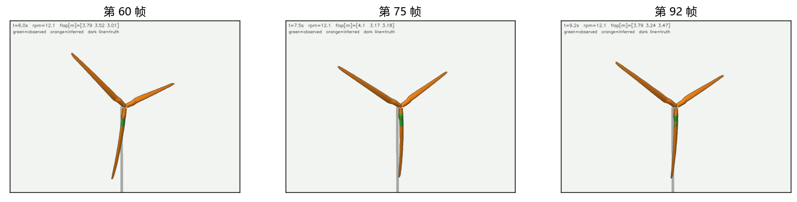

*图 11　第三人称视角下的重建结果。绿色为观测截面（这个安装下主要是叶片朝下时的根部和中段），橙色为推断，深色线为真值前缘线和后缘线。*

---

## 12. 冻结合成基线测量

### 12.1 设置

| 项目 | 设置 |
|---|---|
| 数据 | `synth.py` 合成三路视频，20 s，10 fps，816×636（原分辨率的 1/4） |
| 安装 | 轮毂后 6 m、下 3 m，三路下俯 45° |
| 真值状态 | 转速 12.1 rpm；三叶桨距均为 2°；挥舞 = 3.5 + 0.35·cos ψ_b（风切变）+ 叶片 1 额外 +0.6 m（**注入的气动不平衡**）；摆振 = 0.30·sin ψ_b（重力）；挥舞 2 阶 = 0.15·cos ψ_b（**该冻结测量的拟合只用10维**，用于模型截断对照） |
| 成像 | 灰度朗伯着色，天空渐变，高斯噪声 σ = 2 灰度级；理想针孔，无畸变，无运动模糊 |
| 分割 | 自动阈值，**不使用真值掩码** |
| 数据隔离 | 真值只写入 `truth.json`，只有 `evaluate.py` 读取 |
| 评分 | 跳过第一圈（50 帧，用于建立先验），共 150 帧；三片叶片按 120° 循环对齐编号后再比较 |

### 12.2 总体结果

| 指标 | 叶片 / 区域可见 | 叶片 / 区域不可见（推断） |
|---|---|---|
| 方位角误差 | 均值 0.17°，最大 0.22° | — |
| 桨距误差 | 均值 0.20°，P95 0.46° | 均值 0.19°，P95 0.46° |
| 挥舞幅值误差 | 均值 0.15 m，P95 0.34 m | 均值 0.41 m，P95 0.76 m |
| 摆振幅值误差 | 均值 0.10 m，P95 0.20 m | 均值 0.07 m，P95 0.11 m |
| 叶尖位置误差 | 均值 0.15 m，最大 0.22 m | 均值 0.48 m，最大 1.20 m |
| 截面网格误差 | **均值 6.8 cm，P95 14 cm** | 均值 16 cm，P95 56 cm |

观测区截面占全部截面帧的 13%。速度：每帧 0.62 s（CPU 单线程）。

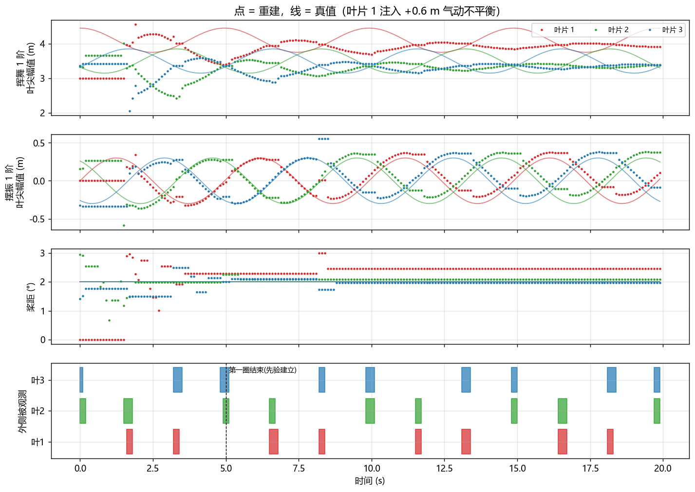

*图 7　挥舞、摆振、桨距的重建值（点）与真值（线）；最下面一栏是各叶片外侧被观测的时段。*

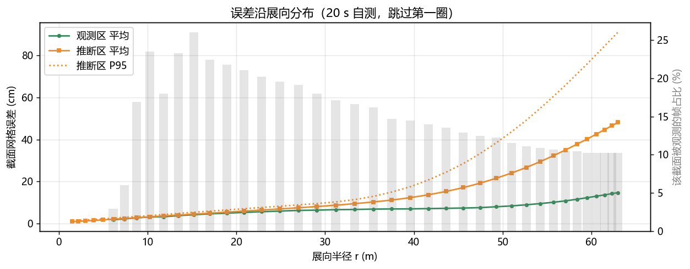

*图 8　截面网格误差沿展向的分布。观测区误差从根部的约 1 cm 增长到叶尖的约 15 cm；推断区误差随半径快速增长，叶尖 P95 约 90 cm。灰色柱为该截面被观测的帧占比。*

### 12.3 气动不平衡识别

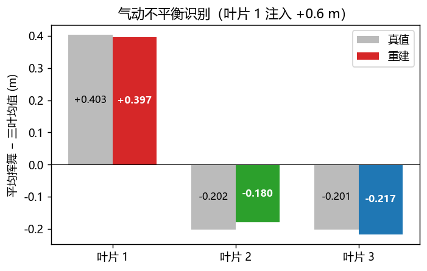

*图 9　各叶片平均挥舞减去三叶均值。叶片 1 注入 +0.6 m 的挥舞，对应相对三叶均值 +0.40 m；重建结果准确指向叶片 1，幅值相差约 1%。*

### 12.4 发现的方法局限

1. **风切变 1P 分量被低估**：图 7 第一栏中，真值挥舞的 1P 振幅为 0.35 m，重建只有约 0.15 m。原因是这个安装下，叶片外侧只在下半圈（ψ_b ≈ 105°~255°）可见，此时 cos ψ_b ∈ [−1, −0.26]，**平均项 F₀ 和 1P 项 F₁ 几乎共线**，无法分开。上半圈的挥舞是外推出来的。要改善，需要能看到上半圈的相机朝向，或者引入额外信息（比如风切变指数先验）。
2. **推断叶片的桨距会有约 0.5° 的固定偏差**（图 7 第三栏中，叶片 1 在 8 s 之后的桨距）：逐叶偏差 q_b 在看得清的少数时刻学偏后，看不见时会一直沿用。
3. 观测区误差在叶尖附近增大到约 15 cm：叶尖离相机远、截面小，而且只在少数方位角可见。

### 12.5 合成测量的适用范围

合成数据是用**同一个参数化模型**生成的，只额外加了挥舞 2 阶分量；成像是理想针孔，没有运动模糊和镜头畸变；分割是理想背景下的自动阈值。所以这些结果只证明**管线能跑通、方法在原理上有效**，**不代表** FAST.Farm/BeamDyn 柔性回放视频或实机上的精度。下一步的验证见 §13。

---

## 13. 当前限制与验证要求

| 限制 | 影响 | 验证要求 |
|---|---|---|
| 动态输入须有逐帧相机外参 | 以静态外参处理机舱或塔顶运动会混淆刚体与弹性变化 | 核对bundle的MODEL系变换、真实frame/t及投影；静态cameras.json仅用于静态相机 |
| 状态只包含桨距、挥舞1/2阶和摆振1阶 | 截面扭转及其他高阶变形未被表示 | 不能将模态拟合称为任意翼型或逐顶点恢复；新增自由度须有可辨识性证据 |
| 模板与输入来源须一致 | 外形偏差可能混入状态估计 | 健康模板只能提供静态结构先验；同刻动态真值只用于独立评分 |
| 1P分量辨识受观测窗口限制 | 上半圈挥舞可能来自先验外推 | 分开报告观测与推断，并核验相机覆盖及先验贡献 |
| 叶片编号有120°歧义 | 算法身份不能自动对应SCADA编号 | 对齐规则与评分使用分离，保留原算法身份 |
| 合成与Blender数据的有限验证 | 不能外推为现场精度 | 固定数据、坐标、时间及评分对象，独立核验实际目标量 |
| 材料点候选未达到科学门槛 | 当前Patch2/8、Crack7/8、跨相机RGB0/264；真实同材料点误差为null | 保持FAILED_GATE / NOT_ACCEPTED，不把显示、软件回归或同相机纹理回投当作科学接受 |
| 离线计算 | §12的约0.6s/帧属于所列冻结合成测量 | 当前13维CLI、动态输入和RGB候选的耗时须按各自运行测量，不能沿用该数字承诺实时性 |

远距离共光心剪影不提供独立三角测量深度。弦长、扭角、厚度、弯度及表面起伏的恢复均需要与目标量对应的图像约束和独立验证；当前纹理融合不测凹坑深度或鼓包高度。纹理的具体范围见§15.1和§15.8。

---

## 14. 结果说明与演示内容

| 主题 | 说明范围 |
|---|---|
| 输入与模型 | 三路原图独立求解；当前CLI为13维状态，由设计外形、振型和刚体姿态生成显式表面 |
| 可观测性 | 图4的安装分析只对应声明的相机和几何条件；逐截面区分图像约束与先验推断 |
| 轮廓拟合 | 图5、图6及§7–§10说明轮廓包络、双向倒角、鲁棒图像项、周期先验与可观性门控 |
| 合成基线 | 图7–9及§12的6.8cm观测区误差、16cm推断区误差和不平衡读数属于所列冻结10维拟合对象，不能当作当前候选的独立精度 |
| 纹理显示 | 图12–16属于所列合成纹理测量；原图像素来源可追溯不等于正确同材料点对应，当前候选的独立科学结果以材料点报告为准 |
| Blender展示 | 显示估计表面、纹理与观测/推断标记；源场景、保存恢复和原生交互按各自证据范围验收 |

推断部分是物理先验输出，不能当作图像测量。表面明暗不能当作高度。三摄共光心不提供可靠的双目基线；当前材料点实验也没有跨相机RGB约束通过。实时性须由完整输入、求解、纹理和显示链路的实测支持。

---

## 15. 表面纹理

代码：`atlas.py`（纹理坐标）、`raster.py`（光栅化与 z-buffer）、`texture.py`（反投影与融合）、`eval_texture.py`（有真值时评分）。

### 15.1 目标与边界

**目标**：二维视频里肉眼能看到的叶片表面特征，比如裂纹、修补块、腐蚀、明暗起伏，在三维重建结果里**同样能看到，而且出现在叶片的正确位置上**。

**做法**：不在三维上"重新生成"表面，而是把**原图的真实像素**按重建出的位姿反投影到每片叶片的表面图集（UV 贴图）上。三维模型上看到的每一个纹素，都能追溯到"哪一帧、哪一路相机、哪个像素"。

**所列冻结合成对象的纹理显示范围**（当前材料点候选的独立接受状态见文首）：

| 项 | 结论 | 原因 |
|---|---|---|
| 裂纹、修补块、腐蚀斑、污渍（**颜色/亮度不同**的特征） | 所列合成对象中可显示；当前独立材料点候选未接受 | 直接搬运原图像素 |
| 表面起伏（鼓包、凹陷） | **只能体现为明暗**：原图里看得出明暗，贴图上就看得出；**不能测出高度** | 单目、无基线，2 cm 的高度变化在 50 m 外对应的视差远小于 1 像素 |
| 背风面（吸力面，朝塔筒一侧） | r = 10~60 m 的背风面 93~98% 被看到（背风面约占周长一半） | 相机在叶轮后方 |
| 迎风面（压力面）、大部分前缘 | **永远看不到** | 被叶片自身挡住。Blender 里显示为证据色（绿/橙），不伪造纹理 |
| 展向细节 | **比弦向粗 5~8 倍** | 相机几乎顺着叶片看过去，展向在图像上被强烈压缩，见 §15.4 |

### 15.2 表面图集（`atlas.py`）

每片叶片一张图，三片叶片的定义相同：

- **行 = 展向半径 r**：第 0 行在叶根，最后一行在叶尖，行距 2.5 cm（`--atlas-dr`），共 2460 行；
- **列 = 沿截面周线的弧长比例 τ**：τ = 0 为后缘 → 迎风面 → 前缘（τ ≈ 0.5）→ 背风面 → τ = 1 回到后缘，共 768 列。r = 57 m 处 1 列约 0.6 cm；
- **表面坐标 (r, c)**：c 是从前缘量起的表面弧长（米），正值 = 背风面。**缺陷位置统一用 (叶片, r, c) 报告**，和叶片的维修坐标习惯（距叶根多少米、距前缘多少厘米）一致；
- 图集只依赖叶片模板，**与状态无关**。叶片怎么弯，纹理都"粘"在表面上一起走。Blender 的 UV 也由它生成（`corner_uv`）。

### 15.3 反投影与融合（`texture.py`）

对每帧、每路相机、每片叶片中"观测"截面（§10）覆盖的那些行：

1. **纹素 → 三维点**：由重建状态生成网格，在网格四边形内双线性插值，得到每个纹素的三维坐标和法向；
2. **投影与可见性**：投影到原图。只有同时满足以下条件的纹素才采样：
   - z-buffer 中该像素属于**同一片叶片的正面**，且深度一致（排除被别的叶片挡住或被自身挡住的点）；
   - 视线与法向夹角余弦 > 0.08（排除太掠射的点）；
   - 在叶片掩码内，并且距掩码边缘 ≥ 1.5 px。位姿有误差时，边缘附近会采到天空；
3. **质量权重**：
   $$
   w=\underbrace{\mathrm{clip}\!\left(\tfrac{d_{edge}-1.5}{4.5},0,1\right)}_{\text{离边缘}}\cdot\frac{1}{1+(\rho/1\,\mathrm{cm})^2}\cdot\underbrace{\frac{1}{1+(b/1\,\mathrm{px})^2}}_{\text{给出曝光时间时}}
   $$
   其中 ρ 是像素脚印的等效尺寸（米/像素，由纹素网格在像面上的雅可比求得），b 是曝光时间内该点在像面上的位移；
4. **光照归一化**：每个视角的样本除以它自己的低频分量（展向 2 m、弦向 0.6 m 的归一化高斯卷积）。这样不同视角、不同光照下的样本可以拼在一起，只保留表面细节。尺度要大于想保留的缺陷，否则修补块本身会被当作"光照"除掉。v0.2 开发中先用了 0.6 m，结果 40×30 cm 的修补块几乎消失；
5. **融合（默认 `best`）**：先把权重做 ≈ 0.5 m 尺度的平滑，**每块区域取平滑权重最高的那一个视角**。这样同一个缺陷来自同一帧，不会被拼接。

**为什么不做多视角加权平均**：实测同一条裂纹在不同视角里，沿展向的位置相差 0~40 cm（16 个纹素）。原因是位姿误差：观测区网格误差约 5 cm，而展向 1 个像素约 7 cm，几个像素的偏差就是几十厘米。如果加权平均，细线会变成两三条淡线（v0.2 开发中实测）。`--fusion mean` 保留为选项，位姿非常准时噪声更低。

**可选的视角间配准（`--register`）**：在高通细节上，把每个视角平移配准到第一遍的结果（展向 ±50 cm、弦向 ±6 cm）后再融合。在合成数据上，它没有找到可靠的匹配：表面细节太少，相关系数提升不到阈值，所以默认关闭。对于有丰富污渍和纹理的真实叶片，值得再试。

### 15.4 关键限制：展向压缩

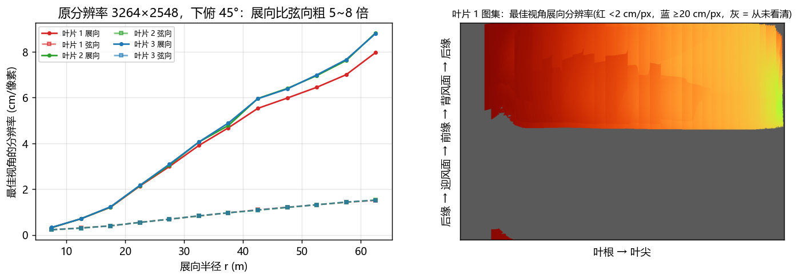

*图 12　(左) 最佳视角下，每个像素对应的表面尺寸，展向（实线）与弦向（虚线）分开统计；(右) 叶片 1 图集上每个纹素最佳视角的展向分辨率。原分辨率 3264×2548，下俯 45°。*

| r | 展向 cm/px | 弦向 cm/px | 背风面覆盖率 | 12 s 内看到该段的视角数（中位） |
|---|---|---|---|---|
| 5~10 m | 0.3 | 0.2 | 65% | 10 |
| 20~25 m | 2.1 | 0.6 | 97% | 24 |
| 40~45 m | 5.5 | 1.1 | 98% | 15 |
| 55~60 m | 7.0 | 1.4 | 98% | 12 |
| 60~63 m | 8.0 | 1.5 | 82~88% | 9~13 |

（叶片 1，`texture.json` 的 `bands` 字段。）

相机在叶轮后方，几乎顺着叶片看过去，所以**展向被压缩了 5~8 倍**：

- 一条 60 cm 长的**展向**裂纹在图像上只有约 9 px 长。在该配置下需按展向与弦向的不同像素尺度解释；
- **弦向**的特征（横向裂纹、修补块的弦向宽度）分辨率高得多。r = 57 m 处 1.5 cm/px，1.5 cm 宽的裂纹约 1 px；
- 改善办法只有硬件：提高分辨率、加长焦相机专看叶尖，或者让相机离叶轮平面更远（视线与叶片夹角更大）。

### 15.5 运动模糊：曝光时间是硬指标

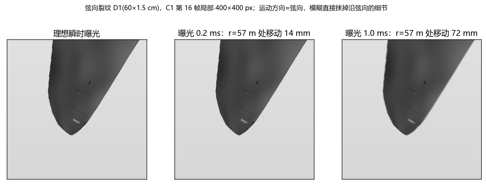

*图 15　同一帧、同一个缺陷区域，三种曝光时间。r = 57 m 处的线速度约 72 m/s。*

叶片沿旋转方向运动，在图像上大致就是**弦向**，恰好是分辨率最好的方向。1 ms 曝光时，r = 57 m 处移动 72 mm，约 5 px，弦向细节被抹平；0.2 ms 时为 14 mm，约 1 px。**要看清叶尖附近的裂纹，曝光需要 ≤ 0.2 ms**（全局快门 + 近红外补光）。`texture.py --exposure-ms` 会按模糊量降低权重，让模糊小的视角优先。

### 15.6 合成数据验证

**设置**：`synth.py --texture`，原分辨率 3264×2548，12 s / 10 fps，曝光为理想瞬时。在叶片 1 和叶片 2 的背风面放 6 个已知缺陷，真值只写入 `truth.json` 和 `truth_texture.npz`。位姿由 `recon.py --fit-scale 0.25` 重建，纹理由 `texture.py` 生成，都不读真值。

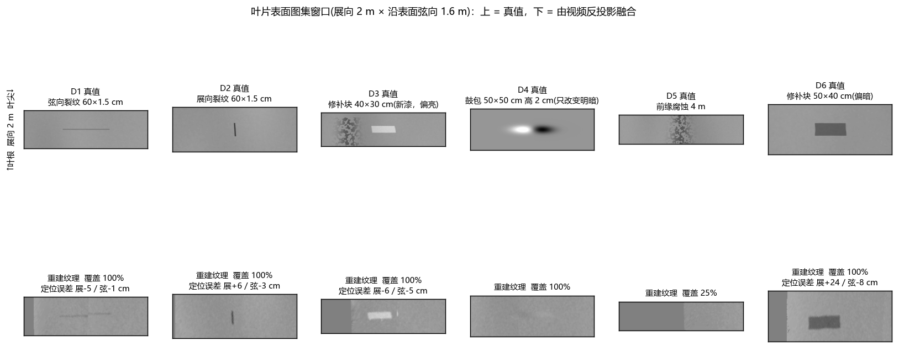

*图 13　叶片表面图集上的同一个窗口（展向 2 m × 沿表面弦向 1.6 m）：上 = 真值纹理，下 = 由视频反投影融合的结果。D4 的真值显示的是高度图的弦向梯度。*

| 缺陷 | 位置 (r, c) | 结果 | 定位误差（展向 / 弦向） |
|---|---|---|---|
| D1 弦向裂纹 60×1.5 cm | 57.0 m, 0.70 m | **看得到**，中间有一处约 5 cm 的错位（两个视角拼接处） | −5 / −1 cm |
| D2 展向裂纹 60×1.5 cm | 51.3 m, 0.80 m | **看得到**，展向偏短偏粗（展向压缩） | +6 / −3 cm |
| D3 修补块 40×30 cm（偏亮） | 59.2 m, 0.45 m | **看得到**，边缘清楚 | −6 / −5 cm |
| D4 鼓包 50×50 cm、高 2 cm | 54.0 m, 1.00 m | **很淡**：只有一点明暗变化，不知道位置时很难认出 | — |
| D5 前缘腐蚀 4 m | 60.5 m, 前缘 | **看不到**：前缘区域只覆盖约 25% | — |
| D6 修补块 50×40 cm（偏暗，叶片 2） | 45.0 m, 0.60 m | **看得到** | +24 / −8 cm |

定位误差是按纹理异常的质心计算的。其中 D6 的 24 cm 来自所选视角的位姿误差（§15.3）。对比度保留率 0.2~0.7：细裂纹在 1 px 级别会被图像平滑与重采样削弱，修补块保留得较好。

**同一相机下的重投影检查**：把"重建位姿 + 重建纹理"从同一路相机重新渲染，与原图相减。除轮廓边缘 1~2 px 外，叶片内部的差值都在噪声水平。裂纹和修补块处有 1~2 px 的残差，来自位姿误差。

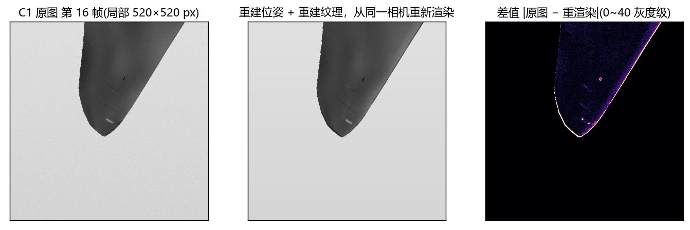

*图 14　C1 第 16 帧叶尖局部：原图 | 重建位姿 + 重建纹理重新渲染 | 差值。*

**三维显示**：

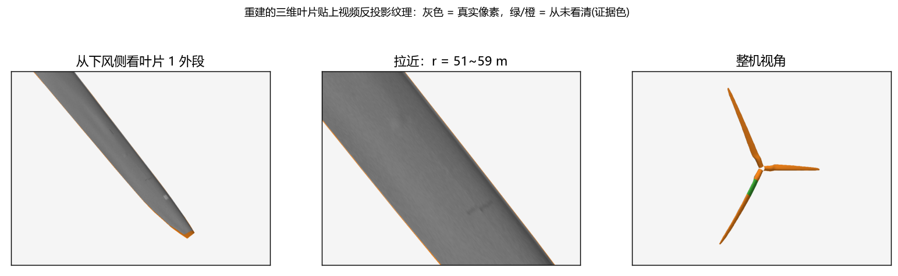

*图 16　带纹理的三维叶片（`preview.py --texture`）。灰色为真实像素；绿/橙为从未看清的区域，仍按 §11 的证据色显示。中图拉近到 r = 51~59 m，可以看到 D1、D2 两条裂纹和 D3 修补块。*

速度：原分辨率下每帧约 4 s（CPU 单线程，主要耗时在三路光栅化）。纹理离线做一遍即可，不影响 §10 的逐帧位姿。

### 15.7 输出与 Blender

`texture.py` 的输出目录（默认 `<recon 目录>/texture/`）：

| 文件 | 内容 |
|---|---|
| `blade{1,2,3}_tex.png` | 纹理图（BGRA）。灰度 150 = 叶片平均亮度；**A = 0 表示从未看清** |
| `blade{1,2,3}_raw.png` | 不做光照归一化的原始亮度，对照用 |
| `blade{1,2,3}_res.png` | 最佳视角展向分辨率伪彩图：说明每块纹理有多可信 |
| `texture.json` | 图集定义、逐 5 m 覆盖率和分辨率统计、参数 |
| `texture_data.npz` | 浮点结果（评分、二次处理用） |

`blender_view.py --texture <目录>`：叶片网格增加 UV 层 `atlas`，材质为"纹理 × 证据色"，混合系数取纹理的 A 通道。看清的地方显示真实像素，没看清的地方显示绿/橙。材质里 `TexMix` 节点的 Factor 改成 0，可以切回纯证据色。网格拓扑与 v0.1 相同，逐帧变形照旧。

### 15.8 待验证能力

| 项 | 内容 |
|---|---|
| 位姿精修 | 默认关闭的固定RGB点重投影候选已提供；完整光度精修与独立定位收益尚未验收，不预报厘米级改善 |
| 缺陷检测 | 在图集上做缺陷分割（阈值或小模型），直接输出 (叶片, r, c, 尺寸) 列表；自动检出与科学精度需独立验证 |
| 起伏 | 只有在有立体基线（第二个光心）或已知光照方向的光度立体条件下，才可能测高度。当前硬件不承诺 |
| 硬件 | 长焦叶尖相机、曝光 ≤ 0.2 ms、近红外补光，三者对表面细节的帮助都大于算法改进 |

---

## 附录 A：代码模块对照

| 文件 | 主要内容 | 对应章节 |
|---|---|---|
| `model.py` | `TurbineConfig`、`BladeTemplate`、`Rotor.forward()`、振型系数 | §3 |
| `camera.py` | `Camera.project()`、`build_rig()`、`scaled()` | §2 |
| `coverage.py` | 安装可观性表 | §4 |
| `recon.py` | `segment`、`Obs`、`silhouettes`、`Fitter`、`PhysPrior`、`RLS`、主循环 | §5–§10 |
| `evaluate.py` | 编号对齐、观测区/推断区分开评分 | §12 |
| `preview.py` | 第三人称三维预览视频 | §11.3 |
| `blender_view.py` | Blender 逐帧播放 | §11.2 |
| `blender_export_cameras.py` | 从 Blender 场景导出 `cameras.json` 并换算到机组坐标系 | §2 |
| `synth.py` | 自测数据生成 | §12.1 |
| `atlas.py` | 叶片表面图集（行 = 展向，列 = 周线弧长），表面坐标 (r, c)，Blender UV | §15.2 |
| `raster.py` | 三角形光栅化、z-buffer、带纹理渲染 | §15.3 |
| `texture.py` | 原图 → 图集反投影、可见性、权重、光照归一化、最佳视角融合 | §15.3 |
| `eval_texture.py` | 有缺陷真值时的纹理评分与对比图 | §15.6 |
| `docs/make_figures.py` | 图 1–11 | — |
| `docs/make_texture_figures.py` | 图 12、14、15、16 | §15 |

## 附录 B：主要参数

| 参数 | 位置 | 默认值 | 含义 |
|---|---|---|---|
| `n_sections` / `n_ring` | `TurbineConfig` | 40 / 32 | 截面数 / 周线点数 |
| `DENSE` | `recon.py` | 4 | 截面之间轮廓插值倍数 |
| `EDGE_PX` | `recon.py` | 2.0 | 鲁棒尺度 f（像素） |
| `SIG_STEP` | `recon.py` | 3° / 1.5° / 0.8 m / 0.25 m | 帧间变化尺度（ψ / θ / q_f / q_e） |
| `PhysPrior.SIG_*` | `recon.py` | 0.4 m / 0.12 m / 0.8° | 物理先验残余散布（挥舞 / 摆振 / 桨距） |
| `RLS.lam` | `recon.py` | 0.99 | 遗忘因子 |
| 门控阈值 | 主循环 | 外侧可见截面 < 3 | 挥舞/摆振不参与优化 |
| 观测判定 | `observed_sections` | < 3 px | 截面"观测"的贴合阈值 |
| `MIN_CONTRAST` / `MIN_AREA_FRAC` | `recon.py` | 12 / 0.002 | 空画面判定 / 最小连通域面积比例 |
| `--fit-scale` | 命令行 | 1.0 | 求解前对图像再缩放（提速） |
| `--polarity` | 命令行 | dark | 叶片相对天空更暗 / 更亮 |
| `--atlas-dr` / `--atlas-cols` | `texture.py` | 0.025 m / 768 | 图集展向纹素尺寸 / 周向纹素数 |
| `EDGE_PX` | `texture.py` | 1.5 / 6 px | 离轮廓多远开始采样 / 权重满值 |
| `MIN_COS` | `texture.py` | 0.08 | 视线与法向夹角余弦下限 |
| `LOW_SIGMA_M` | `texture.py` | 2.0 / 0.6 m | 光照归一化低频尺度（展向 / 弦向） |
| `--fusion` | `texture.py` | best | 最佳视角 / 加权平均 |
| `--exposure-ms` | `texture.py` | 0 | 曝光时间，用于运动模糊降权 |

## 附录 C：复现本文全部结果

```bash
cd blade_recon0.2
python coverage.py --back 6 --down 3 --pitch-down 45
python synth.py   --out data/synth20 --seconds 20 --fps 10 --scale 0.25
python recon.py   --data data/synth20 --out out/synth20 --overlay
python evaluate.py --recon out/synth20/recon.json --truth data/synth20/truth.json --skip 50
python preview.py --recon out/synth20/recon.json --truth data/synth20/truth.json --out out/synth20/preview.mp4
python docs/make_figures.py

# 表面纹理（§15），原分辨率，约 800 MB 视频，合成约 40 min、纹理约 8 min
python synth.py   --out data/synth_tex --seconds 12 --fps 10 --scale 1 --texture
python recon.py   --data data/synth_tex --out out/synth_tex --fit-scale 0.25
python texture.py --data data/synth_tex --recon out/synth_tex/recon.json
python eval_texture.py --recon out/synth_tex/recon.json --truth data/synth_tex/truth.json        --truth-tex data/synth_tex/truth_texture.npz --fig docs/fig/fig13_defects.png
python preview.py --recon out/synth_tex/recon.json --texture out/synth_tex/texture --out out/synth_tex/preview_tex.mp4
python preview.py --recon out/synth_tex/recon.json --texture out/synth_tex/texture        --out out/synth_tex/preview_tex_follow.mp4 --follow-blade 1 --az 180 --el -10 --dist 25
python docs/make_texture_figures.py
```
