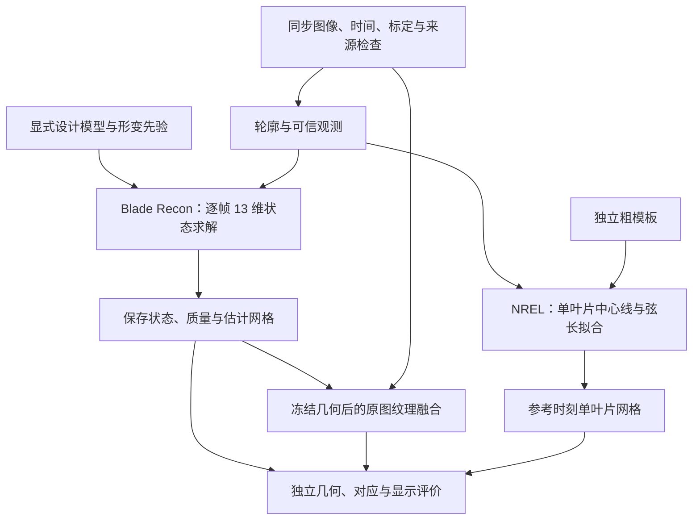
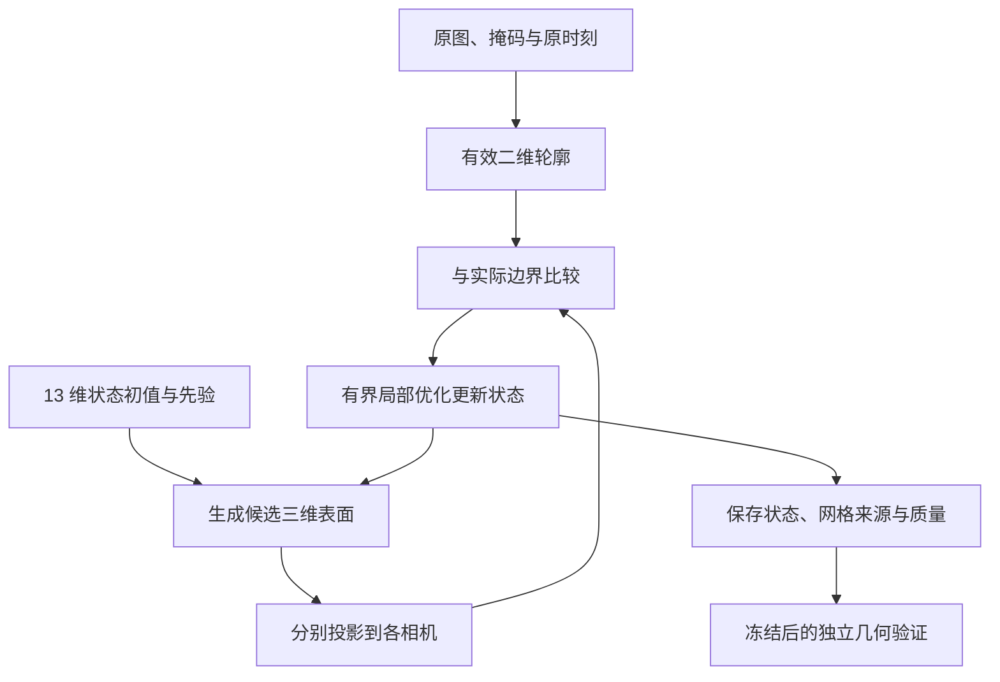
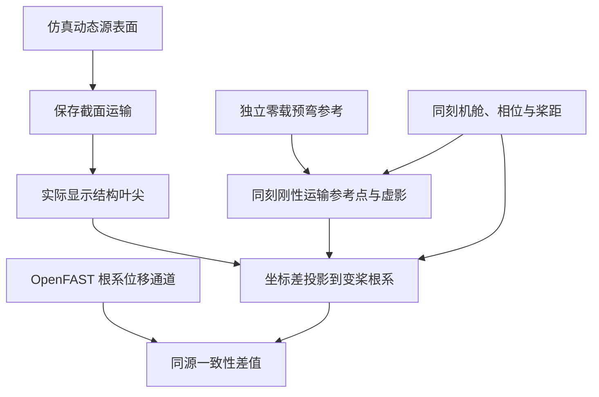

# 风机叶片三维重建、净空、挠度与不平衡算法详细说明

**二维视频到三维结构、表面纹理对应与同源仿真分析｜技术汇报版**

| 项目 | 说明 |
| --- | --- |
| 研究对象 | NREL 5MW 参考机组及当前 Blender/MAPPO 仿真中的叶片 |
| 主要实现 | `blade_recon0.2`：多视图轮廓约束下的三叶片动态状态重建与纹理融合 |
| 独立研究实现 | `wfrl/nrel_reconstruction`：三摄视频约束的单叶片表面拟合 |
| 扩展分析 | 双束净空、独立未受载挠度参考、叶片运动差异与不平衡概念 |
| 说明依据 | 当前源码、冻结实验配置、实际保存的实验报告与机器结果 |
| 当前定位 | 已实现并形成仿真研究与可视化管线；完整几何精度、真实材质点对应及现场缺陷计量仍需独立验收 |

本文说明已经存在的算法及其证据边界。实验数字保留原数据来源、样本范围和验收状态；后续建议单独列出。文中的“正式结果”指相应研究分支保留的结果文件，不表示已经通过现场工程验收。源码与报告索引见第 19 节。

阅读建议：第 3–9 节详细解释二维到三维与纹理对应；第 13–15 节解释净空、挠度虚影及不平衡；第 11–12 节集中列出已有重建验证。当前净空、挠度显示主要读取同源仿真及其派生结果，尚不能解释为全部由视频重建直接测得。

## 🎯 1. 面向管理者的技术概述

项目的核心是利用叶片设计模型和结构形变约束，将视频中的二维观测转化为可解释的三维估计。系统先生成一个候选叶片模型，再投影到实际相机画面，调整模型参数，使投影轮廓与视频轮廓尽量一致。在此基础上，系统将允许读取的原图表面亮度映射到估计网格，形成可以在 Blender 中查看的纹理结果。

现有实现包含两条相互独立的算法路线：

1. **三叶片动态状态路线**：固定设计外形和结构振型，每帧求解 13 个姿态与形变参数，得到三片叶片的估计网格；随后生成表面图集并回放。该路线对应 Blade Recon 与 MAPPO 同源重建演示。
2. **单叶片视频表面路线**：从独立粗模板出发，利用三路视频的可信边界优化叶片中心线和弦长分布，输出参考时刻附近的单叶片网格。当前正式静态研究结果为 v2。

两条路线共同采用“模型生成—图像投影—观测比较—参数优化”的思想，但参数、输入假设、求解器和验收范围不同，不能将它们的结果合并为一个统一精度指标。[S01][S10]

目前已经具备几何估计、图集融合、结果保存和三维显示能力。同源 MAPPO 结果包包含 601 个保存状态，能够在同一时间轴上进行原仿真与估计模型的对照播放。这里的同步播放速度与离线算法计算速度是两个不同指标。[S08]

当前最主要的研究问题是：有限视角下的几何可辨识性、相机与叶片模型的匹配、遮挡和边界误差、原图特征与三维表面点的稳定对应，以及独立数据上的验证。纹理辅助几何候选已实现，但科学状态仍为 `FAILED_GATE / NOT_ACCEPTED`；完整单叶片几何验收也仍待建立。[S07][S10]

净空、挠度与不平衡分析回答不同问题：净空关心指定位置与塔筒的空间关系，挠度关心去除同刻刚体运动后的结构位移，不平衡关心不同叶片在可比较条件下的持续差异。它们可以共同支持运行分析，但当前各自的数据与评价合同分别保存，不应将同源仿真对照统称为视频实测。

## 🧭 2. 总体架构与各部分职责



| 部分 | 核心职责 | 结果含义 |
| --- | --- | --- |
| 输入合同 | 核对原帧身份、时刻、内外参、图像、掩码和允许读取的资产 | 保证求解使用声明的数据 |
| 几何基线 | 用轮廓与先验拟合全局姿态和低阶形变 | 在当前模型空间中的估计 |
| 可选纹理辅助几何 | 将通过质量门的固定身份 RGB 点加入重投影残差 | 候选几何约束；目前未通过科学验收 |
| 纹理融合 | 固定估计几何，将原图表面亮度映射到图集 | 已观察表面细节与覆盖信息 |
| Blender 显示 | 根据保存结果还原网格并同步回放 | 结果展示与交互检查 |
| 独立评价 | 在冻结结果后读取留出观测或评价专用真值 | 判断精度、对应关系与适用范围 |

## 📥 3. 数据输入与坐标约定

### 3.1 Blade Recon 的输入

当前实现支持静态相机输入和严格的逐帧动态输入。实际 MAPPO 同源实验使用两台渲染相机；独立合成验证配置采用三摄阵列。因此，“三摄”是既有设计配置，实际运行应以输入合同中声明的相机为准。[S02][S08]

| 输入 | 内容 | 作用 |
| --- | --- | --- |
| 视频或帧目录 | 各相机的原始 RGB，保留原帧编号与时间 | 提取轮廓、表面亮度和可选 RGB 点 |
| 相机内参 | 每个视图的 `K` 与原图尺寸 | 将三维点投影到原像素坐标 |
| 相机外参 | 静态外参，或每个原时刻的 `T_cv_from_model` | 处理相机与机组坐标之间的变换 |
| 掩码 | 明确声明的二值前景；传统模式可使用受限背景分割 | 确定图像叶片区域 |
| 未知域 | 不可靠、遮挡或无法判定区域的声明 | 从有效观测中排除未知信息 |
| 机组配置 | 轴倾、预锥、轮毂位置、半径、旋转方向等 | 确定前向模型 |
| 可选健康模板 | 显式声明、带哈希的固定健康设计资产 | 替代默认解析外形；不提供逐帧动态答案 |

动态相机必须使用逐帧外参，不能用某一个静态时刻的标定代表整段视频。当前输入检查会核对缺失图像、掩码尺寸、原帧身份和时间等合同问题；未知域不应被填成可信前景或背景。[S02]

传统自动分割利用灰度对比和 Otsu 阈值，默认叶片比背景暗，也可配置亮极性。它依赖当前背景条件；更复杂背景需要另行提供并验证分割结果。代码能够读取外部掩码，不表示项目已经具备适用于任意现场的分割模型。

### 3.2 坐标与针孔投影

Blade Recon 默认机组坐标的原点位于塔底中心，`z` 向上，`x` 指向上风，`y` 由右手系确定。长度使用米，状态中的角度使用度。对模型点 \(P_m\)，相机投影可写为：

$$
\begin{bmatrix}X_c&Y_c&Z_c&1\end{bmatrix}^{T}
=T_{cv\leftarrow model}
\begin{bmatrix}P_m&1\end{bmatrix}^{T},
\qquad
u=f_x\frac{X_c}{Z_c}+c_x,
\qquad
v=f_y\frac{Y_c}{Z_c}+c_y.
$$

只有正深度且处于有效图像范围的投影才可参与相应观测。正深度本身不能证明该表面点没有被遮挡。纹理融合和独立评价还需要检查可见性。[S01][S02]

原图不需要先拼成全景。各相机保留自己的内外参、像素坐标与来源，可减少拼接重采样和接缝处理对观测解释的影响。对于共光心扇形阵列，多视图主要扩大可见范围；几何估计依赖模板、运动和轮廓约束，不能把这种配置直接解释为具有独立基线的稠密立体测量。[S01]

### 3.3 估计与评分的数据边界

几何求解读取允许的图像、标定、掩码和设计先验。逐帧真值、评价专用动态表面以及留出评价数据应在冻结候选之后使用，不能反向用于修正跟踪、几何求解或纹理融合。

设计先验可以包含健康外形；它与真实时刻的动态表面答案是两种不同输入。使用健康设计模板也不会自动建立估计表面与源动态表面的同材质点对应。[S03][S07]

### 3.4 一个二维像素为什么不能直接确定三维点

视频图像把三维空间沿视线压缩到二维。对原像素 \(\tilde u=(u,v,1)^T\)，针孔模型能给出相机坐标中的射线方向：

$$
d_c=\frac{K^{-1}\tilde u}{\|K^{-1}\tilde u\|},
\qquad P_c(\lambda)=\lambda d_c,\quad\lambda>0.
$$

像素确定了方向，却没有直接给出距离 \(\lambda\)。沿同一射线的多个三维点可以投到同一个像素。单幅轮廓还只告诉系统叶片边界在哪里，不能直接观测叶片内部深度、背面和厚度。

如果两台相机有独立光心、准确标定和可靠的同点对应，理论上可以利用两条射线交会估计距离。但共光心扇形阵列主要扩大视场；实际动态 MAPPO 输入虽有不同相机，轮廓基线也没有建立任意像素之间的稠密同点匹配。因此，本项目的主方法是**受模型约束的逆向估计**：在候选叶片形状空间中搜索能够解释各路视频的状态。[S01][S02][S04]

米制尺度来自已声明的叶片尺寸、轮毂和相机变换。若标定或设计尺寸错误，模型仍可能得到看似贴合的二维投影，而三维位置存在偏差；图像拟合不自动建立尺度正确性。

### 3.5 从二维轮廓反求三维结构的闭环

整个求解可以理解为一个重复进行的闭环：



例如，方位角变化主要改变三片叶片在图像中的整体转动；桨距变化会改变截面投影和可见宽度；挥舞、摆振模态改变中心线及外段边界。优化器根据这些参数对轮廓的影响，调整当前状态，而不是先给每个图像像素分配一个自由深度。

三维网格记为 \(M(x_t)\)，多相机投影记为 \(\Pi_k(M(x_t))\)。求解器实际寻找的是：

$$
x_t^*=\arg\min_x F\big(\Pi_1(M(x)),\ldots,\Pi_K(M(x));\text{当前观测与先验}\big).
$$

一个状态同时生成三片叶片，并同时接受各有效视图的约束。只有一个相机能够看到的区域，仍可借助设计模型估计；所有相机都看不到的区域，则主要由模型和时序/周期先验给出。[S04]

### 3.6 求解器怎样知道该改变哪个参数

在当前候选状态附近，算法计算残差对各参数的局部变化率，即 Jacobian：

$$
J_{ij}=\frac{\partial r_i}{\partial x_j},
\qquad r(x+\Delta x)\approx r(x)+J\Delta x.
$$

若某个参数的小变化能让轮廓残差显著减少，该方向具有可利用的图像信息；若两个参数产生相似投影变化，就可能相互补偿；若某个方向几乎不改变任何有效观测，则该方向在当前视角下不可辨识。

TRF 的局部步骤可概括为在参数边界和信赖域内降低线性化残差：

$$
\min_{\Delta x}\frac12\|r(x)+J\Delta x\|^2,
\quad LB\le x+\Delta x\le UB,
\quad\|D^{-1}\Delta x\|\le\eta.
$$

这里 \(D\) 表示参数尺度，\(\eta\) 表示局部搜索范围；这是对局部子问题的解释，具体边界处理由 SciPy 求解器完成。当前代码用帧内增量、绝对差分步长和分组尺度，避免角度累计量或不同单位直接影响局部搜索。[S04]

轮廓包络、最近线段与可见性选择会发生切换，所以目标在局部之外并不保证平滑或唯一。启动方位搜索、时序预测、可观性冻结和鲁棒残差共同帮助算法保持在合理候选附近，仍需要独立验收判断解是否正确。

### 3.7 从“状态向量”到“结构形状”的含义

每帧保存的 13 个数不是仅供动画使用的任意控制量。它们进入统一的健康模板和模态前向模型，决定截面位置、桨距朝向以及中心线低阶形变；前向模型由此生成三维坐标。

假设同一叶片的两个时刻具有相同刚体姿态但不同挥舞幅值，模型会沿既定振型改变整条叶片，而非只移动叶尖。反过来，若只有方位角改变，几何会随转子整体旋转，不能将这种运动称为弹性挠度。

该路线能够估计的是当前模板允许的整体形状。它没有为每个局部裂纹、凹坑或鼓包引入自由形状变量，因此纹理中看到局部明暗特征，不会自动让几何产生相应损伤结构。后续若扩充局部形状参数，必须另行证明观测对这些参数可辨识。[S01][S06]

## 🧩 4. Blade Recon：13 维物理参数化几何

### 4.1 每帧求解的状态

当前CLI的状态是13维：方位角、逐叶桨距、一阶挥舞、一阶摆振和二阶挥舞；外侧支持不足时相关方向由门控冻结，二阶挥舞保持最近可靠值。[S01]

$$
x_t=[\psi_t,\ \beta_{0:2,t},\ a^{f1}_{0:2,t},\ a^{e1}_{0:2,t},\ a^{f2}_{0:2,t}]^{T}\in\mathbb{R}^{13}.
$$

| 状态组 | 数量 | 物理含义 | 单位 |
| --- | ---: | --- | --- |
| \(\psi\) | 1 | 叶片 0 的方位角，其余叶片相差 120° | 度 |
| \(\beta_b\) | 3 | 各叶片桨距 | 度 |
| \(a_b^{f1}\) | 3 | 一阶挥舞模态幅值 | 米 |
| \(a_b^{e1}\) | 3 | 一阶摆振模态幅值 | 米 |
| \(a_b^{f2}\) | 3 | 二阶挥舞模态幅值 | 米 |

这里的模态幅值是模型状态参数，不能当作裂纹深度或任意局部表面位移。当前状态中没有独立局部裂纹、凹坑、鼓包或弹性扭转场的自由度。

### 4.2 从状态生成三维表面

默认前向模型组合以下信息：

1. 公开参考外形的展向弦长、扭角和厚度分布；
2. 近似翼型截面，默认采用 NACA00xx 与圆形的混合表示；
3. 一、二阶挥舞和一阶摆振振型；
4. 叶片桨距、方位角、轴倾、预锥和机组位置；
5. 形变斜率引起的近似弧长缩短处理。

参考机组设计来源为 NREL 5MW 基线；项目中的解析截面近似仍需与实际资产或现场制造外形分别核对。公开参考模型提供设计依据，不提供本算法精度保证。[^nrel]

设归一化展向坐标为

$$
\xi=\frac{r-r_{hub}}{r_{tip}-r_{hub}},\quad 0\leq\xi\leq1,
$$

则模型中的低阶形变可概括为：

$$
d_f(r,t)=a^{f1}_t\phi_{f1}(\xi)+a^{f2}_t\phi_{f2}(\xi),
\qquad
d_e(r,t)=a^{e1}_t\phi_{e1}(\xi).
$$

各振型使用既定多项式，形变沿展向连续变化。截面经桨距和设计扭角旋转，再随叶片方位、轴倾和预锥变换到机组坐标。[S01]

默认离散为每片叶片 40 个展向截面、每截面 32 个周向点。三维网格由少量状态决定，避免逐顶点自由拟合带来的形状漂移；同时，模型表达范围也受到限制。真实叶片若存在超出当前振型、截面或设计模板的形变，优化可能将模型失配吸收到姿态与模态参数中。

### 4.3 模型约束的含义

“物理参数化”表示结果处于指定设计与振型的受限模型空间，具有可解释的状态含义。它不等于每个输出已经满足真实载荷、完整结构动力学或现场计量要求。先验能够补全缺失观测，也可能掩盖模型失配，因此必须保留观测、推断与质量信息。

## 📐 5. 轮廓约束与几何目标函数

### 5.1 从图像建立观测

每帧、每个相机先获得二值叶片掩码，再提取有效轮廓。代码计算图像轮廓的距离变换，并从估计网格的截面投影生成轮廓包络。轮廓残差比较的是二维边界位置，不直接使用叶片内部的 RGB 细节。[S04]

单向比较可能允许候选轮廓只解释观测的一小部分，因此基线使用两个方向：

- 模型轮廓到图像轮廓：检查估计边界是否落在观测边界附近；
- 图像轮廓到模型轮廓：检查被观测到的边界能否由模型解释。

设 \(C_{k,t}^{obs}\) 是相机 \(k\) 的有效图像轮廓，\(C_{k,t}^{model}(x)\) 是状态 \(x\) 对应的投影轮廓。其图像项可以用下式概括：

$$
E_{contour}(x)=
\sum_{k}\left[
\sum_{p\in C_{k,t}^{model}(x)}\rho_f\!\left(d(p,C_{k,t}^{obs})\right)
+\sum_{q\in C_{k,t}^{obs}}\rho_f\!\left(0.7\,d(q,C_{k,t}^{model}(x))\right)
\right].
$$

实际代码通过采样、距离变换和点到投影线段距离构造残差向量。反向距离乘 0.7 是残差权重，不能写成整个反向目标直接乘 0.7。当前鲁棒转换的平方等价于下式，\(f=2\) 像素：[S04]

$$
\rho_f(r)=2f^2\left(\sqrt{1+(r/f)^2}-1\right).
$$

各相机的残差槽位保持固定长度；无观测槽位填零，不代表增加了图像信息。画面边界和未知域附近使用门控，画外区域不直接作为负证据。鲁棒损失减少异常边界点的影响，仍不能修复错误相机标定、错误掩码或持续的遮挡误判。

### 5.2 完整目标的组成

默认目标包含轮廓、时序和绝对先验；周期先验随可靠观测逐步建立，并更新绝对先验的均值与尺度。显式启用纹理辅助几何时，另加入通过质量门的 RGB 点重投影项。

$$
\min_{x\in[LB,UB]}
E_{contour}(x)
+E_{time}(x)
+E_{absolute/periodic}(x)
+E_{rgb}(x;w_{tex}).
$$

更精确地说，传给求解器的残差向量是：

$$
r(x)=\begin{bmatrix}
\operatorname{robust}([r_{model};0.7r_{obs}])\\
\operatorname{robust}(r_{RGB})\\
2w_t(x-x_{pred})/\sigma_{step}\\
2(x-\mu_{prior})/\sigma_{prior}
\end{bmatrix},\qquad F(x)=\tfrac12\|r(x)\|_2^2.
$$

RGB 项的权重在其残差内部使用；不给纹理观测侧车时，该项不存在。先验不做鲁棒转换，保持二次惩罚。图像项与先验项承担不同职责：图像约束提供实际观测信息，先验保持状态平滑并补足弱可观方向；不能将先验产生的确定性当成图像已经测到了该参数。[S03][S04]

## ⏱️ 6. 时序先验、周期先验与可观性

### 6.1 时序预测

相邻帧状态不是完全独立求解。方位角由近期旋转变化进行预测，其他状态以上一保存状态为参考，再使用标准差归一的残差限制不合理突变：

$$
r_{time,i}=\frac{x_{t,i}-\hat{x}_{t|t-1,i}}{\sigma_{step,i}}.
$$

| 状态组 | 帧间先验标准差 | 当前参数边界 |
| --- | --- | --- |
| 方位角 | 3° | 不使用有限角度边界，保留连续旋转表达 |
| 各叶片桨距 | 1.5° | −5° 至 90° |
| 一阶挥舞 | 0.8 m | −3 m 至 12 m |
| 一阶摆振 | 0.25 m | −2 m 至 2 m |
| 二阶挥舞 | 0.3 m | −3 m 至 3 m |

弱绝对先验的标准差依次为：方位角无有限绝对先验；桨距 25°；一阶挥舞 4 m；一阶摆振 1 m；二阶挥舞 1 m。其中一阶挥舞的参考均值是 3 m，其余桨距、摆振和二阶挥舞参考均值为零。它们是代码中的模型约束尺度，不能称为经过独立校准的实际测量误差。[S04]

### 6.2 周期先验

代码利用可靠可见时刻积累低阶周期规律。当前挥舞模型使用平均项、方位角余弦项和逐叶片偏置；摆振使用平均项及正余弦项；桨距分离共同量与叶片偏差。

其直观形式为：

$$
a_b^{f1}(t)\approx A_0+A_c\cos\psi_b(t)+\delta_b,
\qquad \psi_b=\psi+120^\circ b.
$$

采用递归最小二乘更新，遗忘因子 0.99。观测支持比例至少 0.15 时更新对应状态；挥舞和摆振更新次数均超过 6 后，将预测均值和条件尺度用于先验。附加残余尺度为挥舞 0.4 m、摆振 0.12 m、桨距 0.8°。二阶挥舞没有对应的在线周期模型，不可见时使用最近可靠值。

这里是在线学习的低阶预测关系，不是逐时刻求解完整气动弹性方程。刚开始运行、尚未积累足够可靠观测时，周期先验较弱；不可见区域的可信程度应单独说明。[S04]

### 6.3 可观性与推断

相机没有看到叶片外段时，某些挥舞和摆振方向对图像缺乏约束。当前以 \(\xi>0.4\) 定义外段：若预测入画的外段截面不足 3 个，则冻结该叶片的一阶挥舞、摆振和二阶挥舞；若全片入画截面不足 3 个，也冻结桨距。状态由在线先验或最近可靠值补足。

`observed_sections` 则检查至少一路相机的两侧预测轮廓是否都落在观测轮廓距离 3 像素以内，并汇总附近加密截面的支持。该像素阈值作用在拟合分辨率上；改变 `--fit-scale` 后，不能直接将其描述为原图 3 像素。可见性标记与求解质量一起保存。[S04]

绿色和橙色都表示算法估计。绿色表示达到当前轮廓支持判据的区域，橙色表示更多依赖模型或先验的区域。该配色不表示“绿色是真值”，也不自动表示绿色区域达到了某个厘米级精度。[S05]

## 🔧 7. 求解、失败处理与不确定度

Blade Recon 使用 SciPy 的有界非线性最小二乘求解，当前基线采用 `trf` 方法。该求解器寻找有界目标的局部最小值；达到停止条件表示数值过程结束，物理与几何精度仍需独立检验。[^scipy]

求解分为启动与连续跟踪。首次有效图像在 0°–120° 范围以 2° 步长搜索初始方位；第二个被接受的图像状态使用与首个被接受状态之间的真实时间间隔和最大转速范围估计初速度。后续方位角按速度外推，速度采用“0.8×上一有效速度 + 0.2×当前有效观测速度”的平滑更新。三片外形相同会产生 120° 循环编号歧义，物理叶片编号需要额外身份依据。

当前启动和跟踪默认最大函数评价预算分别为 150 和 60。这是求解预算，不是每帧保证完成的迭代数或性能承诺。代码以帧内局部增量优化，采用绝对中央差分构造 Jacobian；保存方位角不做模 360°，避免累计旋转影响局部信赖域尺度。[S04]

需要分别读取以下信息：

| 信息 | 可以说明什么 | 不能单独说明什么 |
| --- | --- | --- |
| 求解器状态与终止原因 | 是否达到数值停止条件或预算上限 | 是否恢复真实形状 |
| 残差与图像支持 | 与当前轮廓或 RGB 观测的符合程度 | 未见表面是否正确 |
| Jacobian 秩与条件信息 | 当前图像对参数方向的敏感性和退化情况 | 现场独立计量精度 |
| 先验参与情况 | 哪些方向依赖时序、周期或绝对约束 | 图像已经提供充分观测 |
| 局部标准差 | 当前近似与噪声假设下的条件不确定度 | 跨模型、跨场景的真实误差上界 |

当前实现保存实际已读取的前导无观测帧与数值求解失败帧，保持原帧身份，避免把第一个成功帧改成“视频第零帧”。无观测帧按预测或不可辨识状态读取；非法输入、明确掩码缺失或尺寸错误按合同报错并中止，不自动插入缺失状态。无观测预测、数值终止与科学验收分别判断。[S02][S04]

`observation_std` 仅使用图像 Jacobian，`posterior_std` 包含先验；不可辨识方向的标准差保存为 `null`。当前 `reconstruction_valid` 要求实际有图像观测、求解器成功终止、图像 Jacobian 秩大于零，并且状态全部有限；它只证明至少存在一个局部图像约束方向，不能推导 13 维全部可观或精度通过。

只有被接受的图像状态参与转速估计、时序预测、最近可靠逐叶值与周期先验更新。被拒绝的有限候选只可作为再次求解的初值，不作为有效观测历史；无观测帧从最近被接受状态按真实时间外推。非有限解使用有限预测状态保存，标记 `nonfinite_solution`，不更新候选或有效观测历史，图像与后验标准差记为 `null`。

参数标准差来自局部线性化信息，其解释依赖残差、模型和可观性。尤其在强先验、遮挡或模型失配时，小标准差可能只表示估计在当前假设下稳定。当前纹理辅助实现分别记录轮廓、纹理以及组合图像信息，避免将先验约束计入图像证据。[S03][S04]

主要几何输出是 `recon.json`，包含机组配置、状态字段名称、输入合同与访问日志，以及以下逐帧记录：

| 字段组 | 保存内容 |
| --- | --- |
| 原时间身份 | `frame`、`t` 与原相机标定 |
| 几何状态 | 13 维 `state`、估计转速与初始化信息 |
| 图像支持 | `observed_sections`、图像 Jacobian 秩与参与相机信息 |
| 不确定度 | `observation_std` 与 `posterior_std` |
| 重建状态 | `reconstruction_status`、`reconstruction_valid` |
| 求解诊断 | success、status、message、optimality、评价次数与 cost |
| 验收和审计 | 默认几何验收状态、可选 RGB 点门控与来源记录 |

`reconstruction_status` 区分无观测、不可辨识、图像约束、先验辅助及纯预测等状态；读取结果时应保留这些区别。仅有数值数组不足以说明其观测来源与可信程度。[S04]

## 🔍 8. 可选 RGB 纹理点辅助几何

### 8.1 候选约束的构造

该功能与后面的“纹理图集融合”是两个模块。它尝试用稳定的 RGB 图像点约束已有的 13 维几何状态，需显式提供 `--texture-observations`。不给该参数时仍使用轮廓基线；`--texture-weight 0` 保留审计但不增加 RGB 几何残差，可用于严格消融。[S03][S06]

具体流程为：

1. 在声明的拟合 RGB 和固定传感器 ROI 中提取角点；
2. 使用 RGB 仿射运动播种和局部 LK 跟踪，保持首帧身份；
3. 检查前后向一致性、对比度、NCC、竞争峰和前景/未知域支持；
4. 首帧先做轮廓拟合，将通过门控的锚像素射线绑定到**估计健康网格**的三角面；
5. 固定记录叶片、面编号和重心坐标，此后不因失败重新选点或重绑；
6. 让绑定点随候选状态运动，将其重投影与跟踪到的原图像素比较。

### 8.2 固定三角面绑定与残差

对绑定面顶点 \(V_1,V_2,V_3\) 与重心系数 \(b_i\)，估计表面点为：

$$
P(x)=b_1V_1(x)+b_2V_2(x)+b_3V_3(x),
\qquad \sum_i b_i=1.
$$

若独立 RGB 跟踪观测为 \(u^{obs}\)，则残差为：

$$
r_{RGB}=w_{tex}\frac{\pi(P(x))-u^{obs}}{\max(\sigma_{RGB},0.25\ \mathrm{px})}.
$$

图像缩放时，像素差与定位尺度同步换算，维持原像素归一化含义。锚点自身的射线绑定不提供额外几何信息；有信息的是后续时刻固定点的重投影一致性。失踪、拒绝与歧义观测保留在计划分母中。[S06]

### 8.3 质量门与能力范围

| 跟踪质量项 | 当前门槛 |
| --- | --- |
| 条件定位标准差 | ≤1 px |
| RGB 前后向误差 | ≤1 px |
| NCC | ≥0.8 |
| 灰度对比 | ≥12 |
| 独立竞争峰质量比 | ≥2 |
| 支持区域 | 实际前景及 known 域 |

这些角点不是已经命名的裂纹或修补块，也不是已知真实材料坐标。当前约束可改变全局姿态与模态幅值，没有独立损伤形状参数。局部条件定位标准差不等于独立定位精度；RGB 支持和正深度也不能代替几何自遮挡验证。

固定联合基线样本中，RGB 局部信息秩为 5，涉及方位角和叶片 0 的四组状态方向；该样本没有增加组合图像秩。因此不能表述为“纹理恢复了全部 13 维状态”。[S07]

## 🎨 9. 表面纹理恢复：冻结几何后的原图映射

### 9.1 目标与图集定义

纹理融合固定保存的估计几何，从允许的原图中取样并投到叶片表面。它不生成缺失表面的细节，也不在该步骤重新拟合几何。当前实现将 RGB 转为灰度，输出归一化灰度细节和原始亮度融合图，不是完整 RGB 彩色纹理。[S09]

每片叶片一张表面图集：

- 行表示由根到尖的半径 \(r\)；
- 列表示闭合截面周线弧长比例 \(\tau\)；
- UV 使用 \(u=\tau\)，\(v=1-(r-r_0)/(r_1-r_0)\)。

默认算法图集展向间距是 0.025 m，周向 768 列；当前同源 MAPPO 包采用 0.05 m、384 列，图集为 1230×384。图集采样间距表示存储网格密度，不能当作实际恢复分辨率或定位精度。[S08][S09]

### 9.2 可见性检查

每个候选纹素按冻结状态映射到三维表面，再逐相机投影和取样。实际检查包括：

1. 保存状态与输入合同、相机和原时刻一致；
2. 相邻截面具有图像支持，且不是无效或纯预测重建；
3. 三角面 z-buffer 中叶片身份和深度一致；
4. 纹素投影位于实际掩码及允许区域；
5. 视线与法向不过分掠射，\(\cos(view,normal)>0.08\)；
6. 深度差低于 \(0.05+0.004z\) 米；
7. 距轮廓太近的像素被抑制，以降低边界混合。

当前主链使用共同输入的实际掩码，不隐式填洞。未观察区域保持缺失，输出 alpha=0。[S09]

### 9.3 质量权重与融合

当前基本权重为：

$$
w=\frac{w_{edge}}{1+(r_{area}/0.01\ \mathrm{m})^2}.
$$

\(r_{area}\) 是投影采样脚印的空间尺度。边缘距离 1.5 px 内权重为零，至 6 px 逐步升到一。若提供曝光时间，再按运动模糊量降低权重：

$$
w\leftarrow\frac{w}{1+(blur_{px}/1\ \mathrm{px})^2}.
$$

`mean` 模式按 \(w^4\) 加权平均；默认 `best` 模式先以高斯滤波平滑质量图，使用当前更优的视角来源，减轻频繁切换造成的接缝。当前权重不能概括成“按法向余弦四次方融合”；法向主要承担前述硬门。[S09]

光照归一化将亮度除以约 2 m 展向、0.6 m 周向范围的低频分量，保留局部表面变化。可选第二遍细节配准允许有限图集平移；该操作改善的是外观对齐，不能单独证明三维坐标精度改善。

### 9.4 输出与解释

| 输出 | 内容 | 解释边界 |
| --- | --- | --- |
| `blade*_tex.png` | 归一化灰度细节与有效 alpha | 有效区域的融合外观 |
| `blade*_raw.png` | 未归一化的原始亮度 | 保留亮度变化供复核 |
| `blade*_res.png` | 投影分辨率伪彩图 | 空间采样质量参考 |
| `texture_data.npz` | 浮点纹理、权重及相关结果 | 分析与审计数据 |
| `texture.json` | 图集定义、覆盖和输入审计 | 说明来源与缺失区域 |

视频中表面标记在三维上出现，是外观映射结果。裂纹宽度、深度和鼓包高度需要独立几何证据；当前灰度细节和明暗变化不能直接支持这些计量结论。

### 9.5 二维纹理与三维表面如何建立对应

几何重建确定的是估计表面在哪里；纹理映射还要回答“某个图集位置在三维表面的哪里，以及它在当前相机图像的哪个像素”。当前方法使用统一表面参数和同一三角面映射来连接三者。[S09]

对图集坐标 \(q=(r,\tau)\)，由当前估计状态得到表面点：

$$
P_t=\Gamma(q;x_t),
\qquad u_{k,t}=\pi_{K_k}\big(R_{k,t}P_t+t_{k,t}\big).
$$

\(\Gamma\) 是图集到估计网格的映射，\(R_{k,t},t_{k,t}\) 分别为当前模型到相机变换的旋转与平移；\(\pi_{K_k}\) 包含内参和透视除法，与第 3.2 节相同。通过可见性与质量门后，从原图在 \(u_{k,t}\) 附近取样，写入图集位置 \(q\)。这里是表面点向原图查询亮度，原图像素与图集像素通常不是一一整数对应，需按图像采样规则插值。

在离散三角网格上，同一个点可用面编号与重心系数表示：

$$
P_t=b_1V_{1,t}+b_2V_{2,t}+b_3V_{3,t},
\qquad
UV=b_1UV_1+b_2UV_2+b_3UV_3.
$$

同一组系数把几何点与 UV 连起来。Blender 使用对应三角面和 UV 读取融合图集，因此随着叶片网格运动，图集细节附着在相同的估计表面坐标上，而不是贴在屏幕固定位置。

### 9.6 跨帧融合为什么可以累积可见表面

叶片转动时，不同时刻暴露的表面不同。对同一个图集位置 \(q\)，可以在多个 \((k,t)\) 视图中获得候选亮度与质量值：

$$
\mathcal O(q)=\{I_{k,t}(u_{k,t}),\ w_{k,t},\ \text{可见性与来源}\}.
$$

若该位置从未通过有效性检查，就保持 alpha=0。若多个视图都看清它，默认方法按平滑质量选择更优来源；平均模式则按既定权重融合。这样得到的是一张跨时刻累积的固定表面外观图，而不是每个显示帧重新求出的实时材质。

图集可以汇集不同角度的观测，实际支持仍受相机布局、遮挡、轮廓区域和图像分辨率限制。把固定图集做得更大，只会提高存储采样密度；不会增加从未观测到的表面细节。

### 9.7 “贴在估计模型上”与“真实材质对应”分别验证

| 对应层次 | 成立需要什么 | 当前意义 |
| --- | --- | --- |
| 几何—UV 一致 | 图集映射、三角面拓扑和 Blender UV 使用同一约定 | 可以稳定显示在估计表面上 |
| 投影来源正确 | 使用正确原时刻、相机、RGB、掩码与可见性 | 图集确实来自声明原图 |
| 真实材料点对应 | 不同时刻取到的确为同一实际表面位置，且留出视角定位通过 | 需要独立实验；当前独立协议未通过 |
| 缺陷三维计量 | 除对应外，还要有真实几何自由度、空间分辨率和计量真值 | 当前未建立 |

固定面编号或 UV 只能固定估计模型中的身份。若估计形状与真实形状失配，同一个图集坐标仍可能在不同帧投到不同真实材料区域，造成拉伸、条带或接缝。第一次将像素射线绑定到估计网格也只建立候选绑定，不能凭此宣布已经找到真实材料点。[S06][S07]

这正是为什么项目保留独立 Patch/Crack 对应门，而不只检查纹理图片是否能打开、模型是否有颜色、或三维显示是否清晰。

### 9.8 几何误差怎样传到纹理错位

对估计参数扰动 \(\Delta x\)，其投影变化可局部概括为：

$$
\Delta u\approx
J_{\pi_K}\,R_{k,t}\,J_{\Gamma,x}\,\Delta x
+\text{标定、时钟和图像观测误差项}.
$$

所以，方位角偏差、相机外参偏差或原帧时间错配，即使都很小，也可能把细线或修补图形投到错误的图集位置。靠近轮廓、掠射视角以及强展向压缩处，这种影响更明显；不能用一个统一的“像素误差乘比例尺”替代各位置的投影几何。

其中 \(R_{k,t}\) 是模型到相机变换的旋转部分，\(\pi_K\) 包含相机内参的针孔投影；其余误差项分别表示外参、时钟与观测扰动。

光照归一化和有限图集平移能够处理部分外观变化，却不能替代相机与几何校正。当前实现输出灰度亮度，标记的颜色分类或 RGB 光谱解释也不属于这张图集已经提供的能力。[S09]

## 🖥️ 10. 同源 MAPPO 结果与 Blender 回放

### 10.1 同源数据和时间映射

现有同源纹理包明确标记为 `SAME_SOURCE_SIMULATION`，来源是 MAPPO/Blender 渲染仿真，几何精度状态为 `NOT_ACCEPTED`。实际相机为 `T1Down` 和 `NacelleT1`，使用逐时刻动态外参。[S08]

| 时钟或结果 | 当前包配置 |
| --- | --- |
| MAPPO 源数据 | 40 Hz，源时段 117–177 s |
| 保存的重建状态 | 601 样本，10 Hz，相对时间 0–60 s |
| Blender 显示 | 60 Hz，显示帧 1–3601 |
| 样本步长 | 每 6 个显示帧对应一个实际重建样本 |
| 纹理 | 每片叶片一张固定图集，随保存几何运动 |

显示时间映射解决的是原仿真与保存估计在同一物理时刻的对照。中间显示帧不构成新的独立重建样本。固定图集由多个时刻融合而成，也不能称为逐时刻在线纹理测量。

独立 `synth_tex` 合成纹理样例有自己的来源和时间轴，应与该同源包分别命名。演示时必须选用相应结果包，不能仅凭“模型正在转动”推断使用了哪一类数据。

### 10.2 当前图集覆盖

| 叶片 | 有效纹素 / 总纹素 | 图集纹素覆盖 |
| --- | ---: | ---: |
| 1 | 182,713 / 472,320 | 38.6842% |
| 2 | 183,421 / 472,320 | 38.8341% |
| 3 | 182,589 / 472,320 | 38.6579% |

上述比例按**整个图集纹素数量**计算，不是经过面积校正的真实叶片物理表面覆盖率。601 帧经过输入合同核验；572 帧尝试外观融合，534 帧产生贡献，共记录 711 个贡献视图。条带、接缝和叶尖误投影问题仍存在，未建立独立同源纹理真值或现场质量验收。[S08]

### 10.3 显示、模型一致性和精度分别判断

Blender 按保存状态使用同一前向模型还原网格，或在独立原生文件中保存估计网格、shape keys、UV 和打包纹理。播放、暂停、寻址和视角操作属于显示与交互层。

现有包比较了源、纹理及打包模型在 601 状态上的顶点和轴线，实现差异为零。它证明不同模块使用了同一估计模型，不能写成真实三维误差为零。显示验证也不能代替原 RGB 到估计表面的对应验证。[S08]

固定健康loft联合基线的独立 Blender 文件完成保存与新进程重开；该实验的安装 reader 与模板兼容性限制须按报告所述载荷身份读取。独立原生文件的显示证据不能转用于其他 reader 或安装包。[S07]

## 🧪 11. 当前动态路线的验证结果

### 11.1 验证状态总表

| 验证层 | 当前结论 | 允许表达 |
| --- | --- | --- |
| 固定联合基线实现与回归 | `implementation_verification=PASS` | RGB 点约束、审计和候选输出已实现 |
| 固定联合基线科学验收 | `scientific_acceptance=FAILED_GATE` | 独立材质对应未通过门槛 |
| 固定联合基线主要几何收益 | `primary_gains=null` | 尚不能给出已验收的主要精度收益 |
| 同材质点三维误差 | `NOT_ESTABLISHED`，误差 `null` | 尚未建立有效计量合同 |
| 601 样本同源包 | `NOT_ACCEPTED` | 同源结果与同步显示包存在 |
| 自动缺陷分类与深度计量 | 当前实现未提供对应已验收能力 | 需另设任务和数据验证 |

固定联合基线状态来自[S07]，同源正式资源身份来自[S08]；当前局部材料点候选另由[S31]定义。候选Patch2/8、Crack7/8（87.5%<90%）、跨相机RGB0/264，`same_material_error_m=null`、`primary_gains=null`，科学状态 `FAILED_GATE / NOT_ACCEPTED`。研究候选未替换前端601样本正式资源。

### 11.2 独立表面标记对应

实验为 MAPPO 渲染回放，使用源帧 42/43/45/47 四个时刻，16 张 RGB 与 16 张掩码。对照四组模型与图像目标：[S07]

| 候选 | 健康几何 | 图像约束 | Patch 独立通过 | Crack 独立通过 |
| --- | --- | --- | ---: | ---: |
| A | 原解析模板 | 轮廓 | 0/8 | 1/8 |
| B | 固定健康 loft | 轮廓 | 1/8 | 1/8 |
| C | 原解析模板 | 轮廓 + RGB 点 | 0/8 | 4/8 |
| D | 固定健康 loft | 轮廓 + RGB 点 | 2/8 | 4/8 |

上表对应固定联合比较基线[S07]，不能作为局部材料点候选的当前评分。局部材料点F与诊断G在同一固定独立协议下均为Patch2/8、Crack7/8；两者观测、拟合及评分数值完全一致，跨相机接受0/264。真实同材料三维误差仍为null。[S31]

每个目标的独立分母为8，包含持出4项和锁定4项；训练项另报。门槛包括原像素边界 P95≤1 px、可见与固定绑定覆盖比例≥0.9、完整计划通过比例≥0.9。D 组的锁定 Patch 0/4、Crack 3/4；丢失、歧义和失败保留在分母内。

本实验中的 Crack 是 60×1.5 cm 的细线型测试标记，Patch 为指定尺寸的亮/暗修补图形。该通过数描述标记对应门，不是通用裂纹检测准确率、召回率或毫米级裂纹识别率。

RGB 跟踪计划为 22 条轨迹×4 时刻=88 项，后续观测 29/66 项通过跟踪门。部分训练点残差下降说明候选确实参与优化，独立测试仍失败，不能将训练改善替代持出结论。

### 11.3 性能范围

严格性能比较是同负载 A/C 串行各 3 次，顺序为 A、C、C、A、A、C：

| 指标 | A：轮廓 | C：轮廓 + RGB 点 | 变化 |
| --- | ---: | ---: | ---: |
| 求解中位耗时 | 47.51744 s | 49.22434 s | +3.59% |
| 各进程峰值 CPU RSS 的中位数 | 220,512,256 B | 220,987,392 B | +0.22% |

该比较排除了约 7.8 s 的跟踪以及纹理融合，内存测量不含 GPU，不能称为端到端加速。同源 601 状态的冻结求解记录为 123.384695 s、运行完成 601/601 帧，但它属于不同实验及保存实现，也不等于当前完整管线在线性能。[S07][S08]

同模型合成实验的厘米级误差、合成缺陷可见性数字与固定联合基线使用的数据、模型和分母不同。汇报当前能力时应引用匹配数据的结论；同模型合成数字只能在保留其假设和范围的独立复现说明中使用。

## 📹 12. 独立 NREL 单叶片视频重建路线

### 12.1 任务定义与实际输入

这条路线研究“视频能否修正一个独立粗叶片模板的表面形状”。它使用三路 MP4、理想针孔标定和声明的叶根刚体位姿，在叶根局部米制坐标中输出参考时刻附近的受载近似表面。相机和刚体运动是固定输入，优化不进行自由尺度或自由刚体配准。[S10][S11]

| 项目 | 正式 v2 配置 |
| --- | --- |
| 视频 | C1/C2/C3，各 1920×1080、20 fps、5 s、100 帧 |
| 仿真区间 | 120–125 s，采用帧中心时刻 |
| 参考时刻 | 122.175 s，原视频索引 43 |
| 拟合图像 | 每路索引 42/43，共 6 张 |
| 时序检查 | 每路索引 44/45，共 6 张；不参与梯度 |
| 结果范围 | 一片叶片，参考时刻附近的静态模型 |

44/45 是非盲时序检查帧，不具有盲测独立性。正式拟合进程重新解码全部 300 帧并核对选定 RGB 签名，保证输入确实来自声明的视频；优化只使用上述六张拟合图像。

### 12.2 可信轮廓和 F/B/U

对应输入观测使用针对已审核 B1 过境的 RGB 对比度规则、遮挡排除框、连通域处理和不确定边界，形成：

| 域 | 含义 | 约束处理 |
| --- | --- | --- |
| F | 可信前景 | 可提供前景支持 |
| B | 可信背景 | 可用于背景溢出检查 |
| U | 不确定边界、裁切或不可靠区域 | 不作为确定背景约束 |

独立可信轮廓在 F/B/U 不确定环生成之前提取，另以裁切与审核遮挡有效域限制轮廓。这样避免把真实边界本身全部删进 U 区。原生像素不确定带为 3 px；低分辨率时同时换算轮廓和内参的像素中心：

$$
p'=(p+0.5)s-0.5,\qquad c'=s(c+0.5)-0.5.
$$

分割规则依赖当前视频的颜色和审核区域，尚不是可迁移到任意现场的通用分割器；该实现也没有可靠材料点跟踪或自动物理叶片身份识别。[S10][S13]

### 12.3 19 参数的 B-spline 表面模型

模型在叶根局部坐标中表示：`x` 为轴向/厚度方向，`y` 为弦向，`z` 为展向；固定长度 61.5 m。网格使用 25 个展向截面、每截面 12 个环点，共 300 顶点、596 三角面。

模型有 7 个控制点，根部中心固定，其余 6 个控制点各有两维中心偏移；另外 7 个控制点表示弦长对数比例，总计 \(6\times2+7=19\) 个优化参数。

有界控制变量为：

$$
\mathbf c_i=5\tanh(\mathbf a_i)\ \mathrm m,
\qquad \ell_i=0.35\tanh(b_i),
$$

$$
\mathbf c(z)=\sum_iB_i(z)\mathbf c_i,
\qquad
C(z)=C_0(z)\exp\left(\sum_iB_i(z)\ell_i\right).
$$

\(B_i\) 是端部夹持的三次 B-spline 基函数，仅用于中心偏移和弦长对数比例；初始独立粗模板不会因此被改成精确源表面。弦长保持正值，比例约受 \(\exp(\pm0.35)\) 限制。

初始截面为粗椭圆形式：

$$
y_0=C(z)(0.25-0.5\cos\phi),
\qquad
x_0=\tfrac12 C(z)\,r_{tc}(z)\sin\phi.
$$

截面按固定设计扭角旋转并叠加中心偏移。厚度比例 \(r_{tc}(z)\)、设计扭转、长度和隐藏面形状没有独立优化；弦长缩放会连带改变绝对厚度，但这不等于厚度已经被图像独立恢复。[S13]

### 12.4 可微轮廓目标

将候选网格按固定的叶根刚体位姿与相机投影到每张拟合图像，提取外轮廓边，过滤内部和自隐藏边，在有效域中比较模型与 RGB 轮廓的双向距离。

设距离不确定带为 \(\delta\)，当前求解分辨率中的像素距离为 \(d\)，则：

$$
e(d)=\frac{\max(d-\delta,0)}{10},
$$

$$
L_{contour}=\tfrac12\left[
\operatorname{mean}\,\operatorname{SmoothL1}_{0.2}(e(d_{M\to O}))
+\operatorname{mean}\,\operatorname{SmoothL1}_{0.2}(e(d_{O\to M}))
\right].
$$

\(\delta\) 为原图 3 px 按求解分辨率缩放后的不确定带；距离尺度 10 px 和稳健转折参数按当前求解分辨率的像素使用。正向比较候选点到观测点的距离，反向比较观测点到连续有效线段的距离。[S13]

可见性、拓扑和采样选择在一次反向传播中固定，梯度经已选中的投影点与线段传播。因此，该目标是局部分段可微；现有检查覆盖闭合凸体和轻弯叶片，不能推广成任意强折叠、自遮挡拓扑切换下的全局可微保证。

### 12.5 正则项与优化配置

控制参数使用相对变化与二阶差分正则：

$$
L_{change}=\operatorname{mean}[(\mathbf c/5)^2]+\operatorname{mean}[\ell^2],
$$

$$
L_{smooth}=\operatorname{mean}[(\Delta^2\mathbf c/5)^2]+\operatorname{mean}[(\Delta^2\ell)^2],
$$

$$
L=\frac16\sum_{j=1}^{6}L_{contour,j}+0.03L_{change}+0.10L_{smooth}.
$$

这两项是控制参数的变化与平滑约束，不是经过结构载荷验证的米制曲率能量或完整力学模型。[S13]

| 配置项 | 正式值 |
| --- | --- |
| 求解器 | Adam，学习率 0.012 |
| 粗分辨率求解 | 160×90，40 步 |
| 中分辨率求解 | 320×180，40 步 |
| 细分辨率求解 | 640×360，20 步 |
| 图像使用 | 每步六张拟合图像等权；共 600 次图像前反向调用 |
| 梯度裁剪 | 10 |
| CPU 线程 | 4 |
| 随机种子 | 20261002 |

从同一个零参数初始模型生成初始模板、同配置无图像对照和最终视频约束模型。无图像对照不应人为扰动；初始模型与该对照一致本身是有效结果。模型先冻结，后由独立进程读取评价真值。[S11][S13]

### 12.6 独立几何评分与保留结果

评价真值是当前仿真时刻的 evaluated mesh，不是实机测量。评分不做刚体配准或自由缩放；用面积均匀样本计算到连续三角面的最近距离，采用全局 8192 样本、分区各 2048 样本、固定种子。这是面积加权 Monte Carlo 表面距离估计，不能解释为所有顶点逐点最大误差。[S11]

| 模型 | R→T mean | T→R mean | R→T P95 | T→R P95 |
| --- | ---: | ---: | ---: | ---: |
| 初始 / 无图像对照 | 0.349443 m | 0.348322 m | 0.854874 m | 0.883120 m |
| 正式 v2，100 步 | 0.183993 m | 0.162617 m | 0.607790 m | 0.511434 m |

R→T 表示重建表面到真值，T→R 表示真值表面到重建；两个方向同时读取可避免只检查一个表面的贴合。正式 v2 与无图像对照共享初始模板；全局距离改善不代表所有局部截面同时改善，也不能据此宣称完整几何验收通过。

根部固定截面的最小面积包围矩形长、短边误差分别为 0.300181 m、0.238707 m，较初始模型退化。这些尺寸是固定 `z` 截面几何近似，不能无条件称为真实气动弦长和厚度。因此，当前状态仍是 `PIPELINE_COMPLETE_PARTIAL_GEOMETRY`，综合几何验收为 `NOT_YET_ESTABLISHED`。

### 12.7 边界密化消融的证据边界

边界密化消融在 C1 的索引 42 图像中使用额外 710 个实际 RGB 亚像素边界点和基础 1104 点。在相同优化预算下，该候选在相同固定观测目标上的图像残差更低，但四项全局表面距离都较正式 v2 更大。两组各自训练目标不同，其最终损失不能直接比较：[S14]

| 边界密化候选 | R→T | T→R |
| --- | ---: | ---: |
| mean | 0.224019 m | 0.189591 m |
| P95 | 0.710826 m | 0.592301 m |

边界密化候选的根部截面长、短边误差分别比正式 v2 高约 13.58 cm、7.62 cm。正式结果为 v2；该候选仅作为边界消融证据。这组对照说明：二维观测解释更好，并不足以证明三维形状更接近真值；缺失视角、模型表达、尺度关联与正则仍影响解的选择。

### 12.8 动态与窗口研究分支

NREL 动态原型另存了原视频索引 42–45 四个时刻；其他 96 帧保持 `UNAVAILABLE; no interpolation`。其状态为 `REVIEW_ONLY`，动态计量门为 `DY1 NOT PASSED`，接受测量样本数为零。显示和同步检查不能将其提升为全序列动态恢复或净空计量能力。[S12]

另有 `blade_recon/window_surface_fit.py` 离线窗口联合拟合研究：各帧状态与每条 RGB 轨迹跨帧共享的材料定位坐标 \(q=(q_{span},q_{perimeter})\) 联合优化，并使用加速度先验。该坐标不是独立的局部损伤形变参数。此分支独立于 v0.2 逐帧 CLI 主链，也不同于第 8 节的固定三角面绑定候选，其参数与结果不能混入当前动态主线。[S15]

## 📏 13. 净空：概念、双束重建与独立报警

### 13.1 净空要说明“哪个对象、哪个方向、哪个时刻”

净空描述指定叶片位置与塔筒之间剩余的空间。工程上关心叶片运动时是否接近塔筒，但计算必须先明确对象与距离定义，否则不同模块的数值不能直接比较。

| 量 | 定义 | 与当前项目的关系 |
| --- | --- | --- |
| 激光斜距 \(r_i\) | 沿光束从光心到最近回波表面的长度 | 输入测距量，不能直接称净空 |
| 方向投影 | 斜距沿某坐标方向的分量 | 还需安装位置和塔筒几何 |
| 结构叶尖同高度净空 | 指定结构点到同一全局高度塔截面的有符号水平距离 | 当前双束主评分口径 |
| 末端轮廓表面参考 | 叶片末截面轮廓与同高度塔截面的间距 | 另存的辅助评价口径 |
| 整叶片三维最小距离 | 全叶片表面与全塔表面之间的最短距离 | 另一个任务，当前未提供已验收的连续时间结果 |

当前结构点净空写为：

$$
C(P,t)=s(P,t)\min_{Q\in\Gamma_T(P_z,t)}
\|(P_x,P_y)-(Q_x,Q_y)\|,
$$

其中 \(\Gamma_T(P_z,t)\) 为实际变形塔表面与全局水平面 \(z=P_z\) 的交线；点在截面外取正、内部取负。代码通过塔三角面截线、点到线段最近距离与内外判别计算。[S16]

全叶片三维距离则是另一种定义：

$$
C_{whole}(t)=\min_{P\in S_B(t),\ Q\in S_T(t)}\|P-Q\|.
$$

这个非负表面距离以及整个时间段内的最低值，不能用某一个叶尖水平距离代替。保存时刻的离散检查也不自动证明两个保存时刻之间不存在更近位置。

### 13.2 从一条二维显示光束到三维测距点

光束在三维中是一条射线。已知光心 \(O_i(t)\)、单位方向 \(d_i(t)\) 和有效斜距 \(r_i(t)\)，命中点为：

$$
P_i(t)=O_i(t)+r_i(t)d_i(t).
$$

若光束相对向下竖直方向的偏角为 \(\theta\)，水平朝叶轮分量的幅值为 \(r\sin\theta\)，向下竖直分量的幅值为 \(r\cos\theta\)；在全局向上为正的 \(z\) 轴中，竖直分量为 \(-r\cos\theta\)。只有结合安装偏距、机舱姿态和塔筒截面，才能进一步解释为某种净空。

当前 S1/S2/S3 在静止机舱材料系的角度为 10°/12°/14°，三束由同一机舱运动运输。设静止方向 \(d_i^0=(-\sin\theta_i,0,-\cos\theta_i)^T\)，机舱旋转和平移为 \(R_N(t),a_N(t)\)，布局平移为 \(b\)：

$$
O_i(t)=R_N(t)O_i^0+a_N(t)+b,
\qquad d_i(t)=R_N(t)d_i^0.
$$

光束按已声明的安装方向运动，不指向已知真实叶片来人为制造命中。当前仿真让叶片、塔筒与地面共同竞争最近正向首交；若塔筒挡住叶片，就不能跳过它去读取后方叶片。[S16][S17]

当前安装标称位置属于仿真选定配置。4.5 m 是未达到的参考目标，S1 指定高度的实算标称塔壁间距约 10.4709 m；安装审计未批准实体安装。该配置不能表述为已经取得现场认证。[S17]

### 13.3 双束为什么能给出一个叶尖估计

S2/S3 各给出一个叶片表面命中点。当前默认方法先用两点割线估计展向方向，再从已知轮毂向外延伸固定参考长度：

$$
u_0=\frac{P_3-P_2}{\|P_3-P_2\|},\qquad
\eta=u_0^T\left(\frac{P_2+P_3}{2}-H\right),
$$

$$
u=\operatorname{sign}(\eta)u_0,
\qquad \widehat T=H+Lu.
$$

\(H\) 是由同刻机舱姿态和机组配置得到的轮毂，\(L=\|(-1,0,63)\|\approx63.007936\) m 是完整参考向量长度。它包含轮毂中心到结构叶尖的长度，不能换成叶根到尖的 61.5 m，也不按真实动态叶尖长度反向调节。[S16][S17]

默认方法 `hub-axis.v1` 的关键近似是：用两个**表面命中点**的割线代表根到尖方向。两点可能位于不同弦向位置，实际叶片又有弯曲和预弯，因此这条割线不等于真实柔性中心线。由局部割线外推到叶尖，会放大方向偏差。

配对必须满足：同一瞬时源时刻、S2/S3 均有效、首交为同一叶片、斜距 5–100 m、点距至少 0.25 m，且朝外方向可确定。\(|\eta|<0.01\) m 时拒绝定号。仿真叶片编号来自首交对象；现场不会自动拥有这种身份标签。

### 13.4 TLS 候选改变了什么

显式候选 `hub-tls.v1` 保留测距、配对、固定长度与塔模型，改用一条经过已知轮毂的总最小二乘直线。令：

$$
A=\begin{bmatrix}(P_2-H)^T\\(P_3-H)^T\end{bmatrix},
$$

$$
u_*=\arg\min_{\|u\|=1}\sum_{i=2,3}
\|(I-uu^T)(P_i-H)\|^2.
$$

对 \(A\) 做 SVD，取第一右奇异向量，再定朝外符号并计算 \(\widehat T=H+Lu_*\)。该矩阵不减去两点均值，因为轮毂已经规定了直线经过的位置；减去均值会丢掉这个约束。[S16]

TLS 是等权的方向估计候选，不读取真实叶尖来选择方向，不逐样本在割线/TLS 中挑误差更小者。数值失败、方向不唯一和无法定号时保留拒绝原因。

### 13.5 从估计叶尖到净空，以及真值怎样独立使用

得到 \(\widehat T\) 后，将其与同刻已知变形塔截面比较：

$$
\widehat C=C(\widehat T,t).
$$

评价分支另将独立未受载结构点通过保存的末端截面变换运输，获得源参考点 \(T_{ref}\)，然后计算：

$$
C_{ref}=C(T_{ref},t),\qquad e_C=\widehat C-C_{ref}.
$$

正误差表示估计净空偏大，工程解释中尤其需要关注这种高估。估计点与源参考点分别按自身全局高度取塔截面，不能为了让误差好看而共用一个错误截面。[S16]

估计器不读取真实叶尖或末端真实变换作为答案，但当前仍依赖已知轮毂、机舱姿态、动态塔几何与仿真叶片关联。它不是仅凭两条现场量程就同时识别所有动态结构的算法。现场取得这些辅助量的误差预算尚未建立。

### 13.6 S1 报警与数值净空阈值是两种规则

当前 S1 只要有有效叶片首交就触发，不要求 S2/S3 成功，也不比较 \(\widehat C\) 是否小于某个数值阈值。未观测或超量程为 unknown；有观测但没有有效叶片首交为 not triggered。原始观测状态与显示报警保持分别记录。[S18]

S1 最后有效命中后显示保持 1 个仿真秒，这是界面状态保持，不能解释为设备响应时延或新的命中样本。没有 S1 报警或没有双束读数，都不能单独推出安全。

B2 演示支路使用 7 m 阈值、0.1 m 滞回的演示规则：有效估计≤7 m 进入接近状态，达到 7.1 m 退出。B2 支路的阈值不能套为 S1 的触发条件，也不构成已认证的安全保护链。[S18]

### 13.7 有效率、保持值与设备数据合同

当前双束显示可保持同一次有效测量的估计、源参考和误差整组 1 个仿真秒。保持值不增加有效样本，过期变为缺失。读数年龄按仿真时钟计算，暂停时不会因墙钟流逝而变老；寻址和重播读取对应的累计前缀，不重复计数。[S18]

新鲜有效率的分母是固定过叶窗口中的全部保存时刻，漏测保留。完整经过覆盖表示一次完整经过至少获得一次有效配对，不表示该经过每帧都有有效测距。误差统计另对可评分有效样本计算，空集返回缺失而非零。

设备 DP 字段解码支路又是不同合同：`65535` 表示无效；指定检测区外/地面哨兵不显示为“安全的 100 m”。目前解码器明确 `pairing_allowed=False`，因为同一个 20 ms DP 包不保证两束来自同时、同叶片的光学命中。不能把设备 50 Hz 输出、原始 20 kHz 光学采样与当前 40 Hz 仿真瞬时射线混称为一种观测。[S19]

### 13.8 当前净空结果的证据范围

同一开发片段使用三机 117–177 s 的保存源几何，两种方法共 400 个相同有效配对：[S20]

| 指标 | 默认割线 | TLS 候选 |
| --- | ---: | ---: |
| MAE | 4.268685 m | 0.776096 m |
| bias | 4.268582 m | −0.203439 m |
| 绝对误差 nearest-rank P95 | 7.201411 m | 2.023246 m |
| 最大高估 | 8.032596 m | 2.353931 m |

新鲜有效率为 400/1794，约 22.30%；94/94 个完整经过至少有一次配对。TLS 在 25/400 个样本上绝对误差更大，不能称处处改善。两种结果仍为 `REVIEW_ONLY / PENDING_ACCEPTANCE`。

雷达链使用 40 Hz 源柔性表面，视频重建链保存 10 Hz 的 601 个估计状态。两者同源、同时段，不代表当前雷达净空是从右侧视频重建网格再算出的值；当前也没有已验收的视频与雷达联合融合器。

## 📐 14. 挠度与虚影：同源仿真的计算依据

### 14.1 挠度应去除刚体运动，并说明参考形状

挠度描述结构相对于未受载参考形状的位移。叶片在世界坐标中移动，可能来自转子旋转、变桨、偏航、塔顶整体运动，也可能来自叶片弹性形变。把当前世界点直接减去上一时刻或第一帧点，会把这些运动混在一起，不能直接称叶片挠度。

当前做法先将独立未受载叶片放到**当前时刻同一刚体姿态**，再与实际结构点作差。这样，实际与参考共享塔顶、机舱、叶轮相位和桨距，剩余差值用于表达当前结构偏移。[S21]

一般形式是：

$$
p_{ref}(t)=h(t)+B(t)q_0,
\qquad d(t)=B(t)^T[p_{actual}(t)-p_{ref}(t)].
$$

\(q_0\) 是未受载参考点，\(h\) 是当前轮毂，\(B\) 是当前叶片根系旋转。总位移 \(D=\|p_{actual}-p_{ref}\|\) 与三个有符号分量表达不同信息；总量不能代替方向分量。

### 14.2 当前包是 BeamDyn v3，保留预弯和变桨根系

当前 `deflection-t1.json` 的 schema 是 `wfrl.tip-deflection.t1.v3`，坐标声明为 `BeamDyn pitched root xyz`，2401 样本覆盖 117–177 s、40 Hz。机组为 NREL 5MW 上风向预弯派生模型，叶片结构模块为 BeamDyn，塔架结构模块为 ElastoDyn。[S22]

BeamDyn 的结构理论允许初始弯曲、扭转及加载后位移和旋转，并区分随根部运动的参考坐标与随变形截面运动的局部坐标。此处引用官方手册解释坐标与结构模型；当前数值来源和显示算法仍以本地源包为准。[^beamdyn]

当前页面的 xyz 是含变桨根系分量，不能无条件套用 ElastoDyn 的“面外/面内”标签。`export_tip_deflection.py` 提供 v1/v2 导出入口，其数据身份与当前 v3 不同；v1/v2 侧车仅有 OoP/IP 时，也不能把第三分量补成仿真零值。

### 14.3 灰色虚影的来源：独立零载荷静止参考

`blade-reference.json` 明确声明 `independent zero-load stationary solve`。当前独立预弯曲线为：

$$
x_0(z)=-\left(\frac{z}{61.5}\right)^2\ \mathrm m,
\qquad y_0(z)=0,\quad 0\le z\le61.5\ \mathrm m.
$$

该曲线在叶根局部展向定义，包含 49 个参考站。加上 1.5 m 轮毂半径，结构参考叶尖的轮毂局部向量是：

$$
q_{tip,0}=(-1,0,63)^T\ \mathrm m.
$$

这里的 −1 m 是未受载设计预弯，不是当前风载造成的挠度。灰色虚影保留预弯与健康参考外形；它既不是直线叶片，也不是把已经受载的第一帧当成无载形状。[S22][S23]

对参考顶点 \(q_{0,j}\)，每时刻虚影坐标为：

$$
p_{ghost,j}(t)=h(t)+B_b(t)q_{0,j}.
$$

代码按行向量写成 `rest @ pitched.T + hub`。因此，虚影随同刻刚体运动，但不加入叶片当前加载形变。它不读取挠度通道反减实际网格，也不为了贴合实际叶片而人为移动参考。

### 14.4 当前根系变换怎样计算

令当前机舱刚性变换为 \(R_N,t_N\)，悬伸为 \(O\)，轴倾为 \(\theta\)，塔高与塔顶到主轴偏移为 \(H_T,T\)。轮毂由同刻机舱运输得到：

$$
h=R_N\begin{bmatrix}O\cos\theta\\0\\H_T+T+O\sin\theta\end{bmatrix}+t_N.
$$

当前源几何标量为 \(O=-5.0191\) m、\(\theta=-5^\circ\)、\(H_T=87.6\) m、\(T=1.96256\) m；负号来自该源包的坐标约定，不能与第 4 节解析重建模型的正向参数直接混用。[S21]

叶片 \(b=1,2,3\) 的未变桨预锥轴系及含变桨根系为：

$$
A_b=R_NR_y(-\theta)R_x(\psi+(b-1)120^\circ)R_y(\gamma),
\qquad B_b=A_bR_z(-\beta_b),
$$

当前预锥 \(\gamma=-2.5^\circ\)。\(\psi\) 和 \(\beta_b\) 使用同源保存的实际相位与逐叶片桨距，不通过转速重新积分重建相位。柔性塔架数据提供同刻机舱平移和旋转，让参考跟随塔顶运动，避免把塔顶运动计作叶片弹性挠度。

### 14.5 实际结构叶尖从哪里来

当前 actual 点来自已经重放形变的叶片网格专用结构顶点：

$$
p_{actual,b}(t)=M_{world,b}(t)v_{struct,b}(t).
$$

代码使用 `vertices[-2]` 这一专用结构点；彩色叶尖轨迹另取 `vertices[-1]` 的显示收尖点。两者定义不同，不能因为屏幕上都接近叶尖，就要求它们完全重合。[S21][S24]

源表面运输模型由动态 VTP 和对应未受载截面建立。每个截面通过刚性最小二乘求旋转与平移：

$$
(R_s,t_s)=\arg\min_{R\in SO(3),t}\sum_j\|Rq_{s,j}+t-p_{s,j}^{source}\|^2.
$$

该过程用 SVD 求解并保持 proper rotation。显示顶点在相邻截面运输之间按展向权重混合：

$$
p_j=(1-w_j)(R_sq_j+t_s)+w_j(R_{s+1}q_j+t_{s+1}).
$$

当前包为每叶片 19 个截面、三机三叶片、2401 时刻的保存运输；源表面到这些截面变换存在拟合近似。Blender 读取运输模型重放，并未在页面中重新求解 BeamDyn 结构动力学。[S23][S25]

### 14.6 挠度通道用于独立比较，不驱动实际点或虚影

当前实际点与参考点计算后，投影到含变桨根系：

$$
\boxed{d_b=B_b^T[p_{actual,b}-p_{ref,b}]}.
$$

OpenFAST 输出的 `B1/2/3TipTDxr`、`TipTDyr`、`TipTDzr` 提供同源结构位移对照，误差是：

$$
e_b=d_b-d_b^{OpenFAST}.
$$

界面按米显示挠度，按毫米显示两条同源计算链的差值。修改这些结构通道不会移动实际点或虚影，因此比较没有通过“读取通道再补差”制造一致性。[S21][S26]

当前原 `Case.T1.out` 文件仍可读取，文件哈希核对其 SHA-256 与侧车声明一致，九个结构位移通道单位均为米。动态源叶片 VTP 的完整原文件仍存在缺失，不能据此宣称重新核验了全部源表面。[S22][S27]

### 14.7 时间、插值与比例怎样保证一致

源挠度 40 Hz 的 2401 样本，与视频重建 10 Hz 的 601 状态是两套保存节奏。默认显示时间为：

$$
t=117+\frac{f+f_{sub}-1}{60}\ \mathrm s.
$$

实际网格、根系、未受载虚影与结构通道按同一时刻取样。改 Blender 播放 FPS 可以改变墙钟播放速度，但不改变已固定的帧到仿真时间映射。[S24]

当前 BeamDyn 形状插值先将相邻样本转回各自移动变桨根系，在局部坐标中插值，再按中间时刻根系转回世界坐标。这避免直接对旋转叶尖的两个世界坐标连直线，产生人工弦线缩短。保存帧与插值帧分别标记和检查。

场景采用米制，当前 FarmFlex 与挠度虚影没有形变放大倍数。透明度、标记球和分量线宽只提高可读性，不乘大挠度数值；镜头放大也不改变米制差值。[S21][S24]

### 14.8 同源依据、已有结果与验收边界



已有安装抽样中，保存网格对结构通道的最大分量差约 1.0613 mm，独立源运输约 1.0665 mm，两种世界坐标运输的最大分量差约 0.0290 mm。原保存帧门槛 0.2 mm、插值帧门槛 5 mm 保留，物理一致性门仍为 `FAILED_GATE`；软件切换、寻址、隐藏与重载检查为 PASS。[S27]

这些毫米差值是保存仿真数据、坐标运输和显示模型之间的一致性残差，不是视频或雷达测量精度。CPU 回归使用的合同与原生 0.2 mm 门也不同，不能用测试通过替代该门。当前源包仍标 `REVIEW_ONLY`，可用性验收标签保留 `FAILED_AVAILABILITY`；这些一致性检查不改变物理验收状态。

## ⚖️ 15. 不平衡度：概念、现有实现与可诊断边界

### 15.1 “三片不一样”需要先区分原因

不平衡并不是一个不加定义就能使用的百分数。不同物理原因可能产生相似运动差异，同一原因也可能随转速、风速和方位产生不同表现。

| 类型 | 物理含义 | 常见可观察表现 | 单靠轨迹能否确诊 |
| --- | --- | --- | --- |
| 质量不平衡 | 质量分布或质心相对旋转轴不对称 | 周期惯性载荷与振动 | 不能直接估质量和质心 |
| 气动不平衡 | 桨距、外形、表面或气动性能差异导致载荷不对称 | 根部载荷、推力、转矩和形变差异 | 不能排除风场差异等因素 |
| 刚度不平衡 | 不同叶片的结构刚度或响应差异 | 相同载荷下形变/振动响应不同 | 需要载荷与结构模型共同验证 |
| 几何/运动差异指标 | 三片估计形状、挠度或轨迹的差异统计 | 叶片之间或相邻转次不一致 | 是观测描述，不是故障原因分类 |

OpenFAST 的气动模型允许逐叶片几何不同，研究文献也分别处理质量、刚度和桨距误差等不对称参数；不能把一种运动差异自动归因于质量或气动故障。[^imbalance]

质量不平衡可以用转子相对旋转轴的质量一阶矩理解：

$$
U=\left\|\int \mathbf r_\perp\,dm\right\|,
\qquad F_{unbalance}=\omega^2U,
\qquad \omega=2\pi\frac{rpm}{60}.
$$

\(\mathbf r_\perp\) 是质量元相对旋转轴的横向位置向量，\(U\) 的单位是 kg·m，表示旋转部件质量分布的偏心程度；三片完全相同且对称布置时，理想横向质量一阶矩相互抵消。\(F_{unbalance}\) 是等转速刚性偏心模型下的惯性载荷幅值解释。当前视频轮廓或叶尖轨迹没有反演 \(U\) 所需的质量分布信息，不能据轨迹直接输出配重需求。

气动不平衡则来自相同或可比入流下的气动力差异，例如桨距零点、弦长/扭角或表面气动性能不同。刚度不平衡来自结构响应差异：载荷相近也可能挠度不同。由此可见，“某片更弯”既可能是受力更大，也可能是结构更软；同时比较载荷、姿态、工况和位移，才有条件进一步分析原因。

### 15.2 为什么正常转动也会出现周期差异

三片叶片相差 120°，同时刻所处高度和局部入流不同。重力、风切变、塔影与尾流可使一片叶片在一圈内呈现周期变化。比较三片同一个墙钟时刻的挠度，可能把方位造成的正常周期差异当成持续逐叶偏差。

一倍转频常记为 1P：

$$
f_{1P}=\frac{rpm}{60}\ \mathrm{Hz}.
$$

概念上，持续的逐叶偏差应与共同工况、方位周期、随机变化和测量误差分开。相同方位下、相近工况内的重复差异更适合作为诊断候选；这仍不能单靠一个差异分数确定故障原因。

### 15.3 当前重建先验怎样保留逐叶差异

Blade Recon 内部使用：

$$
flap_b\approx F_0+F_1\cos\psi_b+o_b,
\qquad pitch_b\approx P_0+q_b,
$$

并另拟合摆振正余弦项。\(o_b,q_b\) 允许不同叶片具有不同偏置，避免先验把三片强制成完全相同。初始化使用偏置零和软伪观测帮助参数分离；后续不是每次都施加严格零和约束。[S04]

这些偏置是内部低阶预测模型的参数，不是已校准的不平衡度。当前 `recon.json` 主要输出逐帧状态、支持和不确定度，没有单独导出可用于故障确诊的标准化 `imbalance score`。

合成研究图使用逐叶片时间均值挥舞与三片均值的差表示偏差：

$$
\bar a_b=\frac1N\sum_t a_b(t),\qquad
\Delta_b=\bar a_b-\frac13\sum_j\bar a_j.
$$

它是带单位的平均挥舞差异，并非质量不平衡百分数。其结论受采样方位、观测/推断比例和合成模型假设限制，不能移作现场指标。[S28]

### 15.4 当前彩色轨迹与不平衡接口实际实现了什么

Blender 彩色轨迹采样显示网格叶尖，通过实际转子相位识别转次，进行两圈轨迹对照。轨迹随仿真时间采样，暂停不累计，时间寻址或不可用叶尖会清空轨迹。当前挠度结构点与轨迹显示尖端定义不同；轨迹本身没有统一三叶不平衡评分、故障分类或安全阈值。[S24]

后端 `TipTracker` 提供可选 `imbalance_tracker` 注入接口，但仓库内没有实际 `feed_pass` 算法实现，只有测试替身。未提供注入算法时，不导入、不伪造不平衡指标，也不妨碍基本跟踪。[S29]

当前内置 MAPPO 遥测提供功率、转矩和姿态相关数据，默认图表没有打包的三叶不平衡通道。因此，不能将“存在轨迹、遥测或扩展接口”写成“已经实现按方位对齐的统一不平衡度算法”。

### 15.5 现有合成健康代理与研究指标

项目另有合成声学健康代理，根据三叶根挥舞载荷的标准差相对平均载荷构造不对称量，再生成标记为 `SYNTH` 的评分：

$$
I_M=\frac{\operatorname{nanstd}(M_{f,1},M_{f,2},M_{f,3})}
{|\operatorname{nanmean}(M_{f,1},M_{f,2},M_{f,3})|+10^{-9}},
\qquad H_{synth}=\operatorname{clip}(1-4I_M,0,1).
$$

这里使用默认总体标准差，输入来自仿真叶根挥舞载荷；它是瞬时相对离散度，没有按方位对齐或固定时间窗。通道声明的 0.2 Hz 不是五秒滑动窗口；映射的饱和点也不是独立验证的故障阈值。其作用是模拟研究中的观测/健康信号，不是实际麦克风采样或已经验证的故障检测器。[S30]

代码用 `nanmean/nanstd` 忽略部分缺失，尚未要求三片全部有效；仅一片有效时甚至可得到零标准差和合成健康分一。整体输入缺失返回 NaN。这说明该合成代理不能直接作为可靠的三叶健康结论。

不同研究指标的分母必须明确。例如，以均值作为归一化尺度时，均值接近零会导致比例失真；带符号载荷的均值也可能相互抵消。此类比值不能未经验证直接当作统一不平衡百分比或报警门槛。

### 15.6 若继续实现量化指标，需要什么步骤

下列内容是建议的实现合同，当前没有完成对应统一算法：

1. 固定指标对象：根系挠度、模态幅值、根部载荷或轨迹，不能混用不同定义的点；
2. 保留原时刻与实际方位，将不同叶片数据映射到可比较的方位区间；
3. 用同工况的共同周期项解释正常变化，再统计逐叶残余差异；
4. 明确有效观测、模型推断、预测、缺失和至少覆盖多少转次；
5. 明确归一化参考和近零分母处理，输出原单位差异和无量纲量；
6. 用已知质量、桨距或刚度扰动分别验证灵敏度与误判；
7. 最后才评估分类或阈值，保留未见工况与独立验证。

例如，可将同方位残余的逐叶均值记为 \(\mu_b\)，定义三片离散程度：

$$
I_{spread}=\sqrt{\frac13\sum_b(\mu_b-\bar\mu)^2}.
$$

该式只是建议的带单位差异统计示例，不是当前项目已经输出的正式指标。即使统计差异显著，也需要进一步解释是载荷、桨距、刚度、质量、标定误差还是重建偏差造成。

## ⚖️ 16. 能力范围与主要限制

| 方面 | 当前具备的能力 | 仍需解决的问题 |
| --- | --- | --- |
| 几何表示 | 解释方位角、桨距和低阶挥舞/摆振 | 制造外形失配、高阶形变、局部损伤表达 |
| 多视图约束 | 独立相机投影和双向轮廓拟合 | 遮挡、边界误差、弱基线与不可辨识方向 |
| 未见区域 | 由模板、最近状态和周期先验补全 | 独立确认推断区域的真实误差 |
| 图像分割 | 读取显式掩码；受限背景自动阈值 | 复杂现场背景和可迁移身份识别 |
| RGB 点约束 | 固定身份跟踪、一次绑定、门拒绝与审计 | 真实材料点对应及独立持出通过率 |
| 纹理图集 | 原图亮度融合、质量权重、覆盖与缺失输出 | 接缝、误投影、遮挡、真实恢复分辨率 |
| 表面损伤 | 显示观测到的表面明暗或图形特征 | 自动分类、毫米裂纹、深度/宽度/高度计量 |
| 动态显示 | 保存估计序列的同时间轴对照 | 完整在线算法耗时、长序列动态精度 |
| 双束净空 | 同瞬时同叶片配对、割线/TLS 方向与已知塔截面评分 | 现场配对、身份、辅助姿态、连续时间最小净空 |
| 挠度虚影 | 独立无载预弯参考、同刻刚体运输与结构通道比较 | 完整源链复核及原 0.2 mm 物理门 |
| 不平衡分析 | 逐叶状态差异、两圈轨迹辅助与研究代理 | 默认统一评分、物理原因识别与独立阈值 |
| 科学验证 | 失败门、独立分母、对照和数据来源留档 | 达到具体工程用途的验收目标 |

相机角度、叶片速度、曝光和投影压缩共同决定可恢复细节。图集加密无法补回原图没有分辨的细节；模型先验也无法将没有观测的信息转变为独立测量。当前针孔实现没有完整镜头畸变或滚动快门模型，现场使用前需要匹配成像合同和标定条件。[S01][S09]

两条路线都具有明确的模型假设。Blade Recon 更侧重低阶动态状态与整轮廓解释；NREL 单叶片分支允许中心线和弦长分布调整，但厚度比例与扭转仍受先验限制。当前代码不能归类为已经完成的自由表面稠密三角化、神经表面重建或局部损伤三维测量系统。

## 🛠️ 17. 后续改进与验收建议

以下是依据当前失败证据提出的后续工作建议，不表示已经执行或承诺完成。

| 主题 | 建议工作 | 应交付的可检验结果 |
| --- | --- | --- |
| 计量目标 | 确定用途和误差目标：动态形变、外观定位、净空或损伤计量 | 明确单位、区域、样本范围与门槛 |
| 输入合同 | 固定相机、时间、健康外形和观测合同 | 独立标定与输入一致性证据 |
| 观测质量 | 修复边界、遮挡和模型失配；保留当前失败项 | 同预算、同分母的轮廓基线改善 |
| 材料身份 | 建立跨帧与留出视角的真实材质点对应 | 固定身份、遮挡与原像素定位门独立通过 |
| 可观性 | 评估纹理点对每个状态方向的信息贡献 | 轮廓/纹理/组合 Jacobian 与消融结果 |
| 模型表达 | 在可观性成立后扩充必要形变参数 | 新自由度的可识别性与局部几何评分 |
| 独立验证 | 建立现场或更独立成像验证 | 镜头、曝光、复杂背景和未见数据结果 |
| 端到端性能 | 按完整链路优化性能 | 包含解码、分割、跟踪、几何、融合和输出的端到端测量 |

纹理辅助几何应在对应关系可信后再解释其几何收益。若目标是损伤深度或局部起伏，需要额外的可观测几何信息、合适模型自由度和独立计量真值，不能只增加图集密度或提高画面清晰度。

净空后续应先建立设备数据的同时性、同叶片身份和动态塔/轮毂辅助信息，再评估现场误差与报警链。挠度后续应补齐动态源表面并按保存帧与插值帧分开复核，不通过修改显示点或通道补差消除失败。统一不平衡指标则应先完成可比较方位、工况和缺失合同，之后再讨论阈值和物理归因。

## 🧮 18. 算法伪代码与复现入口

### 18.1 动态几何与纹理主链

```text
读取显式输入合同，核验原图、时间、标定、掩码与允许资产
创建固定健康叶片前向模型
初始化上一状态、转速、可靠值与周期先验

对每个声明的原时刻：
    读取实际图像、掩码、相机与未知域
    构建有效轮廓与距离变换
    按启动或跟踪状态生成预测
    根据入画支持决定活跃参数
    构造双向轮廓残差
    若显式提供 RGB 点候选：
        首次拟合后一次绑定；后续只使用通过门的固定身份观测
        添加重投影残差；缺失和拒绝仍记录
    添加二次时序与绝对/周期先验
    有界最小二乘求当前状态
    记录数值终止、图像信息、观测/推断与原帧身份
    仅对被接受且全有限的图像状态更新转速、可靠值与周期先验
    拒绝的有限候选只保留为求解初值；非有限解保存为预测状态并标记拒绝

冻结 recon.json
对允许参与融合的保存状态和视图：
    将图集点映射到估计表面并投影
    检查 z-buffer、掩码、未知域、边缘和投影质量
    从原图取灰度亮度、归一化并择优融合
保存纹理、alpha、质量与输入审计
以同一估计模型在 Blender 回放
冻结候选后进行独立评价
```

下面是入口用法，路径占位符需要替换为明确声明的数据和新输出目录。v0.2 使用 NumPy、SciPy 与 OpenCV，依赖见 `blade_recon0.2/requirements.txt`；单叶片研究依赖见 `pyproject.toml` 的 `nrel-reconstruction` extra。使用具备相应依赖的 Python 环境，并冻结代码、依赖和输入签名。[S03][S04][S09]

```bash
# 从实际 Git 根目录执行
python3 blade_recon0.2/recon.py \
  --data <输入目录> --out <新的几何输出目录>

# 候选 RGB 点约束：tracks.json 需由声明 RGB 独立生成
python3 blade_recon0.2/recon.py \
  --data <输入目录> --out <新的候选输出目录> \
  --texture-observations <tracks.json> --texture-weight 1

# 冻结几何后的独立纹理融合
python3 blade_recon0.2/texture.py \
  --data <输入目录> --recon <几何输出目录/recon.json>
```

### 18.2 单叶片静态视频主链

```text
白名单交接视频、标定、时刻与叶根刚体辅助输入
核对签名，解码视频并审核对应输入的F/B/U 与可信轮廓
冻结拟合帧、非盲检查帧、模型与优化配置
从相同独立粗模板创建初始/无图像/视频约束三组
按多分辨率 Adam 优化 19 个中心线与弦长参数
冻结网格、状态、损失与运行指标
独立评分进程读取 evaluated truth
计算双向表面距离、分区与固定截面结果
同时检查 RGB 吻合与三维几何门
保留正式结果、独立评分和消融证据
```

```bash
# 沿用已核验输入和观测，使用新的输出目录与冻结配置
python3 scripts/nrel_single_blade.py fit \
  --input <algorithm-input> --observations <observations> \
  --output <新的结果目录> --config <冻结配置.json>

# 评价专用真值只在此独立步骤读取
python3 scripts/nrel_single_blade.py score \
  --reconstruction <结果目录> --truth <评分网格.ply> \
  --truth-metadata <评分元数据.json> --config <评分配置.json> \
  --output <新的独立评分目录>
```

正式 NREL 实验还使用 macOS 进程隔离策略拒绝访问精确生成资产、评价专用数据和网络；复制上述命令本身不会自动建立相同隔离，复现需参考保存的策略与配置。[S10][S11]

## 📚 19. 实现与证据索引

本文提供当前实现与对应冻结实验的技术复核入口，源码链接相对本仓库根目录定位。实验报告的结论仅适用于其声明的输入、代码和载荷；源码发布不等于当前构建包、安装包或现场条件已经通过相同验证。项目仓库入口为 [wind-farm-blender](https://github.com/snode11/wind-farm-blender)。源码、公开仓库、构建ZIP和安装来源分别核验；同版本号不能证明载荷相同。

当前运行资源随源码树或项目分发附件提供；大型 RGB、视频、原始仿真表面和第三方权重按发布资料索引定位，不能仅由下列报告推定全部复现输入已经在源码树中。

| 编号 | 技术依据 | 文件入口 |
| --- | --- | --- |
| S01 | 状态布局、模板、结构振型与前向几何 | [model.py](../../blade_recon0.2/model.py#L35)；[当前 README](../../blade_recon0.2/README.md)；[相机模型](../../blade_recon0.2/camera.py#L16) |
| S02 | 输入合同、原帧身份、动态标定与允许资产 | [input_adapter.py](../../blade_recon0.2/input_adapter.py#L248)；[严格 bundle](../../blade_recon/input_bundle.py#L45) |
| S03 | 纹理辅助几何职责与边界 | [职责与合同](../../blade_recon0.2/docs/纹理辅助几何_职责与合同.md) |
| S04 | 分割、轮廓残差、先验、初始化与求解质量 | [recon.py](../../blade_recon0.2/recon.py#L247) |
| S05 | 保存结果及观测/推断显示 | [结果 reader](../../blender_frontend/wfrl_blender/blade_recon_data.py)；[分屏实现](../../blender_frontend/wfrl_blender/split_reconstruction.py) |
| S06 | RGB 固定身份与三角面绑定 | [surface_tracks.py](../../blade_recon0.2/surface_tracks.py#L23)；[texture_geometry.py](../../blade_recon0.2/texture_geometry.py#L152) |
| S07 | 固定联合基线验收 | [独立验收报告](../../outputs/blade-recon-v02/阶段4_纹理辅助几何/blade-recon-v02-stage4-20261007-a01/优化与独立验收报告.md)；[最终验证](../../outputs/blade-recon-v02/阶段4_纹理辅助几何/blade-recon-v02-stage4-20261007-a01/final-verification.json)；[最终评分](../../outputs/blade-recon-v02/阶段4_纹理辅助几何/blade-recon-v02-stage4-20261007-a01/evaluation/final-scores/summary.json)；[性能](../../outputs/blade-recon-v02/阶段4_纹理辅助几何/blade-recon-v02-stage4-20261007-a01/performance/summary.json) |
| S08 | 同源 601 状态、时间、纹理覆盖与冻结求解记录 | [同源 manifest](../../blender_frontend/wfrl_blender/assets/blade_recon_mappo_tex/manifest.json)；[纹理元数据](../../blender_frontend/wfrl_blender/assets/blade_recon_mappo_tex/texture/texture.json)；[原求解记录](../../outputs/blade-recon-mappo-two-camera-20261004-a02/reconstruction/solver_manifest.json) |
| S09 | 纹理图集、可见性、质量与融合 | [atlas.py](../../blade_recon0.2/atlas.py#L46)；[texture.py](../../blade_recon0.2/texture.py#L441) |
| S10 | 单叶片研究当前状态及输入职责 | [模块 README](../../wfrl/nrel_reconstruction/README.md)；[研究索引](../../outputs/nrel-video-single-blade/README.md) |
| S11 | 正式 v2 配置、模型与独立表面评分 | [正式 v2 报告](../../outputs/nrel-video-single-blade/stages/02-second-run/README.md)；[冻结配置](../../outputs/nrel-video-single-blade/stages/02-second-run/reconstruction/frozen_config.json)；[评分](../../outputs/nrel-video-single-blade/stages/02-second-run/evaluation-only/reconstruction/scores.json) |
| S12 | 独立动态原型与未通过计量门 | [合并动态研究报告](../../outputs/nrel-video-dynamic/runs/20261004-integrated/README.md) |
| S13 | 单叶片模型、可信轮廓与优化 | [model.py](../../wfrl/nrel_reconstruction/model.py#L72)；[contour.py](../../wfrl/nrel_reconstruction/contour.py#L197)；[optimize.py](../../wfrl/nrel_reconstruction/optimize.py#L173) |
| S14 | 边界密化消融与独立评分 | [边界消融报告](../../outputs/nrel-video-single-blade/stages/06-p5-observation/README.md) |
| S15 | 独立离线窗口研究分支 | [window_surface_fit.py](../../blade_recon/window_surface_fit.py#L29) |
| S16 | 双束割线/TLS 求解、射线首交与同高度塔净空 | [dual_beam.py](../../wfrl/lidar/dual_beam.py#L119)；[moving_tower.py](../../wfrl/lidar/moving_tower.py#L73)；[后处理](../../scripts/lidar/postprocess_dual_beam.py#L125) |
| S17 | 三束标定与安装审计 | [calibration.json](../../blender_frontend/wfrl_blender/assets/dual_beam/calibration.json)；[installation-audit.json](../../blender_frontend/wfrl_blender/assets/dual_beam/installation-audit.json) |
| S18 | 双束/S1 状态、统计保持及 B2 演示规则 | [dual_beam_replay.py](../../wfrl/lidar/dual_beam_replay.py#L124)；[B2 replay.py](../../wfrl/lidar/replay.py#L108)；[净空面板](../../blender_frontend/wfrl_blender/panels/clearance.py#L193) |
| S19 | 设备 DP 字段、无效值与禁止瞬时配对合同 | [molas_cl.py](../../wfrl/lidar/molas_cl.py#L50)；[设备与报警集成验证](../../docs/blender/validation/双束精度与报警集成验证.md) |
| S20 | 双束 TLS 实际误差、分母与研究状态 | [实施与验证总报告](../../docs/lidar/双束TLS候选实施与验证总报告.md) |
| S21 | 实际点、参考点、根系坐标差与虚影 | [deflection.py](../../blender_frontend/wfrl_blender/deflection.py#L24) |
| S22 | 当前 BeamDyn 挠度身份、时间、源通道与参考 | [deflection-t1.json](../../blender_frontend/wfrl_blender/assets/mappo/deflection-t1.json)；[blade-reference.json](../../blender_frontend/wfrl_blender/assets/mappo/blade-reference.json)；[源 manifest](../../blender_frontend/wfrl_blender/assets/mappo/manifest.json) |
| S23 | 独立参考预弯与源表面运输导出 | [prebend.py](../../blender_frontend/wfrl_blender/prebend.py#L8)；[export_farm_flex.py](../../scripts/lidar/export_farm_flex.py#L65) |
| S24 | 保存形状、局部插值、共享时钟与轨迹尖端 | [farm_flex.py](../../blender_frontend/wfrl_blender/farm_flex.py#L407)；[时间映射](../../blender_frontend/wfrl_blender/clearance_replay.py#L34)；[tip_tracking.py](../../blender_frontend/wfrl_blender/tip_tracking.py#L138) |
| S25 | 对应截面刚性最小二乘运输 | [blade_flex_export.py](../../wfrl/blender_bridge/blade_flex_export.py#L18) |
| S26 | 挠度通道不驱动实际/参考点的回归合同 | [test_tip_deflection.py](../../blender_frontend/tests/test_tip_deflection.py#L75) |
| S27 | 原输出与保存安装验收 | 原始 `Case.T1.out` 的来源身份见打包源 manifest；[tip-installed.json](../../evidence/nrel-local-0.3.18-20261008/tip-installed.json)；[源运输诊断](../../evidence/nrel-local-0.3.18-20261008/tip-source-diagnostic.json) |
| S28 | 合成挥舞偏置及评价图 | [synth.py](../../blade_recon0.2/synth.py#L28)；[make_figures.py](../../blade_recon0.2/docs/make_figures.py#L329) |
| S29 | 可注入的不平衡接口与现有遥测 | [TipTracker](../../wfrl/viz/tip_tracking.py#L12)；[接口说明](../../docs/development/叶尖代码与后端接入.md#交互与数据规则)；[charts.py](../../blender_frontend/wfrl_blender/charts.py#L14) |
| S30 | 合成载荷离散度健康代理 | [AcousticSensor](../../wfrl/channels/sensors.py#L471) |
| S31 | 局部材料点候选与跨相机诊断 | [材料点对应实验报告](../../blade_recon0.2/docs/材料点对应实验报告_2026-10-11.md)；F/G 原始运行输入与冻结产物不在当前工作区或分发中，报告只支持所列测量；当前源码不能代替冻源 |

[^nrel]: J. Jonkman, S. Butterfield, W. Musial, G. Scott. *Definition of a 5-MW Reference Wind Turbine for Offshore System Development*. NREL/TP-500-38060, 2009. [原始技术报告](https://www.nlr.gov/docs/fy09osti/38060.pdf)。此文献提供参考机组设计资料，不是本项目重建精度的评价报告。

[^scipy]: SciPy 官方文档：[scipy.optimize.least_squares](https://docs.scipy.org/doc/scipy/reference/generated/scipy.optimize.least_squares.html)。引用用于解释有界非线性最小二乘与数值停止条件；项目的残差、参数与默认值以 S04 本地代码为准。

[^beamdyn]: OpenFAST 官方 [BeamDyn 理论与坐标系](https://openfast.readthedocs.io/en/main/source/user/beamdyn/theory.html)、[输入与输出量约定](https://openfast.readthedocs.io/en/main/source/user/beamdyn/input_files.html)。用于结构理论和参考系概念；当前保存源输出版本、通道、参考数据和软件实现以 S21–S27 为准。

[^imbalance]: OpenFAST 官方 [AeroDyn 输入合同](https://openfast.readthedocs.io/en/dev/source/user/aerodyn/input.html)；[NREL 风机参数敏感性原研究](https://www.nrel.gov/docs/fy19osti/74876.pdf)；[NREL OC6 不对称载荷研究](https://www.nrel.gov/docs/fy23osti/86250.pdf)。用于区分气动、质量和结构不对称的物理概念，不表示当前项目已经复现文献中的诊断能力。


