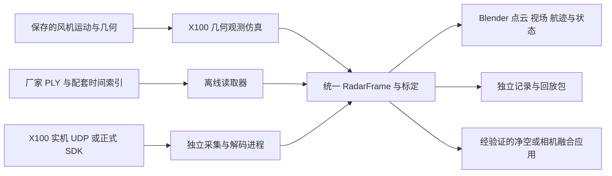

# CTSAI X100 与 Blender 风场前端融合最终方案

## 目标与实施状态

用户已确认需要同时支持：**在 Blender 中模拟 X100，以及真实 X100 数据的离线回放与实时接入**。融合对象为原生 WFRL Blender 风场前端。

本文描述已确认的融合要求及实施边界。工作区源码与本机日常安装已具备统一帧合同、T1 安装／点云、同刻几何仿真、PLY 软件读取／记录／回放及独立本地采集通道；真实样例对照、厂家 UDP／SDK 解码、航迹、实机标定、净空与相机融合尚未完成。日常安装身份与验证范围见[安装记录](../../../publication/daily-installation.json)，公开附件按其独立载荷核对。适用项目为 [snode11/wind-farm-blender](https://github.com/snode11/wind-farm-blender)。

当前操作与限制见 [X100 雷达](../../blender/X100雷达.md)，实际接口见[数据核心](../../../wfrl/radar_x100/README.md)。下文的覆盖评估、属性筛选／累积、远程转发和融合要求仍是待实现目标；当前点云着色、原始 RGB 隔离和回放控制不代表这些目标已验收。

总体方案为：**在原生 WFRL Blender 中建立独立的 X100 传感器模块，以统一帧合同、标定和显示层连接几何仿真、真实文件回放与实机实时输入。** 从 T1、一台 X100、一段连续数据建立完整入口，再按独立安装标定扩展到 T2/T3。

## 功能范围与交付内容

拟在 **N → WFRL → X100 雷达** 提供统一操作入口，数据源选择为“几何仿真”“实测回放”“实时实测”。用户可检查安装位置与视场、查看点云属性、控制文件播放，并识别当前数据来源、时间质量和连接状态。

| 能力 | 实施内容 | 交付结果 |
| --- | --- | --- |
| 安装与显示 | 按厂家外形尺寸建立近似模型，提供独立挂载节点、视场、点云和状态面板；检查关注掠塔区域的覆盖 | T1 上可配置、可观察的 X100 模块，点云与原始相机采集隔离 |
| Blender 仿真 | 按同一时刻的风机几何与雷达姿态生成确定性几何观测，提供有依据的径向速度；保存采样参数及来源 | 无需实体设备即可生成、显示、记录和重放模拟点云，明确标注几何仿真 |
| 真实数据回放 | 读取厂家 PLY 与配套索引，支持播放、暂停、单步、跳转和属性着色；CSV／Track 按实际字段扩展 | 可携带的记录包、严格读取器与连续回放入口；真实样例对照后完成该能力验收 |
| 实机实时接入 | 外部采集端按正式 UDP／SDK 解码、组帧与记录，通过独立雷达通道提交显示；适配实际采集平台 | 设备连续数据、断流恢复、有效空帧及记录失败均有明确状态；使用真实设备数据验收 |

实施依赖为：**统一数据合同与 T1 安装显示 → 几何仿真和 PLY 软件回放 → 真实样例对照 → 正式协议下的实时接入验收**。真实数据与协议的取得可以和软件实现并行；其缺失不能由合成夹具代替实测验收。

安装、几何仿真、真实回放和实时接入构成核心交付。叶片净空估计、相机融合、跨雷达跟踪和完整电磁信号仿真作为独立扩展，分别具备标定、观测与评价依据后实施。核心交付保留这些应用的数据接口。

## 资料依据与可确认范围

| 资料 | 已确认内容 | 接入影响 |
| --- | --- | --- |
| [X100 数据手册](<../../../../CTSAI X100超级雷达相关资料/1.产品规格书/CTSAI X100超级雷达数据手册-CN-V1.0_20260720160030.pdf>)，共 7 页 | 76–79 GHz、8T8R、FMCW & DDMA；点云和航迹输出；千兆以太网 | 属于毫米波成像雷达，需要点云／航迹接口 |
| [SUPER RADAR 使用说明](<../../../../CTSAI X100超级雷达相关资料/2.超级雷达上位机与使用说明/SUPER_RADAR上位机_用户使用说明书V1.0_20260704_.pdf>)，共 20 页 | Windows 上位机；当前通信固定为 UDP；近程、远程、2in1 与 Track 分开；支持 DAT、CSV、PLY、PCD 导出 | 可用厂家上位机采集，再向 Mac 上的 Blender 交付数据；UDP 解码另需报文合同 |
| [PLY 字段说明](<../../../../CTSAI X100超级雷达相关资料/4.ply数据字段说明与回放软件/PLY点云数据字段说明.pdf>)，共 4 页 | binary_little_endian 1.0，8 个字段，每点 26 字节 | 是现有资料中最清楚、最适合先落地的点云交换入口 |
| [ADC MATLAB 示例](<../../../../CTSAI X100超级雷达相关资料/3.ADC数据matlab解析示例程序/adc_analysis.m>)及[效果图](<../../../../CTSAI X100超级雷达相关资料/3.ADC数据matlab解析示例程序/示例程序运行效果.jpg>) | 示例按 4 通道、1024 采样、512 chirp 读取，演示窗函数和距离／多普勒 FFT | 可作为原始信号研究参考，不能据此实现完整的 X100 成像与航迹链路 |
| [上位机压缩包](<../../../../CTSAI X100超级雷达相关资料/2.超级雷达上位机与使用说明/superradar上位机_20260704.zip>) | 配置包含 UDP 接收和数据导出设置；运行配置依赖 WindowsDesktop .NET 8 | 包内跨平台依赖文件不代表上位机本身支持 macOS |

资料目录未提供实际采集的 PLY、PCD、CSV、DAT 或 ADC BIN 样例，也没有独立的 X100 UDP 报文说明、SDK 或 ROS 接口定义。配套的 Windows 运行时与独立 PLY 回放 EXE 不是 macOS 原生接入组件。

上位机手册与压缩包配置中的设备地址存在差异，配置值只能作为交付样例，不作为设备实际 IP／端口的依据。手册提及 ADC 由雷达硬件侧写盘；这与上位机保存点云数据是不同路径。

[官方社区 X100 产品页](https://www.superradar.cn/dev-kit/7)可作为厂家资料入口；[公开文档中心](https://www.superradar.cn/docs)与[公开 GitHub](https://github.com/Super-Radar)目前未列出 X100 专用协议下载入口，其他交付渠道的资料可用性待厂家确认。A100 的文档不能代替 X100 协议。

## 与现有雷达功能的关系

当前 [clearance_visual.py](../../../blender_frontend/wfrl_blender/clearance_visual.py)负责机舱下方的雷达示意外壳和三束方向线；[radar_feedback.py](../../../blender_frontend/wfrl_blender/radar_feedback.py)解释已保存的测量与报警；[wfrl/lidar](../../../wfrl/lidar/README.md)承担理想激光首交、双束净空及结果包读取。它们没有 X100 实体设备驱动或毫米波回波模型。

X100 使用独立传感器类型和结果合同，保留现有激光功能自己的身份、算法和状态。X100 的点云不转换成虚构的 B1/B2/B3 观测，也不沿用现有 S1 报警或双束净空数值。能够复用的是风机场景、机舱运动、播放时钟、相机标定工具及资源生命周期规则。

拟议数据路径：



三种来源明确标为“几何仿真”“实测回放”“实时实测”。合成测试报文另标为测试输入，不能计入实测能力验收。

## 参数、安装与显示

### 厂家参数配置

以下为数据手册标称值，作为 X100 profile 的来源信息，不代表本项目实测结果。

| 项目 | 手册标称值 | 设计处理 |
| --- | --- | --- |
| 外形 H × W × D | 120 × 95 × 40 mm | 按米建模：0.120 × 0.095 × 0.040；机械尺寸轴与雷达测量轴分别定义 |
| 方位视场 | −60°～+60° | 显示完整 120° 视场 |
| 俯仰视场 | −22°～+22° | 显示完整 44° 视场 |
| 距离 | 0.2～396 m | 量程范围与视场显示长度分别配置 |
| 距离精度／分辨率 | ±0.05 m／0.2 m | 分开记录，不把分辨率当导出量化步长，不把精度当噪声标准差 |
| 方位精度／分辨率 | ±0.1°／1°@0° | 保留测试条件限定，不推定全视场均相同 |
| 俯仰精度／分辨率 | ±0.2°／2°@0° | 不据此承诺叶尖三维定位精度 |
| 速度范围 | −400～+200 km/h | 内部统一 m/s；符号、参考系和具体工作模式待厂家协议确认 |
| 单帧规模 | 点云最多 4096 点，航迹最多 256 | 用于初始容量预算，解码按实际协议和 profile 校验 |
| 刷新 | 正文写 30 Hz，规格表写 33.3 ms／66 ms | 暂以 30 Hz 做工程容量目标；实际近远程与航迹节拍待实测确认 |

数据手册的 33 ms 响应描述不能作为整条 UDP、接收、排队、Blender 绘制或报警链路的延迟验收结果。

### 安装结构

拟在 T1 建立独立对象层级：

```text
WFRL.Turbine.T1.YawRoot
└── X100.Mount
    ├── Housing
    ├── SensorFrame
    └── FOV

WFRL.X100.Session.<session_id>
├── Points
└── Tracks
```

机舱安装模式使用 `YawRoot` 的实际完整变换，使支架、设备和视场随机舱偏航与塔顶运动。另支持固定在塔架或世界坐标的安装模式，各自使用对应挂载节点。点云对象按采样时刻转换到世界坐标，避免历史点随当前机舱运动被再次变换。

外壳按厂家尺寸和照片做外观近似，标明不属于厂家 CAD。没有机械图时，不编造安装孔距、连接器针脚、支架尺寸或电磁相位中心。安装点、方向和设备参考原点由独立标定保存，不能直接复用现有激光的 `origin=(-2,0,0)`。

### 覆盖评估

安装评估优先针对“叶片掠塔区／关注扇区”，并比较机舱固定、塔架固定等候选位姿。单台雷达能否观察完整叶轮，必须由安装姿态、实际视场和遮挡诊断决定。

作为量级检查，在轴向距离 `d`、垂直于雷达主轴的平面上，44° 俯仰视场的覆盖高度为 `2d × tan(22°)`：`d=60 m` 时约 **48.5 m**；若要求这个方向覆盖 126 m，所需轴向距离约 **155.9 m**。这只是平面几何示例，不是具体机舱安装的覆盖率证明。可比较设备绕主轴转动后的覆盖，但不得凭视场示意直接宣称无遮挡或全周期可见。

拟输出按叶片和转子方位组织的视场覆盖、几何遮挡、近场盲区和安装干涉诊断。几何遮挡近似与毫米波的真实反射、穿透及多径效果分别说明。

### 点云与面板

拟在 WFRL 主入口增加“X100 雷达”页面，提供来源选择、安装参数、文件／连接设置、点属性筛选和诊断。显示当前帧来源、时间基、点数、有效性、接收节拍、数据年龄、缺帧及显示丢帧计数。

点云按一个或少量可复用 Mesh／点集合批量绘制，避免每点建立 Object 或每帧重建整套场景。支持高度、距离、RCS、SNR、动静状态着色；仅在来源实际具有速度时开放速度着色。近程、远程、2in1、航迹分别展示，组合输出不能与近远程重复计入点数或测量统计。

瞬时点云、短时累积点云与轨迹使用独立开关。累积图仅辅助显示，不作为同一时刻的净空测量；历史点使用各自采样时刻的外参。

X100 点云、视场、辅助坐标轴和轨迹属于显示辅助对象，须有明确的集合或角色标识，默认从原始相机预览、离屏采集和其他原始 RGB 输出中排除；实体外壳与物理支架按场景物体保留。[custom_camera_preview.py](../../../blender_frontend/wfrl_blender/custom_camera_preview.py) 的 `without_annotations()` 已识别 `wfrl_x100_role=annotation`；`_simulation_state_hash()` 排除辅助对象并包含 `physical` 外壳。GPU 点云在原始离屏绘制期间停绘。当前没有实体支架模型、坐标轴或航迹绘制。

原始 RGB 的像素与状态摘要不受被排除的雷达辅助对象更新影响。融合图像独立导出，其缓存及来源记录必须包含雷达帧、时间映射、外参和投影参数。临时隐藏仅作用于对应场景／View Layer，并在成功、取消或异常时恢复用户原有可见状态。不得通过改变相机 FOV、画幅或关闭雷达接收实现隔离。

## 统一数据与标定合同

### RadarFrame

已实现独立的 `x100-frame.v1` 合同，供几何仿真、文件读取和外部适配器生产。当前字段与校验以 [schema.py](../../../wfrl/radar_x100/schema.py) 为准；下表描述完整设备接入的字段要求，厂家帧号、固件、分片凭据及航迹须由已确认的适配器提供，不能从 PLY 补造。

| 数据组 | 主要内容与约束 |
| --- | --- |
| 身份 | schema、传感器 ID、会话 ID、来源类型、设备／固件 profile、标定摘要 |
| 帧与流 | 采集序号、厂家帧号（可缺失）、近程／远程／2in1／Track 类型、原始记录索引 |
| 时间 | 源时间与时钟域、采样起止及时间戳参考位置、接收时刻、记录相对时间、时钟映射身份与误差；未知项保持未知 |
| 空间 | 原始坐标系、原点、单位、轴映射、厂家运动补偿状态、外参身份、挂载姿态来源及其对应时刻 |
| 点属性 | xyz、ms、mag、rcs、snr、原始 label；速度、点 ID 等只在实际来源提供时存在 |
| 航迹 | 航迹 ID、位置、速度和类别等按已确认的 Track 合同提供，不从 PLY 伪造 |
| 采集状态 | 完整、不完整、损坏；预期／实收分片或记录数量及组帧终止依据；重复与丢弃另存事件 |
| 展示状态 | 有效非空、有效空帧、等待、过期、断开；数据年龄、缺失原因与解码诊断 |
| 来源凭据 | 原始文件／数据包引用、文件摘要、解析器版本、派生时间或派生量的生成方式 |

原始值与派生量分开保存。负 RCS、负速度等合法量不按异常清零；非有限坐标隔离为无效点并报告。字段缺失使用 `null` 和原因，不能借零值伪装为观测。

### 组帧与多流身份

只有具备已确认的终止条件、数量及载荷校验的完整采集单元，才能提交为有效 `RadarFrame`。分片缺失、超时或损坏保留诊断，不以收到的部分点冒充完整帧；完整性未知时不得标为完整。重复包和显示端丢弃属于事件，不作为新的观测帧。

身份至少由传感器、会话、流类型和采集序号共同确定；厂家帧号、重启标识、回绕规则及扫描关联 ID 按实际协议保存。设备重启或无法连续解释的计数重置需要新会话身份。近程、远程、2in1 与 Track 独立组帧；只有厂家明确提供关联规则时，才可认定跨流数据来自同次扫描。

有效空帧必须来自完整且明确为零目标的采集单元，不能从缺包、缺文件或没有新消息推导。Track 使用独立更新时间和过期策略，持续收到点云不能延长旧航迹的有效期。每点有效性、采集完整性和展示新鲜度分别保留。

### PLY 输入

厂家 PLY 的固定点布局为：

```text
偏移    0    4    8    12   13    17    21    25
字段    x    y    z    ms   mag   rcs   snr   label
类型   f32  f32  f32   u8   f32   f32   f32   u8
```

相应标准库解包格式是 `<fffBfffB`，大小 **26 字节**，不能使用带本机对齐填充的结构布局。读取器必须解析并核对 PLY header、字节序、字段类型／顺序、vertex 数和完整载荷长度；不符合支持合同的文件明确拒绝。

`ms=1` 表示运动，`ms=0` 表示静止。`label` 表达有效性／异常信息，不能解释为目标类别；资料未明确给出其异常数值编码，应保留原始字节，取得样例或厂家确认后再启用对应过滤。`mag`、RCS 和 SNR 保留各自语义与单位。

该 PLY 合同**不包含径向速度、航迹 ID、帧号和时间戳**。不能由 `ms` 恢复速度，也不能把相邻帧任意最近点的位移当成厂家测速。PLY 文件序列需要配套索引；仅有用户指定帧率时可以生成回放时间，但须标为“由帧率推算”，不作为雷达／相机硬件同步证据。

厂家导出的文件粒度、文件名顺序以及空帧是否写出零顶点文件，需要真实样例确认。读取器不能仅凭文件名排序推断连续帧、空帧或真实采样时间。

### 空间变换

建议内部传感器坐标采用右手系：`+X` 为主轴前向，`+Y` 为左，`+Z` 为上。这是拟议内部约定，不是对厂家输出轴的判断。

```text
p_world(t) = T_world_mount(t) · T_mount_sensor · A_vendor_to_sensor · p_vendor
```

`A_vendor_to_sensor` 保存厂家轴顺序、正负方向和单位映射；`T_mount_sensor` 保存安装外参；`T_world_mount(t)` 来自匹配时刻的挂载姿态。上式适用于已确认的传感器局部坐标。实测输入还需确认原点、参考时刻和厂家是否已做自运动补偿或世界坐标转换；已经转换的坐标不得再次套用传感器挂载变换。坐标或补偿状态未知时允许查看原始点云，不用于风机空间测量。

真实数据必须使用实际静态标定或同步的实机位姿；不能把实测雷达挂到不相关的 MAPPO 动画上，随后把视觉重合当成测量对齐。

### 同一时刻的场景样本

`radar_x100/scene.py` 的 `SceneSampler.sample(t)` 绑定来源、T1、拓扑与安装标定，只读返回同一源时刻的几何／材料点、传感器变换及来源身份。采样不依赖活动窗口、全局当前播放器或无关场景的帧位置，不写 Blender 时钟。当前只支持保存的 FarmFlex 来源，手动场景与实机位姿输入尚未接入；几何遮挡范围为所选展示叶片、塔筒和机舱外壳。

当前 [farm_flex.py](../../../blender_frontend/wfrl_blender/farm_flex.py) 的 `deform_points(..., time_s, world=True)` 可读取指定时刻的世界坐标，`world_matrix(obj)` 则读取场景中当前已写入的姿态。二者不能直接组合成任意时刻的雷达样本。机舱姿态应从同源保存运动按 `t` 采样；若采样必须求值 Blender 场景，则使用所属场景的排他事务、检测冲突并恢复状态，不在后台线程访问 `bpy`，也不与相机采集争用时钟。

离线仿真、历史点累积以及速度差分均通过同一接口取样；不能使用当前时刻的 `YawRoot.matrix_world` 变换其他采样时刻的点。

### 时间与生命周期

时间合同至少包含以下语义：

| 字段或概念 | 拟议约束 |
| --- | --- |
| `clock_domain` | 明确设备、采集主机单调时钟、仿真或回放时钟；不同主机／启动会话的单调时间不能直接相减 |
| `timestamp_reference` | 采集开始、中心、结束或未知；输出到达时刻不自动成为采样时刻 |
| `acquisition_interval` | 采样起止时间；厂家未提供时保持未知，不能用帧间隔代替 |
| `clock_mapping` | 源与目标时钟域、映射身份、偏移／漂移、适用区间、估计误差及依据 |
| `time_alignment_status` | 已验证、估计或不可对齐；与实际用途要求的容差一起判定 |

设备与场景时间可用经观测支持的 `t_scene = a × t_device + b` 映射，不能仅凭一次 UDP 到达任设偏移和漂移。映射超出有效区间或误差超过用途容差时撤回测量级同步状态；历史记录保存其原有映射身份，不能用新映射静默重写。接收单调时间仅用于本地新鲜度，不能替代物理同步证据。

一帧内各点的采样时刻和采样区间未知时，不实施未经支持的运动去畸变，也不把该帧解释为已验证的瞬时同步观测。几何仿真的瞬时采样假设必须随来源记录；实机同步容差需要按实际用途确定，未确定时只能展示相应的时间质量。

仿真和离线回放按源时间确定性采样，复用所属场景的播放时钟。暂停、后退、重播不得重复统计、插值生成新观测或泄露未来帧。实测回放与风机运动只有在时间基和来源匹配时才允许联动；否则单独播放并标明未同步。

实时数据使用接收单调时钟判断年龄，阈值按实际工作模式配置；冻结显示不停止接收和数据年龄判断。有效空帧清空当前点云，网络超时则显示过期／断开，两者不可混同。切来源、切会话、重标定、关闭文件或删除所属场景时清理旧点、累计和资源，不自动认领另一个场景。

## Blender 中的 X100 仿真

### 几何观测模型

建议先提供可解释的**几何观测仿真**，输入为当前明确选择的风机几何、保存运动、X100 安装位姿和视场参数。它用于安装覆盖、点云接口、同步播放和算法原型，不声称复现厂家电磁回波或目标检测算法。

仿真按独立雷达采样时刻生成观测，拟采用内部传感器坐标的角域近似：

```text
r = sqrt(x*x + y*y + z*z)
azimuth = atan2(y, x)
elevation = atan2(z, sqrt(x*x + y*y))
0.2 m <= r <= 396 m
abs(azimuth) <= 60 deg
abs(elevation) <= 22 deg
```

这是标称角域的几何近似，不表示角域内均匀检测，也不表示量程内任意叶片表面必然可见。视场示意与候选点筛选使用同一角度定义，不直接套用相机矩形视锥。

建议采用固定参考三角面上的材料采样点，在各时刻运输同一组点；表面采样密度、种子、拓扑摘要及超过点数上限时的确定性筛选规则进入仿真 profile。对候选点进行视线首交检查，以同刻风机物理表面近似几何遮挡，忽略点云和视场等显示辅助对象；遮挡对象范围与数值容差需明确记录。近远程实机模式未知时不合成虚假的模式关联。

点数上限是容量约束，不是每帧补满 4096 点的要求。噪声、漏检和角分辨近似均为显式实验参数，不能只凭手册精度建立未经标定的统计分布。

几何模型可从保存的同源柔性表面及变换离线产出；交互预览若使用 Blender 展示网格，必须记录模型身份。rootkink、合成缺陷和刚性手动姿态不能冒充对应的真实材料散射或重新求解的气动结果。手动场景产生的是其自身的刚性几何观测，不能取用既有柔性回放的雷达数值。

径向速度采用同一材料采样点的世界速度与传感器速度之差，投影到视线方向：

```text
v_r = dot(v_surface - v_sensor, unit(p_surface - p_sensor))
```

传感器速度包含安装偏置随机舱运动产生的速度。不能通过相邻帧不同命中点的位移制造多普勒。没有材料身份或可靠时间导数时，速度保持缺失。仿真参考数据只有 40 Hz 时，30 Hz 观测属于几何重采样，不等于已经模拟实际硬件曝光、chirp 和混叠。

例如半径 63 m、9 rpm 的叶尖切向速度约 59.4 m/s；手册正向速度上限换算约 55.6 m/s。是否超出设备可测范围取决于径向投影、符号和工作模式，不能仅凭切向速度判定，也不能在仿真中忽略这一诊断。

未建立物理模型的 RCS／SNR 保持缺失；若需要人为属性用于界面测试，必须标为测试合成值。模拟点云参考值、带扰动观测和算法输出分别保存，观测端不能读取参考值补点或补测量。

### 原始信号模型的范围

完整 FMCW／DDMA、天线阵列、CFAR、DOA、速度解模糊、多径、材料散射与跟踪属于更深的雷达模型，不是几何仿真可自动获得的能力。需要厂家配置、原始信号样例和独立对照后再制定对应模型。

现有 ADC 示例的 4 通道配置不能解释 8T8R／DDMA 的完整数据组织；采样率、调频斜率、chirp 时序及阵列标定也未给全。文件路径传递、`offset=0` 对应的负 seek、seek 字节单位与样本计数、第二维 FFT 的循环范围均需要核查。该示例不作为上线解析器或 X100 仿真正确性的依据。

## 真实数据回放

优先支持厂家逐帧 PLY 加索引；取得 CSV 样例及字段定义后增加速度与 Track 读取；DAT、PCD 按各自真实合同再接入。不能把 PLY 点结构当成 UDP 或 DAT 的二进制结构。

建议回放包结构：

```text
x100_recording/
├── manifest.json
├── calibration.json
├── frame_index.jsonl
├── frames/
└── tracks/                 仅在具有已确认的航迹来源时提供
```

manifest 记录来源、profile、单位、时间基和载荷摘要；frame_index 显式记录文件、序号、源时间、时间质量和空／缺帧状态。厂家原始文件保留原始字节，索引、标定和派生结果放在独立文件中。

取得真实样例前，可以用合成夹具验证解析和播放合同，但不能宣称真实设备回放通过。单帧 PLY 可以作为静态点云检查，不具备连续回放或同步测量含义。

## 真实设备接入

### 采集与传输

实时设备采集／解码放在 Blender 外部进程，负责 UDP 接收、按正式协议组帧、校验、记录和发布 `RadarFrame`。几何仿真和文件回放可在进程内直接调用统一合同，不要求经过 IPC 或启动采集进程。Blender 主线程只做有界轮询与绘制，不在面板回调中阻塞等待，也不由工作线程修改 `bpy` 数据。

macOS 上能否直接解码取决于厂家协议或 SDK 的平台支持。若只能使用 Windows 上位机或 Windows SDK，可先由 Windows 采集端导出文件；实时模式再由 Windows 采集端发布统一帧，经独立雷达转发接口送达 Mac 本地适配器。ROS 是可选输入适配器，必须先取得真实版本、topic、字段、frame_id 与时钟合同。

当前 [WFRL Bridge 消息合同](../../../wfrl/blender_bridge/messages.py)只接受既定消息类型，单 JSON 帧上限 1 MiB，并拒绝 binary capability；[transport.py](../../../blender_frontend/wfrl_blender/transport.py)只接受 loopback 地址。独立雷达通道的依据是消息语义、实时数据流与训练会话的生命周期隔离；1 MiB 上限本身不足以说明一帧点云无法容纳。因此建议为实时雷达建立独立的本地 IPC 通道，使用带长度的元数据与二进制数组，不把点云塞进训练快照、wake 或 safety_event，不放宽现有训练连接的地址约束。

IPC 需有版本、会话／帧身份、载荷长度、数组类型与上限。元数据和数组属于同一原子帧；协议解码与记录使用完整数据，显示端可丢弃过时待绘帧以保持响应，但必须单独统计显示丢帧。UDP 缺包／乱序、组帧超时、重复帧和来源切换需要明确处理。

Windows 到 Mac 的远程转发属于独立的网络输入，默认不启动远程监听。启用时明确监听接口、允许的采集端身份、版本／长度上限和会话握手；跨越既定可信网络时使用经过认证的传输。远程断开或发送端重启后重新核对来源、会话与时间映射，不能沿用旧帧身份。Mac 本地适配器再向 Blender 的本地通道发布，不改变训练 Bridge 的连接范围。

按 4096 点、每点 26 字节、30 Hz 估算，点属性净载荷约 **3.2 MB/s**，不含网络头、时间元数据、航迹和记录开销；这不是设备 UDP 报文大小。可采用固定容量缓冲和批量数组更新，显示帧率与雷达源帧率分别测量。

### 记录与显示背压

组帧后分别进入记录路径与有界的最新帧显示路径。Blender 绘制变慢不能静默丢弃已接收且校验通过、应被记录的完整帧；显示路径可替换尚未绘制的旧帧，并单独计数。采集丢包、组帧失败、记录失败和显示丢帧使用不同统计。

记录路径也必须有容量上限。写盘错误或持续积压超过记录预算时，停止当前记录并进入 `FAILED`，保留已写载荷及不完整标记，报告最后成功帧和可确认的缺失范围。实时显示可继续，但不得继续标示“记录完整”。UDP 已丢失的数据不能被“完整记录”承诺覆盖；记录完整性只对声明的、实际收到的数据范围成立。原始 UDP 包保存是可选诊断能力，不要求默认永久保存。

### 实机解码前置资料

需要匹配设备固件的 UDP／SDK 定义：帧头、长度、大小端、分片、校验、帧号／时间、近远程与航迹区分、点属性单位、坐标轴、速度符号、label 编码及空帧规则。还需要确认实际 IP／端口、单播／组播方式和当前工作模式。没有这些信息时，不能猜测报文并宣称实时接入完成。

## 净空测量与相机融合

### 净空应用

建议先提供关注区域内点云、观测点至已标定塔面的距离及质量诊断。这个量需命名为“观测点到塔面距离”，不能直接称为真实叶尖最小净空。

若要估计叶片净空，需增加叶片／塔筒关联、同刻转子姿态、有效目标筛选、离群点处理、完整经过窗口和不确定性表达。雷达散射点并不自动具有叶片编号、材料点身份或叶尖身份；不能用 Blender 真值替实测完成这些关联。

手册的 ±0.05 m 距离精度不能推导出三维叶尖精度。仅作量级说明：60 m 距离下，0.1°／0.2° 角偏差对应横向约 0.105／0.209 m，还未包含安装和时间误差。这与项目保存帧／插值帧的毫米级显示门槛属于不同对象。

测量应用用独立参考建立误差、漏测率和误报／漏报统计。没有观测、有效空帧和连接失效都不得显示为安全；现有仿真激光阈值不自动成为 X100 报警阈值。

### 相机应用

可复用 [camera_projection.py](../../../blender_frontend/wfrl_blender/camera_projection.py)和[相机采集记录](../../../blender_frontend/wfrl_blender/custom_camera_capture.py)已有的 `K`、`T_camera_cv_from_world`、图像尺寸与采样时刻，对匹配来源的点云做图像投影。

合成场景中的同步与外参仅证明合成投影。实机需另有相机内参／畸变、雷达—相机外参、时钟关系和可接受的时间偏差；用实际像素尺寸投影，保持原始画幅和 FOV。外参或时间不匹配时明确标为未对齐。投影叠加、目标关联、多模态检测和三维重建分别验收，不能由“叠得上”推定后三者已完成。

## 代码落点与实施依赖

当前实现按无 Blender 依赖的数据核心、Blender 适配层、外部采集端三个边界组织。已有回放与训练协议不承载设备报文，文件按实际职责拆分。

| 模块 | 建议位置 | 责任 |
| --- | --- | --- |
| 数据合同与配置 | `wfrl/radar_x100/schema.py` | 帧校验、名义 profile、来源、时钟与空间元数据；实测轴映射和标定仍待确认 |
| 离线输入 | `wfrl/radar_x100/ply.py`、`recording.py` | 严格读取、显式索引、摘要和无插值回放 |
| 几何仿真 | `wfrl/radar_x100/simulation.py` | 从明确的几何／运动来源生成带身份的观测与参考 |
| 采集边界 | `wfrl/radar_x100/acquisition.py`、`channel.py`、`scripts/radar_x100/` | 已解码分片组帧、记录分流和本地发布；正式 UDP／SDK 解码待资料 |
| Blender 安装与显示 | `blender_frontend/wfrl_blender/radar_x100/` | 设备外观、安装节点、视场、点云批绘制、原始相机采集隔离和资源归属 |
| 操作入口 | `blender_frontend/wfrl_blender/panels/radar_x100.py` | 数据源、标定、回放／连接及质量诊断 |
| 现有接口连接 | `radar_x100/scene.py`、`runtime.py`、`custom_camera_preview.py`、主入口及注册／卸载入口 | 只读采样 FarmFlex、所属场景归属、辅助对象排除与切换释放 |
| 扩展交付 | `scripts/blender/build_extension.py`及扩展权限声明 | 按实际依赖打包规范读取器；网络／文件权限说明匹配新用途 |

实施依赖建议为：**统一合同与安装预览 → PLY 回放和几何仿真 → 协议明确后的实时采集 → 具有独立参考的净空与相机应用**。PLY 回放和几何仿真共享合同，可分别推进；真实资料缺失不阻塞几何仿真、安装诊断与软件合同验证。

不建议为显示点云给扩展引入完整 Open3D、ROS 或厂家 Windows DLL。外部进程可以使用实际需要的依赖，Blender 端尽量使用已有 NumPy、标准库和原生数据 API。

规范数据核心使用 `wfrl.radar_x100` 路径；[build_extension.py](../../../scripts/blender/build_extension.py) 通过 `RADAR_MODULES` 显式清单复制到 `wfrl_blender._vendor.radar_x100`，在 build-info 保存规范模块摘要。扩展优先通过包内相对导入使用同一实现。内部依赖不得反向要求仓库级 `wfrl`、训练环境或厂家 SDK；外部采集依赖留在采集端。安装载荷须在脱离源码路径的环境中验证独立 PLY 导入、必需模块和规范源码摘要，不能以源码环境导入成功代替。

## 验收条件

| 对象 | 应取得的证据 | 不据此推定的结论 |
| --- | --- | --- |
| PLY 与统一合同 | 已知二进制布局、完整载荷、空帧、截断、非有限点、缺字段及异常编码检查；真实样例与厂家显示的点数／属性对照 | 合成夹具通过不代表真实设备已接入 |
| 安装与坐标 | 尺寸、轴方向、已知位置和距离、非零 yaw／roll／pitch、塔顶运动、固定挂载、厂家补偿状态和重新标定 | 显示外壳正确不代表实体安装或电磁标定完成 |
| 时间与同刻采样 | 已知偏移／漂移、采样区间、映射失效及未知时间；窗口停在其他时刻时仍取得同一源时刻的几何和安装姿态；相机采集冲突保护 | 接收时刻或帧间隔不代表物理同步 |
| 仿真 | 解析几何与已知运动对照、视场边界、几何遮挡、同材料点径向速度、固定种子和输入身份 | 几何模型不代表厂家成像、RCS 或检测性能 |
| 回放与场景 | 一段完整连续片段的播放、暂停、后退、重播、片尾、换源、保存重开和所属场景删除；时钟与统计一致 | 单帧截图不代表连续播放通过 |
| 实时软件 | 已知报文注入下的乱序／丢包／完整空帧／重复／重连／计数重置；多流独立过期；记录积压和写盘失败；有界队列与显示丢帧统计 | 报文注入不代表真实 UDP 协议与设备模式通过 |
| 真实采集 | 匹配固件与配置的连续数据；帧号、时间、属性、厂家上位机对照及断流恢复 | 接收节拍不等于端到端物理延迟 |
| 性能与生命周期 | 目标 Mac、实际窗口与扩展载荷上的完整片段；另用持续满载输入评估处理节拍、绘制间隔、数据年龄、内存与资源释放 | 容量估算、后台检查和短时运行不代表稳定 FPS |
| 原始相机与融合输出 | 同一物理场景下切换或更新雷达辅助物，原始 RGB 和缓存身份保持一致；融合输出随所用雷达帧更新；异常时恢复可见状态 | 对象隐藏标志不代替实际像素与采集验证 |
| 安装载荷 | 包内模块、源码摘要、独立导入与脱离工作区的 PLY 回放 | 工作区可运行不代表扩展 ZIP 已包含依赖 |
| 净空与融合 | 独立几何／现场参考、误差与无效比例、完整经过漏测、外参和时间对齐；阈值在评估前明确 | 点云可见、最小点距或图像叠加不代表叶尖精度与保护能力 |

实施时按受影响范围分别运行宿主合同检查、原生 Blender 后台检查、可见窗口与真实数据验证。具体测量容差、端到端延迟及现场报警门槛需要按实际用途确定，不能由厂家标称值或既有激光演示参数代填。

## 需要补足的输入

- 一段真实逐帧 PLY 序列及相同采集的 CSV／Track 数据、原始 DAT 和厂家回放对照，保留帧号／时间及空帧信息；如暂时只有 PLY，应明确可提供的时间索引。
- 与设备固件匹配的 X100 UDP 协议或 SDK、坐标／速度约定、字段说明、实际工作模式及可运行的接收示例。
- 雷达正面方向、机械尺寸轴、安装孔位、参考原点与相位中心资料，以及风机上的实际安装约束；没有图纸的外观部分维持近似标识。
- 若需与实机风机／相机融合，提供对应的位姿、转子方位或编码器、相机标定与时间同步来源；缺失时保持独立点云展示或明确的未同步状态。

现有资料足以确定模块边界、PLY 解析合同、安装预览和几何仿真设计；真实回放验收需要真实数据，实机实时解码需要正式协议或可用 SDK。
