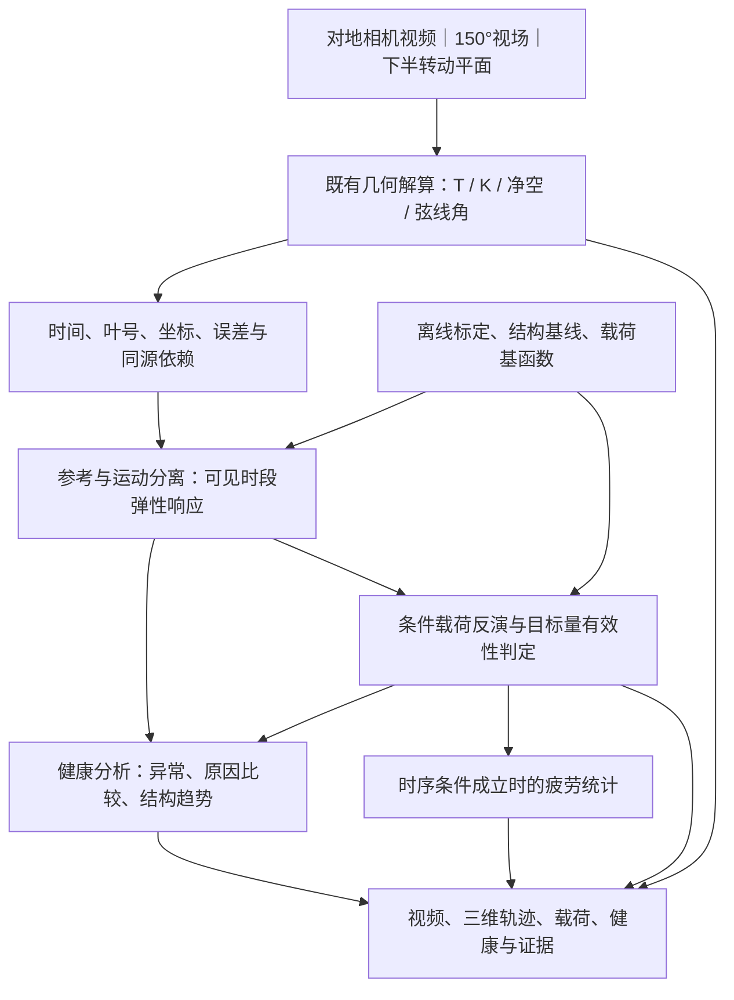

# 基于机舱视觉的叶片载荷与健康状态分析系统设计方案

**系统定位：以对地相机视频及既有几何解算成果为入口，建立可解释、可验证的叶片载荷估计与健康分析。**

在线输入为机舱安装的单台对地相机视频流，光学视场角为 **150°**，覆盖叶片转动平面的下半面。现有数学建模与几何运算已经提供叶尖空间轨迹、后缘拐点空间轨迹、三叶片净空等数据，并以净空／挠度与截面弦线角协同辅助判断。本方案直接承接这些成果，设计其后的力学建模、载荷反演、健康分析、接口和验证方法。

主线为：**视频流 → 既有几何解算 → 叶片弹性响应 → 条件载荷 → 运行异常、结构变化与疲劳负担。** 健康分析同时读取原始几何响应、工况和载荷解释，避免只凭一个载荷数值判断结构状态。

载荷反演、定量刚度识别及疲劳分析属于待实现、待验证能力。设计优先解决“哪片叶的响应异常、当前模型下对应多大载荷、是否有证据支持结构变化”，不以完整表面三维重建作为前置条件。

## 一、任务范围与交付对象

### 输入条件与既有基础

| 项目 | 当前有效定义 |
| --- | --- |
| 在线观测 | 单台机舱对地相机；150°光学视场；覆盖转动平面下半面 |
| 已有几何数据 | 叶尖空间轨迹 T、后缘拐点空间轨迹 K、三叶净空 c，以及现有算法提供的方位、轴线与截面弦线角等辅助量 |
| 配套资料 | 两份不平衡与桨距偏差 PDF，说明现有几何路线、双通道判断及对应试验结果 |
| 离线基础 | 相机标定、安装几何、叶片参考外形与结构参数、健康参考工况；按目标量准备校准和独立验证数据 |
| 在线辅助量 | 视频可提供的叶号、方位、转速与相对桨距；已有 SCADA、测风或温度信息可增强分析，不构成基础配置的必需硬件 |

150°是镜头的光学视场描述，下半面是相机覆盖的空间区域。叶尖／拐点的有效叶轮方位、可见时段及边缘测量质量，依据实际标定与视频逐帧登记；不把两种角度直接等同。150°对应水平、垂直还是对角视场，以及分辨率、帧率、曝光和快门形式，作为部署配置记录。

### 最小可行系统

最小系统由既有视觉前端、单叶低阶响应模型、条件载荷估计器、异常分析器和证据展示组成。建议以一个经过检验的主导挥舞响应自由度和一个规范化展向载荷基函数作为最小候选；需要更多自由度时，由独立观测和验证结果决定。

| 交付对象 | 用户可见结果 | 启用条件 |
| --- | --- | --- |
| 几何与运行状态 | 三叶轨迹、净空、相对桨距、同方位差异和持续异常 | 继承已有解算，附叶号、坐标、时间、来源与误差 |
| 条件载荷 | 可见时段的等效载荷曲线、区间、条件与各叶差异 | 结构基线、载荷形状和目标量通过校准及独立验证 |
| 结构健康 | 响应异常与候选原因；条件成立时给出等效刚度／柔度变化 | 载荷与结构解释可区分，目标变化量通过独立验证 |
| 疲劳负担 | 有效片段的循环统计；条件成立时给出相应载荷 DEL | 时序和带宽已验证，缺测及片段边界规则明确 |

叶根弯矩是有工程价值的候选输出，须单独建立力学映射并验收。任意展向载荷分布、全表面应力、任意损伤定位和剩余寿命均不列为最小系统的默认交付。

### 两份材料的适用范围

《汇报》第 3–6 个 PDF 页面说明净空／挠度与拐点弦线角的协同路线；第 7 页报告 5 个仿真视频用例，其中 3 个盲测，条件为 9 rpm、每段 5 min。报告中的偏差叶与方向为 5/5 判对，有量级估计的用例报告偏差不超过 0.2°；0.5°用例主要依靠像素域响应，其三维面外结果出现其他叶号。该结果属于对应的不平衡与桨距任务，不代表载荷或结构健康精度。资料 A：`基于机舱视觉的叶轮不平衡与桨距偏差检测_汇报(1).pdf`（原件未入库）。

《方案陈述》第 1–7 页描述单相机几何解算，第 11–12 页给出 3 MW 机组、30 min 观测与弦线角串扰校正材料。材料中的多相机案例和配置仅属于对应结果的上下文；本系统采用本节明确的单台对地相机输入。指标分母和正负号按本文统一定义，具体阈值由目标配置的验证确定。资料 B：`叶轮不平衡与桨距偏差检测_方案陈述(1).pdf`（原件未入库）。

## 二、系统架构与数据依赖



离线标定与验证和在线推断分开。物理求解器、同步载荷／应变参照及受控结构状态用于建立模型和评分；在线基础模式只使用视频、已有几何数据与声明的模型参数。验证真值不进入被评估的视觉输入。

### 既有几何数据如何进入力学模型

T、K、c 是正式输入对象，接入时保留生成方式。T 若由叶尖像素与几何约束联合求解，记录像素与先验；若由 K、轴线和长度推导，记录派生关系；c 若由 T 和塔筒几何计算，继承这条关系。这是对已有成果的来源建模，不改变数据的可用身份。

**同一信息不能按多个独立测量重复计权。** T 由 K 推导、c 又由 T 计算时，三者可承担不同展示与诊断职责，但不自动增加三个独立力学约束。估计器使用最小独立观测集，或显式处理联合协方差；重复派生导致协方差奇异时，在独立子空间建立似然，不人为添加微小独立噪声制造信息。

独立噪声的同方向观测可以提高精度，但未必增加可辨识维度；需要区分这种有效重复观测与同一数据的重复派生。

若已有三维解算使用固定半径、刚性轴线或健康形状约束，下游须检验这些约束是否压缩了待识别形变。几何先验和结构状态分别表达，不能用受某假设限制的数据再次证明同一假设。

前向观测模型须对应实际解算链：将候选弹性形状投影到相机，经同样的几何解算算子G得到预测的T／K／c，再与已有输出比较。G可解析实现或经离线扰动标定，不要求在线逐帧渲染完整图像。不能直接把物理模型中的真实叶尖坐标等同于受轴线外推约束的几何叶尖；若直接使用原始像素似然，派生几何量作为初值或展示，不重复加入独立数据项。

## 三、视频与几何数据合同

### 广角标定、身份与时间

以完整画幅的独立标定选择适用的广角／鱼眼或透视畸变模型。像素经已标定模型映射为单位视线，再进入既有几何运算；未矫正的 150°画面不直接套用理想针孔关系。保留原图与去畸变图映射、裁切区域和尺度。OpenCV 的鱼眼标定、投影与去畸变接口可作为实现参考。[OpenCV 相机模型](https://docs.opencv.org/4.13.0/db/d58/group__calib3d__fisheye.html)

标定误差按图像位置、叶轮方位和目标部位评估，特别检查视场边缘。曝光位移、失焦、压缩、滚动快门和机舱振动均进入误差预算；只有实际硬件与采样条件支持时才忽略相应项。

物理叶号统一为 B1／B2／B3，保留与原算法的映射。由视频相位连续性与可用特征维护身份，上半圈离场后重新进入时核验关联；身份不明的轨迹不参与跨叶载荷和健康比较。

使用采集时间与曝光信息，不以解码时间替代。每次过境记录起止时间、方位范围、可见部位、丢帧和质量掩码。转速由方位随时间估计并携带误差；三叶在不同时间经过同方位，不视为同时经历同一阵风。

### 坐标与变量

相机、机舱／轮毂和随叶片转动的局部坐标采用显式变换。方位角从竖直向下起算，正方向在配置中固定；接口使用 rad，界面可显示 °。输出基本单位为 m、s、N、N·m。

| 变量 | 定义与使用方式 |
| --- | --- |
| T(t) | 既有叶尖空间解算结果，附像素支持、几何先验或外推来源 |
| K(t) | 后缘拐点空间解算结果，附截面位置、定位误差和约束 |
| c(t) | 指定叶片部位到当前塔筒表面的距离；叶尖净空与全叶最小净空分别命名 |
| θ(t)、Δβ(t) | 截面弦线角与三叶相对桨距代理，保留弹性扭转和姿态串扰条件 |
| ψ(t)、Ω(t) | 叶轮方位与转速，供同方位对齐及运动模型使用 |

净空按实际塔筒表面和共同坐标中的最近距离计算，不用到某一固定高度圆周的距离替代到塔筒表面的距离。仅有叶尖结果时，不据此宣称整片叶最小净空已知。

截面弦线角在两个均垂直于截面法向的正交方向内定义。变桨是弦向量绕轴旋转，轴线绕自身旋转不会改变轴向；三叶相对角不能单独识别共同桨距零位偏差。既有 H→C 可能包含挥舞响应，不能把其全部倾斜都当刚体姿态扣除，否则会消掉载荷信息。

### 不平衡指标

按同方位、相近转速与可比相对桨距组织样本，先对每叶按过境或独立时间块统计，再比较三叶。保留叶号，以有单位差值为主，百分比为辅助。将各叶平均净空排序为 c_min、c_med、c_max，定义非负上／下偏幅度：

```text
I_up   = (c_max - c_med) / c_med × 100%
I_down = (c_med - c_min) / c_med × 100%
```

同时保存有符号差值 Δcᵢ = c̄ᵢ - c_med。分母过小或净空定义不适用时，只报米制差值。净空不平衡、挠度差异和条件载荷不平衡分别命名；净空百分比不直接等于推力百分比。各叶同时与自身基线比较，以保留三叶共同变化。

## 四、参考状态与弹性响应

### 参考库与响应表示

参考库包含各叶中心线、预弯、预扭、叶长、截面位置及轮毂／塔筒几何；结构库另存质量、刚度、阻尼、边界和不确定度。CAD外形不能代替结构参数。低风速或空转轨迹作为已知工况参考，仍可能包含重力、离心和气动力，不标为严格无载形状。

采用参考形状、低阶弹性响应和整体运动的分解：

```text
p(s,t) = H(t) + R(t) [ p_ref(s) + Φ(s) q(t) ]
```

H、R表示明确建模的轮毂／整体运动和叶片转动，p_ref包含预弯与预扭，q表示弹性自由度。根部变桨、截面扭转和弯曲耦合按模型处理，不用任意刚体配准消除真实变形。

最小候选采用一个主导挥舞模态 φ(s)，按 φ(L)=1 归一化，L表示从叶根到叶尖的展向长度，使q的单位为m；q是该模态幅值，模型适用时才对应其叶尖位移贡献。旋转矩阵R(t)与长度L分开命名。摆振、扭转和更高阶模态按独立信息启用，不由数据行数决定。

在实际可见方位检查 q、姿态、相对桨距和标定的灵敏度。K与T处于不同位置，只有包含独立响应时才有助于区分模态；派生关系须进入检查。不可观测方向保持为空或明确预测，不强制补成完整三维运动。

接入时先形成方位匹配残差r=z-z_ref(ψ,u)。对候选q及姿态／标定参数分别施加小扰动，经投影和既有解算G获得响应矩阵，再用已知形变样本检验线性范围、比例与符号。标定偏差作为整段共享变量或相关误差传播，不能随帧数增加按独立噪声缩小到零。该步骤把已有轨迹转为模型可解释的响应接口。

### 基线管理

基线按机型、叶号、标定和有效工况保存。异常运行数据不自动吸收进正常基线。结构参数只能在独立证据支持并重新验证后更新，参考形状变化与结构参数变化分开管理。

## 五、载荷估计模型

### 载荷目标与单位

从有限维载荷空间入手，候选横向分布载荷写为 f(s,t)=b(s)F_eq(t)。以叶根为s=0、叶尖为s=L，规定∫b(s)ds=1，积分范围均为0至L；b的单位为1/m，f为N/m，F_eq为N。b的形状、方向和适用工况经离线物理模型与标定确定，不在每个在线窗口任意变化。

对应模态广义力为 Q(t)=∫φ(s)f(s,t)ds，归一化与φ一同保存。多个载荷基函数只能在目标量有足够独立信息时启用。“等效载荷”表示规定模型中的响应解释，不等于任意真实分布已恢复。

在单模态适用模型中，令Γ=∫φ(s)b(s)ds，则Q=ΓF_eq，对应动力学中的B₀=Γ。健康基线给出的换算为F_eq=(m₁q̈+c₁q̇+k₁q-Q_known)/Γ，其中Q_known是同一归一化下的已知作用。Γ=0时该模态不约束F_eq；Γ接近零，或b与Γ的误差导致映射不稳定时，按载荷区间与误差预算判断是否允许输出，不用不稳定除法制造大载荷。

小变形、已知方向的准静态例子中，该载荷分量的叶根弯矩贡献为 M_eq=F_eq∫s b(s)ds。实际叶根总弯矩还涉及重力、惯性、其他载荷和结构响应，由完整模型输出并独立验证。大变形按实际力臂和方向计算。[BeamDyn 理论与截面力定义](https://openfast.readthedocs.io/en/main/source/user/beamdyn/theory.html)

### 条件动力学

在已标定的健康结构基线下，使用与实际运行范围匹配的低阶模型：

```text
M₀(u) q̈ + C₀(u) q̇ + K₀(u) q
    = B₀(u) ℓ + f_known(u) + e_model

z = h(q, 位姿, 相对桨距, 标定) + e_obs
```

u表示可得工况与声明的未知工况参数，ℓ为允许的载荷系数，单基函数时为F_eq。重力、离心、基座运动和气动作用分别归属，不在已知项和待估载荷中重复计算。有效质量、刚度和耦合可随转速／工况变化，大变形采用适用的非线性内力模型。

q̇和q̈分别表示q对采集时间的一阶与二阶导数。观测模型明确为h=G_v(Π(物理状态))：Π产生对应相机图像特征，G_v固定实测解算使用的版本、约束、分支选择与有效性筛选。若使用原像素似然，派生量不再进入独立似然项。轮廓、轴线与载荷模型的误差不能只压缩为任意调大的独立白噪声。

视频可提供相对桨距和转速，但绝对集体桨距、来流和温度不一定已知。未知量按干扰参数或适用域处理，不用相对桨距替代绝对桨距，不把仿真真值作为在线工况。缺少辅助数据的影响落实到输出范围与区间。

**条件载荷是指定健康基线、载荷空间和观测条件下的力学解释。** 固定健康模型得到载荷，不能反过来证明结构健康。

### 求解器与输出判定

建议采用按真实时间采样的滑动窗口状态估计或直接配点优化，联合拟合q、运动导数和载荷。数据项使用独立观测或正确联合误差，动力学项允许经过标定的模型偏差；连续性与频带先验须声明，不作为额外观测。

不对含噪轨迹直接二次差分后代入力学公式。优先在连续可见窗口内由平滑状态轨迹和动力学共同约束导数，窗口边缘和重新入场处扩大区间或暂不输出，避免虚假载荷峰。

准静态模式仅在目标工况的独立验证证明惯性、阻尼及耦合项影响小于误差预算时启用。低转速或轨迹平滑不单独构成准静态依据。

各载荷目标分别检查约束、适用域、残差、参数敏感度与区间，再与独立载荷参照比较。用前向模型预测留出时刻的几何和图像，检查一致性；低重投影误差不单独证明载荷正确。

区间传播像素／几何误差、同源相关性、结构参数、标定、载荷形状及模型偏差。只有强先验才能得到窄区间时，明确精度主要来自先验；没有对应独立验证的结果保留为研究估计。

## 六、下半圈观测与周期缺测

下半圈提供每叶一段连续可见轨迹，支持窗口内形状、速度及受验证频带内的动态响应分析；上半圈对该叶缺测。三叶依次出现，不等于任一叶拥有全周期连续数据。

逐叶记录实际采样间隔、连续窗口长度、有效方位与最长缺口。以材料中的9 rpm为计算示例，转一圈约6.67 s；若某目标确实连续覆盖180°方位，可见时间约3.33 s。一般可见时长为Δψ/Ω；这些示例不是当前相机实测覆盖或帧率承诺。

| 任务 | 下半圈数据的使用方式 |
| --- | --- |
| 几何与条件载荷 | 片段内估计；边缘、遮挡与曝光质量不足处保留缺测 |
| 三叶比较 | 可比窗口内对齐方位，计入经过时的时间差与随机载荷 |
| 低阶周期成分 | 多转联合拟合常量、sinψ、cosψ等候选项，检查覆盖、噪声相关性与设计矩阵条件 |
| 上半圈轨迹 | 需要时按模型传播并增加不确定度，明确预测来源；重新入场由观测校正 |
| 全周期载荷与疲劳 | 补全对独立完整时序验证通过，且属于同一适用域时启用 |

半圈可以约束某些低阶周期成分，但幅相在拟合窗口内是否稳定须验证。阶次按方位ψ分析，时间频率按采集时间分析，变转速时两者不混用。相机帧率的Nyquist频率不直接代表单叶全周期可恢复带宽。

上半圈不以镜像、周期复制、三叶替代或首尾连线默认补全。分别记录帧处理、窗口积累、计算与事件确认延迟；离线双向平滑不能宣称为同等延迟的在线结果。

## 七、健康分析与原因辨析

### 运行异常、结构状态与疲劳负担

运行分析判断桨距偏差、不平衡和持续响应异常；结构分析判断在载荷及干扰受约束时刚度／柔度是否改变；疲劳分析统计已验证载荷时序的循环作用。高载荷、结构变软和累计疲劳分别定义与显示。

基础特征包括同方位净空差、轨迹形状差、相对桨距、响应模态、残差和持续性，同时使用自身参考与三叶对比。基线仅按可得工况条件化；未观测的风、温度或附加质量保留为原因歧义。

| 证据组合 | 输出 |
| --- | --- |
| 相对桨距与响应指向同叶，方向和量级符合目标工况模型 | 桨距偏差嫌疑，附叶号、估计量及证据 |
| 桨距不显著，轨迹／净空持续异常 | 非桨距响应异常，保留气动、质量、结构及环境候选原因 |
| 角度异常但响应证据弱 | 几何异常待复核 |
| 载荷与结构可区分，参数变化通过独立验证 | 结构参数变化及区间；定位范围受空间分辨力限制 |
| 循环幅值增大，尚无明确结构变化证据 | 疲劳负担上升，不等同材料损伤 |
| 身份、标定或模型证据冲突 | 结果不可用或原因未分离，显示具体原因 |
| 有效范围内无显著异常 | 未检出目标异常，附覆盖和检测限 |

### 结构参数识别

最小候选为一项等效刚度比例α，表示明确响应子空间中的变化。局部展向刚度下降需要额外独立空间信息，不能把单个α涂成彩色图便宣称损伤定位。

在该候选定义中，α=K_eff/K_ref且α>0，α=1为同等工况的结构基线。α下降仅表示所定义有效刚度降低，材料损伤仍需排除质量、温度和边界等原因；不能把离心或工况引起的有效刚度变化自动算作材料退化。

比较同一组观测的两类解释：

- H₀：健康结构基线 + 允许的载荷变化与干扰。
- H₁：结构参数变化 + 同样受约束的载荷与干扰。

两者使用相同数据、相关误差、外部约束和可比模型复杂度。任意时变载荷可能完整吸收刚度变化；“快载荷、慢刚度”只提供先验，不自动解决混淆。

可区分信息可能来自适用的载荷时空模型、质量与姿态已知且其他作用受控的重力激励、经验证的动态特征或独立空间响应。每一种都须证明不能被其他允许的载荷／姿态／标定变化同等解释；更多帧数不替代这一检验。

对y=g(α,η)，将结构参数α和干扰η的灵敏度按噪声白化，检查剔除干扰方向后的剩余信号。再结合重新优化干扰参数的似然剖面、等价解搜索、先验敏感性和独立盲测，判断α是否可辨识到目标变化幅度。一阶秩仅是局部诊断，不单独证明全局可辨识或不可辨识。

启用定量α前，固定H₀／H₁各自允许的载荷空间及干扰范围，并在已知α的独立试验上同时满足最小变化量、误报与最低输出覆盖要求。在线区间跨越基线或允许原因仍有重叠时，不输出已确认退化。判别阈值不能在看见测试标签后调到通过。

独立α参照须映射到相同响应子空间、归一化与工况，来自受控加载、适用模态试验或独立验证的结构模型，并计入参照误差；不能由被测视觉反演器自产真值。模态参照还须约束质量、边界和运行状态，频率变化不能单独归于刚度。上述影响无法界定时，不将α解释为材料退化率。

无法区分时输出“响应异常，载荷与结构原因未分离”；能够区分时也仅声明被验证参数和工况。温度、覆冰、质量与边界变化进入竞争解释。仅由同源形变反演载荷、再归一化形变，不构成独立结构健康证据。

### 事件与趋势

事件由质量、显著性、持续性和原因一致性共同定义。置信度按独立过境／转数／时间块估计，不把相关帧当独立样本；双通道共享图像和标定，不简单相乘置信度。

配置事件合并间隔、进入／退出阈值与恢复迟滞，按叶号和原因维护事件。连续窗口支持“持续异常”，不能自动升级为“确认结构损伤”。30 min可作为兼容原材料的趋势窗口，不固定为所有输出的刷新或响应延迟。

## 八、疲劳负担

载荷时序经过带宽与误差验证后，执行循环计数并计算指定载荷分量的等效疲劳载荷DEL：

```text
DEL = [ Σ nᵢ (ΔLᵢ)^m / N_ref ]^(1/m)
```

ΔLᵢ为循环范围，nᵢ为计数，m为指定疲劳曲线斜率，N_ref为参考循环次数。输出附载荷类型、单位、统计时长、有效带宽、均值修正和计数规则；使用幅值时保持一致换算。MLife指南可作为短时DEL与损伤率接口参考。[MLife 用户指南](https://www.nlr.gov/docs/libraries/wind-docs/mlife-user.pdf?sfvrsn=1bb1c40c_1)

下半圈片段默认独立处理，声明边界半循环规则与有效暴露时长，不连接相邻转的断点作为真实循环。短片段不能支持稳定统计时，提供均值、峰值和波动范围等窗口指标，DEL保留为空。

独立验证后的补全模型可产生“模型补全时序DEL”，同时报告观测支持比例、补全比例与不确定度。验证时将完整独立时序按真实可见掩码删减，对比片段统计、补全结果与完整参照，并覆盖不同载荷和结构状态。缺测与方位／载荷相关，不能按可见比例简单放大损伤。

带宽受限或缺测的DEL不无条件视为完整DEL的下界。损伤增量还需要热点应力／应变映射、材料疲劳曲线和累积模型；寿命另需历史暴露与未来工况。条件不足时交付疲劳负担与趋势，不生成无定义健康百分比或寿命数值。

## 九、接口、状态与运行方式

以下为待实现接口，供几何模块、分析服务和前端对接。

| 对象 | 核心信息 |
| --- | --- |
| VideoFrame | 视频／帧引用、采集时间、曝光、画幅、镜头模型与标定身份 |
| GeometryPacket | 叶号、方位、T／K／c／弦线角、坐标、像素支持、source_ids、派生关系、观测算子身份及协方差分组 |
| OperatingContext | 转速、相对／绝对桨距区别、可用辅助工况、来源、误差和有效时间 |
| ResponseState | 参考形状、模态与归一化、q及导数、观测／预测标记、有效时空范围和区间 |
| LoadEstimate | 目标类型、基函数、结构基线、坐标、单位、曲线／统计、区间、残差和带宽 |
| HealthEstimate | 异常、候选原因、H₀／H₁证据、允许的结构参数、疲劳、定位范围与事件 |
| EvidenceRecord | 原始帧、上游数据、模型身份、观测／输出覆盖、补全比例、验证范围和拒绝原因 |

### 独立表达数据与结论状态

| 字段 | 值与含义 |
| --- | --- |
| data_status | OK：质量满足；MISSING：未观测；REJECTED：已获得但质量不满足 |
| inference_status | SUPPORTED：目标证据成立；CONDITIONAL：依赖必须展示的额外假设；UNRESOLVED：证据不足 |
| domain_status | IN_DOMAIN：属于引用验证范围；OUT_OF_DOMAIN：超出；UNVALIDATED：尚无对应验证 |
| source_type | VIDEO_GEOMETRY、DERIVED_GEOMETRY、MODEL_PREDICTION、EXTERNAL_MEASUREMENT、SIMULATION_TRUTH，来源链可含多项 |

每个目标量单独保存状态、单位、时空范围、区间方法和reason_code。条件载荷记录HEALTHY_BASELINE_ASSUMED；其他原因包括ID_UNCERTAIN、CALIBRATION_UNCERTAIN、INSUFFICIENT_INFORMATION、GAP_UNVALIDATED和MODEL_MISMATCH。NON_IDENTIFIABLE仅用于已有等价解或充分辨识论证的情况，不从数值秩直接推定。

空值表示无结果，不用零或“正常”代替。几何有效但载荷无效、载荷可用但结构原因未分离，均为合法组合。失去新观测支持的估计标明数据年龄及预测状态，不继续作为实时实测显示。

业务接受的数值须同时满足data_status=OK、domain_status=IN_DOMAIN，且inference_status为SUPPORTED或展示全部条件的CONDITIONAL。健康基线假设下的载荷即使验证通过，仍保留CONDITIONAL及结构假设。UNVALIDATED或OUT_OF_DOMAIN结果如需显示，明确标为研究用途，不进入已接受的业务结论。

### 服务职责

视觉模块负责既有解算和来源，力学服务负责响应与载荷，健康服务负责原因／趋势／疲劳，展示模块负责同步与解释。通过版本化记录交换，物理时间不依赖界面FPS。

在线窗口只用已到达数据，离线回放允许更长窗口或双向平滑，记录运行方式与延迟。处理速率和计算预算通过真实视频测定，不预先承诺未经测试的实时性能；输出能按原始时间、标定与模型身份复算。

## 十、标定与独立验证

### 数据与参照

载荷标定可使用气动弹性／结构模型、受控加载或同步载荷／应变参照；健康验证使用已知结构参数变化或可确认的结构状态。OpenFAST／BeamDyn提供离线力学参考，Blender负责成像与呈现。

合成视频须匹配实际镜头投影、150°视场定义、安装、曝光和可见掩码；仅用理想针孔画面通过的结果不能代替广角相机验证。几何扰动、载荷扰动、结构变化和图像误差分别受控，以检查各模块到底利用了哪类信息。

几何、载荷和结构真值分开保存，对被评估算法隐藏。生成器与反演器采用独立建模或明确模型失配，避免同一低阶方程既生成又反演而虚高精度。全尺寸模型验证可综合位移、应变与模态证据，结论限定到实际测试响应。[全尺寸叶片模型验证](https://wes.copernicus.org/articles/7/105/2022/)

按完整试验、机组、时段、风场随机种子、结构状态和标定配置划分数据。同一视频相邻帧不跨训练／测试当独立样本；盲测前固定目标、模型、阈值和统计规则。

### 载荷与结构辨析实验

| 结构状态 | 较低实际载荷 | 较高实际载荷 |
| --- | --- | --- |
| 健康基线 | 基线响应与误报参照 | 检查纯载荷增加是否被误判退化 |
| 已知刚度降低 | 检查结构变化与载荷减小的混淆 | 检查载荷和结构变化并存 |

载荷按独立施加或测得的实际值分组，相同风速不替代相同载荷。设置低刚度／低载荷与健康／高载荷的近似等响应组合，针对实际T、K、角度与整个可见轨迹检验区分能力。

比较固定结构条件反演、带可验证载荷约束的联合估计、以及额外独立载荷信息的参照配置，量化新增信息作用并计入参照自身误差。纯视觉配置不能读取后两者的在线独立测量。

| 测试因素 | 主要目的 |
| --- | --- |
| 正常、弱偏差与已有桨距用例 | 保持双通道职责，区分像素、几何与载荷能力 |
| 不同载荷形状、相同叶尖响应 | 检查等效载荷与弯矩对先验的依赖 |
| 全局／局部刚度、三叶共同变化 | 检查识别范围、定位能力与差分盲区 |
| 阵风、湍流、偏航、转速和桨距变化 | 检查工况混淆、窗口假设与适用域 |
| 温度、附加质量、覆冰和边界变化 | 检查非损伤原因是否被误归因 |
| 广角边缘、漂移、抖动、曝光和压缩 | 建立图像位置相关误差与拒绝行为 |
| 叶号重关联、丢帧、上半圈缺测 | 检查虚假载荷峰、错误拼接与补全偏差 |
| T／K／c重复派生、遗漏协方差 | 检查虚高置信与新增信息真实性 |

### 验收口径

| 层级 | 必须报告 |
| --- | --- |
| 几何 | 叶号错误率、有效方位／时间覆盖、轨迹／净空／角度误差与区间覆盖 |
| 条件载荷 | 有单位的偏差与RMSE、峰值、有效带宽内幅相误差、模型失配敏感度 |
| 叶根弯矩 | 对独立弯矩参照评分，不以等效载荷或重投影代替 |
| 健康 | 目标变化量下检测率、错误归因率、误报事件率、延迟与区间校准 |
| 疲劳 | 指定时段／带宽的DEL或损伤增量误差、片段边界与补全偏差 |

区分观测覆盖、输出覆盖和区间覆盖率：分别指实际有效观测的时空比例、预定评估对象中接受输出的比例、真值落入所报区间的比例。误差、拒绝率和分工况最低输出覆盖同时报告，不能靠拒绝全部困难样本通过。

材料中的“已知不平衡识别准确率≥90%、正常机组误报≤2次／月”保留为对应任务的业务目标。误报按去重事件统计，分母记录正常机组有效监测时长与置信区间；短视频通过不代表月度目标达成。载荷和结构目标的最大误差、最低覆盖与最小可检变化量，在盲测前结合参照误差确定。

## 十一、展示、接入与实施配置

### 结果展示

同一时间轴显示原始视频、T／K轨迹、参考／当前形状、三叶净空、相对桨距、条件载荷和健康趋势。结论旁显示目标量、单位、有效时段与主要条件，选中事件可回到图像与模型证据。

红色表示受力时，图例给出物理量、单位、方向和固定色标。已验证的展向载荷可用分段箭头展示；只有F_eq或弯矩时，显示对应曲线与模型载荷分布示意，不画成实测全表面应力。高载荷、结构退化与疲劳负担用不同文字及图层表达。

不可见上半圈、未观测背面和外推区域用虚线、透明或灰色标识。改变三维查看角度只改变展示，不产生新观测。

### 项目接入

相机采集、原始画幅、时间戳与回放参考[相机与重建合同](../../../.agents/skills/windfarm-blender-dev/references/cameras-reconstruction.md)；输入与评分真值分离参考[NREL研究模块](../../../wfrl/nrel_reconstruction/README.md)。其他研究对象的精度和状态不移作本系统完成依据。

现有合成缺陷为`physics_coupled=False`，改变外形而不自动改变刚度或载荷，见[缺陷数据定义](../../../blender_frontend/wfrl_blender/nrel_defects/defect_schema.py)。退化样本须在物理模型中改变参数并重新求解，再生成视频。

分析服务输出结果，Blender或网页负责回放和解释。安装包、动画或表面缺陷显示不证明载荷与健康功能已实现。

### 需要落实的配置

| 对象 | 配置内容 | 影响 |
| --- | --- | --- |
| 相机与视频 | 视场方向定义、帧率、分辨率、曝光、快门、安装与时间戳 | 空间误差和每叶有效采样 |
| 已有几何接口 | T／K／c依赖、坐标、参考、单位、质量和误差 | 独立信息与可用于反演的响应 |
| 结构基线 | 机型、质量、刚度／阻尼、边界、离心与重力模型 | 条件载荷尺度与不确定度 |
| 载荷目标 | 等效力／广义力／叶根弯矩、基函数、方向与归一化 | 可识别目标和工程解释 |
| 验证参照 | 独立载荷／结构参照、同步误差、完整时序与适用域 | 可声明的精度及健康／疲劳能力 |
| 业务接受 | 最小异常、允许误差、最低输出覆盖、误报和延迟 | 阈值、窗口和交付范围 |

已确定的单相机输入与已有几何成果直接采用，其余配置在接入和标定中填写。各目标单独接受：几何须约束对应响应，载荷须有明确物理定义与独立参照，结构结论须有原因可分离证据，疲劳结论须匹配实际时序覆盖。证据不足时保留仍有效的几何和异常结果。

## 附录：必要的力学辨析

### 形变、载荷与刚度

静态关系δ=F/k中，同时按比例改变F和k，δ不变。动态关系m q̈+c q̇+kq=F(t)中，若F任意未知，候选k′可对应F′=m q̈+c q̇+k′q，产生相同q(t)。因此多帧本身不保证载荷与刚度可同时辨识。

固定k₀计算F̂=k₀δ，再算δ/F̂=1/k₀，只返回所用基线，不是独立健康证据。健康模块必须保留响应和竞争原因。

### 叶尖挠度与叶根弯矩

长度L、恒定EI的线性悬臂梁，叶尖集中力F给出δ_tip=FL³/(3EI)、M_root=FL。在a=L/2处施加P=3.2F，由δ_tip=Pa²(3L-a)/(6EI)得到相同叶尖挠度，根部弯矩却为1.6FL。

这个简化反例说明弯矩需要载荷空间、更多独立响应或其他约束；它不否定特定模型下的弯矩估计，而是要求验证目标在观测等价解中的变化范围。

## 资料与方法参考

- **资料A**：`基于机舱视觉的叶轮不平衡与桨距偏差检测_汇报(1).pdf`（原件未入库），实际7页；几何和协同路线见第3–6页，仿真结果见第7页。
- **资料B**：`叶轮不平衡与桨距偏差检测_方案陈述(1).pdf`（原件未入库），实际13页；几何见第1–7页，现场材料见第11–12页。
- [OpenCV：Fisheye camera model](https://docs.opencv.org/4.13.0/db/d58/group__calib3d__fisheye.html)，镜头模型与标定接口参考。
- [OpenFAST：BeamDyn Theory](https://openfast.readthedocs.io/en/main/source/user/beamdyn/theory.html)，结构动力学、坐标与截面力定义参考。
- [Hayman、Buhl：MLife User’s Guide](https://www.nlr.gov/docs/libraries/wind-docs/mlife-user.pdf?sfvrsn=1bb1c40c_1)，疲劳统计接口参考。
- [Noever-Castelos等：全尺寸叶片模型验证](https://wes.copernicus.org/articles/7/105/2022/)，独立结构验证的观测配置及范围参考。

页码按实际PDF页面顺序计数。两份原始PDF保持原样；方法参考不代表本系统已达到对应研究的性能。
